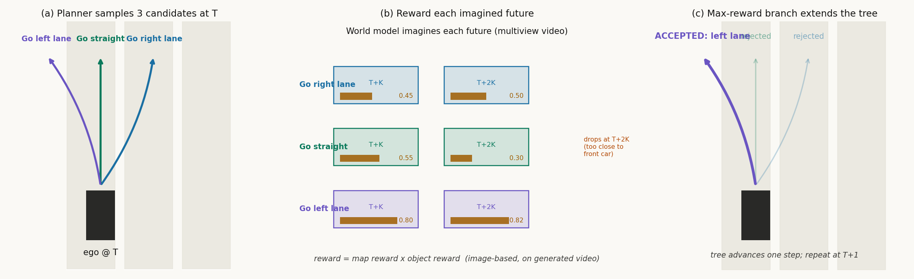

# 多个未来里挑一条命：Drive-WM 的树状 rollout 规划

> 信息块
>
> - **论文**：Driving into the Future: Multiview Visual Forecasting and Planning with World Model for Autonomous Driving（Drive-WM）
> - **作者**：Yuqi Wang*, Jiawei He*, Lue Fan*, Hongxin Li*（共同一作）, Yuntao Chen, Zhaoxiang Zhang（CASIA / 国科大）
> - **发表**：CVPR 2024（arXiv 2311.17918v1，2023-11-29；已用 openaccess.thecvf.com 的 CVPR2024 收录页核实）
> - **链接**：https://arxiv.org/abs/2311.17918 ｜ 项目页 https://drive-wm.github.io
> - **代码**：https://github.com/BraveGroup/Drive-WM（439 stars；核实到 2026-10 为止：仓库仅含部分推理代码，README 里训练代码与模型权重的 TODO 至今标着 "coming soon"，上次更新 2023-12-07 —— 代码不完整，无法完全复现，核对结论见"怀疑式阅读"）
> - **一句话核心洞见**：把"世界模型预测未来"从一句口号变成一个可以用的规划流程：让规划器在脑内同时开几条未来支线（树状 rollout），每条支线用扩散模型生成多视角视频，再用"看视频"的感知奖励函数给每条未来打分，最后走分最高的分支。

---

## 一个先放在桌上的事实

先看论文图 2 那个让作者们下定决心的实验（正文第 2 页）。他们拿来当时（2023 年底）的端到端规划器 VAD，只做了一件事：把自车在车道上的位置向右平移 0.5 米——一个真实世界里再普通不过的起步位置。正常位置下 VAD 规划的轨迹很合理；平移 0.5 米后，VAD 输出的轨迹完全不像话。

注意这不是测试误差，是**行为克隆的缺探索问题**：VAD 只在专家轨迹（几乎永远贴着车道中心线）上训练过，从来没见过"车不在中心线上"这个状态，所以它在这个状态下的输出是未定义的。这是一个结构性失败，调参数救不回来——数据里根本没有这个状态。

作者的反应不是"给 VAD 加数据"，而是换了一个问题：**能不能在做决策之前，先在脑子里把几个候选动作的未来都"演一遍"，看到哪个会出事，再选那个不出事的？** 整个 Drive-WM 就是对这个问题的回答。图 1 是这篇论文的赌注：T 时刻有三条候选（右变道、直行、左变道），世界模型把每条候选的未来都生成成多视角视频，然后在视频上打分，发现直行在 T+K 时刻安全、但到 T+2K 时刻会贴上前车，于是接受左变道。**世界模型在这里不是"生成一段好看的视频"，它是规划器的"脑内试错场"。**

这句话在 2024 年之前没有人完整做出来过，所以这是 S 级：它是"世界模型 rollout 评估候选轨迹"这个范式的开山代表。

---

## 作者的底牌

读到引言第 2 页贡献列表之前，先问：作者凭什么相信这件事做得成？推测（有依据的推测）作者手里有三张牌。

**第一张牌：latent video diffusion 已经成熟了。** 2023 年 VideoLDM、Stable Diffusion 都是现成的。作者不需要发明生成模型，只需要把图像扩散模型"抬"到多视角+时序上：冻结空间参数 θ，只训练新增的时间层 φ 和视角层 ψ。这是一个工程量可控、审稿人挑不出毛病的方法。证据：3.1 节整个就是在讲"怎么把一个预训练好的图像扩散模型抬起来"，而不是"我们发明了一种新生成器"。

**第二张牌：nuScenes 的六个相机天然构成一个"视角一致性"可以被验证的实验场。** 相邻视角有重叠区域，一致性好不好是可测量的。作者还顺手发明了一个 KPM 指标（用 LoFTR 在相邻视角重叠区做关键点匹配，生成图 vs 真实图的匹配点数之比）来量化这件事。第一张图（图 1 的树状规划）押的是"规划应用"，但技术上最硬的一块其实是 3.2 节的视角分解（factorization）：把六个视角分成参考视角 {F, BL, BR} 和拼接视角 {FL, B, FR}，先联合生成不重叠的参考视角，再以它们为条件生成拼接视角。消融表 2c 显示 KPM 从 45.8% 跳到 94.4%——这个数字是整篇论文技术部分最硬的一个。

**第三张牌：2023 年底"世界模型+规划"在自动驾驶里还是无人区。** GAIA-1（Wayve，2023-09）只能做单视角视频生成，DriveDreamer 也是单视角。作者是第一个把多视角视频生成做出来、并且真的把它接到规划器上做闭环决策的。审稿人看到"first"加真实实验，通常愿意给机会。

但也要诚实地说：这三张牌里，真正决定论文分量的是第二张（技术）和第三张（时机）。第一张是借来的。规划部分（第 4 节）的实验其实很薄——后面"怀疑式阅读"会细说。

---

## 从最朴素的想法走到 Drive-WM

假设你是作者，面前摆着"VAD 在偏移 0.5 米就崩"这个问题。最直接的想法是什么？

**尝试一：给 VAD 加数据增强。** 把训练数据里每条轨迹都随机平移/旋转，让规划器见过"不在中心线"的状态。这能缓解，但治标：真实世界的长尾是无限的，你不可能把"洒水车喷水""路面破损"这种非结构化事件都增强出来。作者在 4.2 节末尾专门点名了这类"不可向量化"的事件——这是他们选择像素空间世界模型的深层动机：向量空间的世界模型需要额外的向量标注，而且感知模型的估计噪声会污染状态。

**尝试二：学一个向量空间的世界模型，在 BEV 上做 rollout。** 这是当时更主流的路线（MILE 等）。问题有两个：第一，你需要一个感知模型先把图像变成向量，世界模型的输入就带上了感知误差；第二，很多风险事件（路面上的水坑、破损）根本向量化不了。作者赌的是：**直接在像素空间做世界模型，用无标注的视频数据训练，容量够大就能把这些长尾事件"生成"出来。**

**尝试三有了方向，接下来是三个具体的工程难题**（引言列的三个 challenges，一个一个看）：

1. **高分辨率像素空间建模难。** 解法：不从零训练，用 Stable Diffusion 的 latent diffusion 做底座。图像先进 VAE 编码器变成 latent（384×192 的图，latent 大约是 48×24），扩散过程在 latent 空间做。这就是公式 (1) 里的 z。为什么这是对的？因为像素空间的 1600×900×3 直接做扩散，计算量和训练稳定性都扛不住；latent 空间把"画得像"这件事交给了预训练好的 VAE 和 Stable Diffusion，自己只学"怎么动"和"多视角怎么对齐"。

2. **多视角一致性难。** 先做联合建模（3.1）：在 latent 上加两类新层。时间层：把 latent 从 (TK)CHW 重排成 KCTHW，在 THW 维度做 3D 卷积，再重排成 (KHW)TC 在 T 维度做自注意力。视角层：重排成 (THW)KC，在 K（视角）维度做自注意力。直觉：时间层让同一视角的不同帧互相"对齐运动"，视角层让同一时刻的不同视角互相"对齐内容"。但联合建模只能保证"风格相似"，重叠区域的严格一致保证不了——于是有了 3.2 的分解：p(x) = p(x_r) p(x_s | x_r)，先生成三个互不重叠的参考视角，再以它们为条件生成拼接视角。拼接视角在生成时能"看到"邻居视角的内容，一致性自然就上去了。这是一个漂亮的取舍：完全自回归（公式 2，每个视角都以前面所有视角为条件）太贵；分成两组之后只需要两步。

3. **异构条件难。** 图像、文本、3D 框、地图、动作，每种条件本来要单独设计接口。作者的解法粗暴但有效（3.3）：全部编码成 d 维 embedding，按 token 长度拼起来：c_t = [i_0, l_0, e_0, a_t]，维度 (n+k+m+2)×d，然后在 UNet 里做 frame-wise 的 cross-attention。图像条件用 ConvNeXt 编码，文本用 CLIP，动作 (Δx, Δy) 用 MLP 映射。**这是一个"统一接口"的设计，承重的是"能用"，不是"优雅"。**

走完这条路，Drive-WM 的最终形态就自然出现了：一个以 Stable Diffusion 为底座、加了时间层和视角层、用视角分解保证一致性、用统一条件接口喂各种控制信号的多视角视频扩散模型。规划部分（第 4 节）是把它"用起来"：规划器采样候选轨迹 → 转成每帧的动作 (Δx, Δy) → 世界模型生成未来多视角视频 → 在视频上跑 3D 检测和在线建图 → 算 map reward × object reward → 选分最高的 → 树往前推一步，重复。

---

## 公式 (1)：去噪分数匹配到底在学什么

论文公式 (1)：

$$\mathbb{E}_{\mathbf{z}\sim p_{data}, \tau\sim p_\tau, \epsilon\sim\mathcal{N}(0,I)}\left[\|\mathbf{y} - f_{\theta,\phi,\psi}(\mathbf{z}_\tau; \mathbf{c}, \tau)\|^2_2\right]$$

第一次见扩散模型的读者，这里容易被符号淹没。拆开看：

- $\mathbf{x} \in \mathbb{R}^{T\times K\times 3\times H\times W}$：一段多视角视频，T=8 帧，K=6 个视角，每帧 H×W×3。这就是训练数据的一条样本。
- $\mathbf{z} = \mathcal{E}(\mathbf{x}) \in \mathbb{R}^{TK\times C\times \hat{H}\times \hat{W}}$：VAE 编码器把每帧每视角压成 latent。$\hat{H}, \hat{W}$ 是下采样后的尺寸（论文用 384×192 输入，latent 空间大约 48×24，通道 C=4，这是 Stable Diffusion VAE 的标准设置）。
- $\mathbf{z}_\tau = \alpha_\tau \mathbf{z} + \sigma_\tau \epsilon$：前向加噪。$\tau$ 是扩散时间步（注意和视频的帧下标 t 是两回事，论文用 $\tau$ 区分），$\alpha_\tau, \sigma_\tau$ 是噪声 schedule。$\tau$ 越大，噪声越多。
- $f_{\theta,\phi,\psi}(\mathbf{z}_\tau; \mathbf{c}, \tau)$：去噪 UNet，输入是带噪 latent、条件 c、时间步 τ，输出是对噪声 $\epsilon$ 的预测（target y 就是 $\epsilon$ 本人）。下标 θ/φ/ψ 分别是空间参数（冻结，来自 Stable Diffusion）、时间层参数、视角层参数。
- 整个目标：让网络学会"从带噪版本恢复出加了什么噪声"——等价于学会数据的分数函数（score），采样时从纯噪声开始一步步去噪就能生成新视频。

**几何直觉**：想象数据分布是一个高维空间里的"流形"（所有合理的多视角驾驶视频都趴在这张薄膜上）。加噪就是把点从薄膜上抖开，网络学的是"每个被抖开的点应该往哪个方向走才能回到薄膜上"。条件 c 的作用是指定"回到薄膜上的哪个位置"——比如"下一帧自车向左 0.3 米"就对应薄膜上所有满足这个动作的视频点。

**训练分两阶段**（附录 B.1，这是复现的关键细节）：先训条件图像扩散模型 60,000 iterations、batch 768、AdamW、lr 1e-4；冻结 θ 后，加时间层和视角层，用视频数据 fine-tune 40,000 iterations、batch 32、T=8 帧。推理用 DDIM 采样 50 步，η=1.0，CFG=5.0。每个条件在训练时以 20% 概率随机 drop（这是 classifier-free guidance 的标准做法，让模型同时学会"无条件"和"有条件"去噪）。

---

## 公式 (5)：统一条件接口

$$\mathbf{c}_t = [\mathbf{i}_0, \mathbf{l}_0, \mathbf{e}_0, \mathbf{a}]_t \in \mathbb{R}^{(n+k+m+2)\times d}$$

- $\mathbf{i}_0 \in \mathbb{R}^{n\times d}$：当前真实帧的图像条件（ConvNeXt 编码后展平，n 个 token）。
- $\mathbf{l}_0 \in \mathbb{R}^{k\times d}$：layout 条件。3D 框和 HD 地图先投影到 2D 透视视角，再用和图像一样的方式编码，k 个 token。注意这是一个简化：3D 信息被拍扁到 2D，会丢深度，但换来了"和图像条件共用编码器"的简单。
- $\mathbf{e}_0 \in \mathbb{R}^{m\times d}$：文本条件（CLIP 编码视角信息+天气+光照，比如 "Sunny. Day."），m 个 token。
- $\mathbf{a} \in \mathbb{R}^{2\times d}$：动作条件。(Δx, Δy) 经 MLP 映射成 2 个 d 维 token。下标 t 表示这是"第 t 个生成帧"的条件——动作是逐帧给的，所以每个未来帧的动作用自己的条件。
- 拼起来一共 (n+k+m+2) 个 token，在 UNet 的每一帧上做 cross-attention。

**为什么这个设计是"承重"的**：规划应用（第 4 节）要求世界模型能接受"规划器采样出的任意候选轨迹"作为条件。如果动作条件接口是特制的、和别的条件耦合的，规划器就接不进来。统一接口让"给定未来 8 帧每帧的 (Δx,Δy)"变成一件平平无奇的事——这正是树状 rollout 能跑起来的前提。

---

## 规划部分：树状 rollout 的完整走一遍

这是 RAMP 血缘里最重要的一节，值得用一个具体场景走完全程。

**场景**：nuScenes 某段路，自车在中间车道，前方 15 米有一辆慢车，左车道空旷。VAD 采样出三条候选轨迹，对应三个高层命令："右变道""直行""左变道"。

**第 1 步——候选转动作**。每条候选轨迹是一串未来位置 (x_{t+1}, y_{t+1}, ...)，转成逐帧动作 a_t = (x_{t+1}−x_t, y_{t+1}−y_t)。这是为了和 VAD 的输入格式兼容（4.1 节）。

**第 2 步——世界模型生成未来**。对每条候选，把当前 6 视角真实图像 + 动作序列喂给 Drive-WM，生成未来 K 帧的多视角视频。三条候选 → 三段"未来视频"。注意这里生成的是**整段视频**，不是单步状态；K 在图 1 里画的是 T+K 和 T+2K 两档，实际是连续 rollout。

**第 3 步——在视频上打分**。对每段生成的视频，跑一个 image-based 的 3D 检测器（论文用的是 BEVFormer 系的检测器 [37]）和在线 HD 地图预测器（MapTR [38]），得到"视频里有什么车、在哪"和"车道线在哪"。然后算两个 reward：
- **map reward**：离路缘多远（鼓励待在可行驶区）+ 中心线一致性（惩罚频繁变道/横向偏离）。
- **object reward**：和其它交通参与者在纵向/横向上的距离（防碰撞）。
- 总 reward = map reward × object reward（**乘积，不是加权和**——这意味着任何一项接近零，总分就崩；是一个"一票否决"式的设计）。

**第 4 步——选分支，前进一步**。三段未来里，"直行"在 T+K 时刻 reward 最高（安全），但 rollout 到 T+2K 时发现会贴上前车（object reward 暴跌）；"左变道"全程 reward 稳定。于是接受左变道，树往前推，下一时刻重复。

下图是自绘的树状 rollout 流程（对应论文图 5）：

*图：Drive-WM 树状规划三步走。(a) VAD 采样三条候选轨迹；(b) 世界模型为每条候选生成未来多视角视频，在生成视频上跑感知得到 map reward × object reward（注意"直行"在 T+2K 档 reward 暴跌——这正是图 1 里"贴上前车"的情形）；(c) 选总分最高的左变道分支，树前进一步。*

**基线对比**：如果没有世界模型，VAD 只能按"哪个命令"采样轨迹（表 3）：用随机命令（rand cmd）L2 avg 1.02、碰撞率 0.93%；用真值命令（GT cmd）L2 0.72、碰撞 0.22%；Drive-WM 的树状规划（从三个命令里选）L2 0.80、碰撞 0.26%——**接近用真值命令的效果，但不需要真值**。表 4 的消融显示 map reward 和 object reward 缺一不可：只用 object reward 时碰撞率 0.27% vs 两者都用 0.26%，只用 map reward 时 0.39%。

**OOD 恢复实验**（表 5，最有信息量的一个）：把自车横向偏移 0.5 米（图 2 的 OOD 场景），VAD 的 L2 从 0.72 掉到 1.02、碰撞率从 0.22% 飙到 1.59%。然后用世界模型**生成**"从偏移位置开回车道"的视频，用"开回车道"的轨迹做监督去 fine-tune VAD，性能回到 L2 0.82、碰撞 0.91%。**世界模型在这里的角色从"评估器"变成了"数据生成器"**——这是同一套生成能力的两种用法，论文把两种都展示了。

---

## 怀疑式阅读

**1. 规划实验是开环的，闭环没有。** 表 3、表 4、表 5 的规划评估用的是"开环指标"（L2 距离真值轨迹、碰撞率），5.1 节明确写了 "We follow open-loop evaluation metrics [29,30]"。也就是说，树状 rollout 的"选分支"是在离线数据上验证的，没有真的把"世界模型选出的动作"送进仿真器跑闭环。图 1 画的是一个闭环的梦想，实验给的是开环的证据。这是整篇论文最大的证据缺口——作者自己也诚实，4.1 节标题叫 "Tree-based Rollout"，正文用的是 "explore""showcase the potential" 这种措辞（we show / we explore，不是 we prove）。

**2. 奖励函数依赖的感知模型是在生成视频上跑的，生成视频的质量直接决定奖励的可信度。** 4.2 节的 reward 来自"在生成的视频上跑 3D 检测+建图"。如果生成的视频里某辆车被画糊了、画没了，object reward 就是错的。论文没有量化"生成视频上的感知误差 vs 真实视频上的感知误差"，这是一个缺失的对照。附录 A.5 用 GPT-4V 当 reward 的定性例子很吸引眼球，但那是 showcase，不是实验。

**3. 计算代价没有诚实讨论。** 每次决策要对每条候选生成一段多视角视频：DDIM 50 步 × 6 视角 × 8 帧，3 条候选就是 3 次完整生成。论文没有报告单次规划的墙钟时间。在 2023 年底的 A40 上，这显然是秒级甚至十秒级的——离车载实时差了几个数量级。作者在正文里完全没有提 latency，这是"只谈可能性、不谈可行性"的典型写法。RAMP 如果要引用这篇做先例，必须自己把"我们比它快多少/为什么我们能实时"讲清楚。

**4. KPM 指标是自创的，没有外部验证。** 5.1 节的 KPM（Key Points Matching）用 LoFTR 在相邻视角重叠区匹配关键点，生成图与真实图的匹配数之比。直觉上合理（重叠区内容应该一致），但它对"生成了真实但位置稍偏的内容"会怎么打分？论文没讨论。这是一个"作者自己发明尺子、自己量"的指标，94.4% vs 45.8% 的提升幅度要打折扣看——不过表 2c 里 FID/FVD 在 factorization 前后基本不变（15.8→16.4 / 122.7→116.6），说明一致性提升没有以牺牲质量为代价，这一点是可信的。

**5. 数据层面：nuScenes 的动作分布是严重不均衡的**（附录 C.2 自己承认：大量帧是小转向角+10-20 m/s）。作者做了重采样平衡（32×11 的速度-转向网格，每格采 36 个 clip，共 7272 个 clip）。这个处理是诚实的，但也意味着"action-conditioned 生成"的泛化能力部分来自数据工程，而不是模型本身。

**6. 代码不完整。** 官方仓库 BraveGroup/Drive-WM 最后更新 2023-12-07，README 的权重和训练代码至今是 "coming soon"。这意味着表 1 的 FID 12.99 / FVD 122.7 等数字无法被第三方复现。引用时要注明。

**做得漂亮的地方**：视角分解（3.2）是一个干净的、只用概率图语言就讲清楚的设计，消融（表 2c）隔离得干净——只换 factorization，其他不动，KPM 翻倍。这是整篇论文技术上最硬的一块，也是值得 RAMP 借鉴的"把联合分布拆成条件分布"的思路。

---

## 背景补讲：在需要的地方停下来

**Latent diffusion（潜扩散）**：Stable Diffusion 那套。图像先用 VAE 压成低分辨率的 latent（比如 384×192 的图压成 48×24×4），扩散（加噪/去噪）全在 latent 空间做，最后再解码回像素。好处是计算量小一个数量级，且 VAE 已经学会了"什么是自然图像"。Drive-WM 冻结了 Stable Diffusion 的空间参数，只学"时间"和"视角"——相当于站在巨人肩膀上只解决增量问题。

**DDIM 采样**：去噪扩散的一种加速采样法。标准扩散采样要上千步，DDIM 用非马尔可夫的构造把步数压到 50 步左右，质量损失不大。论文推理用 50 步——这就是规划 latency 的主要来源。

**Classifier-free guidance (CFG)**：训练时以 20% 概率把条件 drop 掉，让模型同时学会"有条件"和"无条件"去噪；采样时把两者外推混合（CFG=5.0），增强条件对生成的控制力。代价是每次采样要跑两次 UNet（一次有条件一次无条件）——latency 再翻倍。

**KPM（Key Points Matching）**：作者自创的多视角一致性指标。nuScenes 相邻相机视角有重叠区，用 LoFTR（一个做图像特征点匹配的 Transformer）在重叠区找匹配点。真实图像的重叠区自然是一致的，匹配点多；生成的如果视角间对不上，匹配点就少。KPM = 生成图的匹配点数 / 真实图的匹配点数。94.4% 意味着几乎和真实图一样一致。

---

## 与 RAMP 的血缘 / 划界

**血缘（直系先例）**：Drive-WM 是"用世界模型 rollout 出多个未来、再用奖励函数评估候选轨迹"这个范式的 2024 开山之作。RAMP 的风险校验模块（对候选轨迹做 world-model rollout、检查未来风险）和它的第 4 节是同一个思想：**不直接相信规划器的输出，而是让世界模型把每个候选的未来"演一遍"再打分**。RAMP 在 related work 里引用它时，可以名正言顺地说 "following the generative-evaluation paradigm pioneered by Drive-WM"。

**划界（RAMP 的增量在哪里）**，三条，每条都具体：

1. **表示空间不同**：Drive-WM 在像素空间做扩散生成，一次规划要做 3 条候选 × 50 步 DDIM × 6 视角的完整视频生成，秒级延迟，不可车载。RAMP 在 latent 空间做单次前向得到中间分布 q(z|o)，rollout 在 latent 里展开，不经过像素解码和 50 步去噪——这是"单次前向异构复用"相对它的第一处增量：**把"生成未来"从"画视频"降级为"在隐空间推分布"，换实时性**。

2. **评估方式不同**：Drive-WM 的评估是"生成视频 → 跑感知模型 → 算 reward"，奖励的可信度被生成质量和感知误差双重污染（见上文怀疑点 2）。RAMP 的风险校验直接在 latent 分布上做（分布的方差/多模态本身就是不确定性的度量），不依赖"先画出来再看"。这是第二处增量：**风险信号从隐分布里直接读，不经过像素中转**。

3. **规划器关系不同**：Drive-WM 的世界模型是规划器的"外挂评估器"，规划器（VAD）本身不变；RAMP 的世界模型中间分布同时服务 LLM 调度先验和风险校验，是异构复用的。这是第三处增量：**一次前向、两种用法**，而 Drive-WM 的一次生成只服务一种评估。

一句话：Drive-WM 证明了"脑内试错"这条路走得通，RAMP 要做的是把这条路修成高速公路——latent 化、单次前向、双重用。
