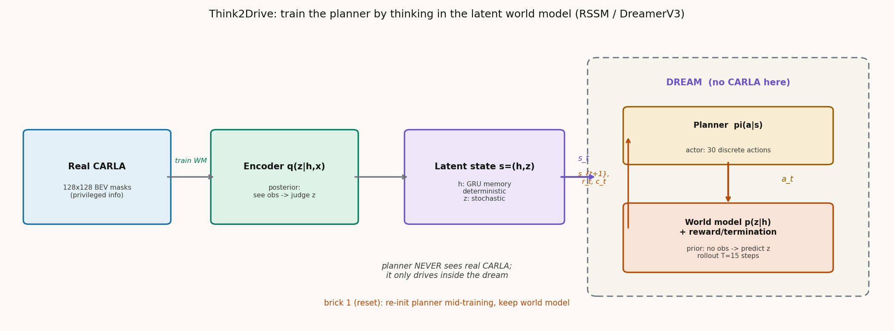

# 在脑子里开车：Think2Drive 如何用隐空间世界模型训出 CARLA v2 的首个专家

> 信息块
>
> - **论文**：Think2Drive: Efficient Reinforcement Learning by Thinking in Latent World Model for Autonomous Driving (in CARLA-v2)
> - **作者**：Qifeng Li*, Xiaosong Jia*, Shaobo Wang, Junchi Yan（上海交通大学；*共同一作）
> - **发表**：ECCV 2024（arXiv 2402.16720v2；venue 已用 Bench2Drive 官方仓库的 BibTeX `@inproceedings{li2024think, booktitle={ECCV}, year={2024}}` 核实）
> - **链接**：https://arxiv.org/abs/2402.16720
> - **代码**：未找到官方开源仓库（GitHub 上 Thinklab-SJTU/Think2Drive 不存在；论文正文未给代码链接）。注意：同团队的 Bench2Drive 基准（https://github.com/Thinklab-SJTU/Bench2Drive）用 Think2Drive 训练出的 expert 做数据采集器，间接证明了模型存在且可用，但训练代码未公开，复现受限。
> - **一句话核心洞见**：把 DreamerV3 的隐空间世界模型（RSSM）搬进自动驾驶，用"在脑子里开车"代替"在 CARLA 里开车"训 RL 规划器；真正的贡献不在世界模型本身（直接用的 DreamerV3），而在让 model-based RL 在 CARLA v2 上真正跑通的那 7 块"砖"（brick）——尤其是训练中途把规划器权重全部随机重置的那块。

---

## 先把时间坐标摆出来

2022 年 11 月，CARLA 官方发布 Leaderboard v2：39 个新的 corner case 场景（施工绕行、对向来车借道、无保护左转、闯红灯的横向车辆……），路线从 v1 的约 1 公里拉长到 7–10 公里，每条路线约 60 个场景。发布一年后，**没有任何公开方法能在 v2 上跑出成绩**——规则式的 autopilot 失效，Roach（model-free RL，v1 时代的 SOTA expert）在 v2 上直接归零（论文表 3：PPO expert 在 v2 上 driving score 0.7，route completion 1.0%）。

这就是 Think2Drive 出场时的局面：一个公认"难到没人做出来"的基准。作者的目标不是发一篇方法论文，而是**第一个把 v2 拿下**。理解了这一点，才能理解论文里那些看起来"工程味很重"的 bricks——它们不是装饰，是作者撞了南墙之后一块一块砌上去的。

---

## 作者的底牌

推测作者手里有两张牌，一张是借来的，一张是自己攒的。

**借来的牌：DreamerV3（2023）。** Hafner 的 DreamerV3 已经在 Minecraft"从零开始挖钻石"这种稀疏奖励任务上证明了自己：RSSM 世界模型 + actor-critic，超参数基本不用调。作者的判断是：**自动驾驶在 BEV 语义掩膜下的转移动态，比 Minecraft 简单**（related work 原话："the transition of AD scenes under rasterized BEV is relatively easy to learn"）。这是一个关键判断——如果转移动态学不准，后面全是空中楼阁。论文图 2 的世界模型预测可视化就是这张牌的验货：用前 5 帧预测未来 50 步的 BEV 掩膜，车辆、车道线都对得上。

**自己攒的牌：对 CARLA v2 难点的解剖。** 论文 3.3 节列了 7 个 challenge，每个配一块 brick。这种"挑战-对策"一一对应的写法，说明作者是真的一个一个趟过来的，不是先有方法再编故事。消融图（图 3）显示去掉 brick 1（reset）或 brick 5（warmup），成功率直接塌掉——这两块是最承重的。

---

## 背景补讲：RSSM 和 latent rollout（大白话版）

**世界模型（world model）**：一个神经网络，学会"给定当前状态和动作，预测下一个状态"。经典出处是 Ha & Schmidhuber 2018。Dreamer 系列把它做成了 RL 的标准件：先在真实环境里收集数据训世界模型，然后让智能体在世界模型里"做梦"（imagination）来学策略，不用再跟慢吞吞的真实环境交互。

**RSSM（Recurrent State-Space Model，循环状态空间模型）**：Dreamer 系列世界模型的具体结构，也是 Think2Drive 直接搬用的。它把隐状态拆成两部分：

- $h_t$（deterministic，确定性部分）：一个 GRU 循环网络的隐藏状态，记住历史。给定 $h_{t-1}, z_{t-1}, a_{t-1}$ 算出 $h_t = f_\theta(h_{t-1}, z_{t-1}, a_{t-1})$。它是确定性的——同样的输入永远得到同样的 $h_t$。
- $z_t$（stochastic，随机部分）：一个离散/连续的随机变量，建模环境的不确定性（比如前车是刹车还是变道）。有两个分布：后验 $q_\theta(z_t|h_t, x_t)$（看到了真实观测 $x_t$ 之后对 $z_t$ 的判断）和先验 $p_\theta(\hat{z}_t|h_t)$（没看到 $x_t$、只靠历史预测的 $z_t$）。训练目标之一就是让先验逼近后验——这样**做梦时（没有真实观测）用的先验，和有观测时的后验就一致了**。

**Latent rollout（隐空间展开）**：训好世界模型后，规划器的训练完全在隐空间里进行：从一条真实记录里取一个观测 $x_t$ → 编码成 $s_t=(h_t,z_t)$ → 规划器输出动作 $a_t$ → 世界模型预测 $r_t, c_t, s_{t+1}$ → 重复 T=15 步。整个过程是张量运算，可以一次并行跑几百条 rollout，速度比 CARLA 快几个数量级。**规划器这辈子没见过真正的 CARLA，它只在世界模型的梦里开过车。**

下图是自绘的训练流程（对应论文公式 1–2 与图 4 的思想）：

*图：Think2Drive 的"在脑子里开车"。真实 CARLA 数据只用来训世界模型（编码器学后验 q(z|h,x)）；规划器（actor）的全部训练都在隐空间的梦里完成——给定隐状态 s_t 输出动作，世界模型用先验 p(z|h) 推演 s_{t+1} 并给出奖励/终止信号，一次并行数百条 15 步 rollout。Brick 1 的精髓也在图里：reset 时只重置规划器，世界模型不动。*

**Symlog / two-hot**（DreamerV3 的两个数值技巧，论文直接沿用）：奖励的尺度在不同场景差很大（一次碰撞 -100，正常行驶每步 +1），直接回归会炸。symlog 把奖励压成 $sign(x)\ln(|x|+1)$ 的尺度；two-hot 把连续的奖励值离散成相邻两个桶的加权（比如奖励 3.7 就表示成"0.3 概率是 3、0.7 概率是 4"），critic 学分类而不是回归，训练稳定得多。

---

## 方法是怎么被一步步逼出来的：7 块砖

论文 3.3 节的 7 个 challenge + brick，是全文最值得细读的部分。每一块都对应一个真实的训练事故。

**Brick 1（reset）：训练中途把规划器的权重全部随机初始化。** 事故现场：39 个场景里，有的场景最优策略互相矛盾——前车急刹的场景要求"跟前车保持距离"，汇入高速车流的场景要求"主动贴近前车"。前者简单得多，规划器很快学会"保持距离"，然后就陷在这个局部最优里出不来了（policy degradation）。解法粗暴但有效：训到一半，把规划器的**所有权重随机重置**，世界模型不动。因为世界模型已经能给出准确稠密的奖励，重置后的规划器冷启动不致命，反而能跳出局部最优。灵感来自 Nikishin et al. 2022 的 primacy bias 工作。消融图 3 显示，去掉 brick 1 是掉点最狠的两块之一。**注意**：这个 trick 只有 model-based RL 玩得起——model-free 的 PPO 每次 reset 后要从 replay buffer 里重学，而 buffer 里的奖励是有噪声的，论文 4.4 节明确对比了 PPO + reset 依然失败。

**Brick 2（自动场景生成器）**：官方 90 条训练路线上 39 个场景是稀疏的、且和固定 waypoint 绑定。作者写了个生成器：把长路线切成短路线，按道路情况自动布置场景。附带产出是一个新 benchmark **CornerCaseRepo**：1600 条训练路线 + 390 条评估路线，每条 <300 米、只含一种场景。这是"把长尾变稠"的工程手段，也是 RAMP 实验直接相关的部分（见血缘节）。

**Brick 3（termination-priority 回放）**：一个 10 秒的红灯，10 FPS 决策就是 100 帧"低价值"转移。均匀采样会让世界模型在 trivial 状态上浪费容量。解法：以一半概率采样 episode 终止前 K 帧——终止帧附近要么是世界模型没学准的地方，要么是探索到的危险状态，都是"值得学"的。

**Brick 4（steering cost）**：RL 的随机策略很难"长时间保持同一个动作"，直道上方向盘会抖（Roach 的 demo 里肉眼可见）。在奖励里加一项 $c_{steer}$ = 当前 steer 与上一步 steer 的差，惩罚抖动。

**Brick 5（warmup 课程学习）**：直接上 39 个难场景，学习曲线太陡，模型会陷进"过度保守"的局部最优（宁可不动也不犯错）。先在简单的跟车+简单转弯上 warmup，学会基本驾驶技能再上难度。消融显示这是另一块最承重的砖。

**Brick 6（planner 增量训练比）**：世界模型学得比 planner 快（BEV 下的转移动态相对简单），如果两者 1:1 训练，planner 会拖后腿。让 planner 的训练步数渐增到世界模型的 4 倍。

**Brick 7（CARLA 并行/异步）**：CARLA 每次 reset 要 40 秒以上（加载路线+实例化场景）。包一层标准 RL 接口，异步 reload + 并行跑多个 env。附录 C 说每 100K 步能省约 1 天。

**奖励函数**（5 节，公式 8）：$r = r_{speed} + \alpha_{tr} r_{travel} + \alpha_{de} p_{deviation} + \alpha_{st} c_{steer}$。四项：速度奖励（跟前车距离/类型相关的安全速度）、里程奖励（沿路线走的距离）、偏离惩罚（离车道中心线的距离）、转向平滑代价。动作空间离散成 30 个（throttle/brake/steer 的组合，附录表 6）。输入是 128×128×34 的 BEV 语义掩膜（34 个通道：1 个静态 + 动态物体各 4 个历史帧）+ 车速/上一步动作等向量。注意：**输入是特权信息**（simulator 直接给的 bounding box、地图、红绿灯状态），不是 raw sensor——感知被 bypass 了，论文聚焦纯规划。这是它和 RAMP（raw sensor 输入）的根本区别之一。

---

## 实验：数字是在什么条件下得到的

**主结果**（表 1，CornerCaseRepo）：Think2Drive driving score 83.8±1 / WDS 89.0±0.2 / route completion 99.6±0.1，对 Roach（57.5 / 54.8 / 96.4）是碾压。注意 Roach 的 collision vehicles 是 8.42±4.65（每公里），Think2Drive 是 1.2±0.5——差 7 倍。每个数字是 3 次运行的均值±标准差，这一点论文做得规范。

**官方路线**（表 3）：v1 上 Think2Drive DS 90.2（Roach 84.0）；v2 上 Think2Drive DS 56.8 / WDS 91.7 / RC 98.6%，而 PPO expert 是 0.7 / 0.6 / 1.0%。**这是 v2 发布一年多后第一份像样的成绩单。**

**WDS（Weighted Driving Score）**：作者自创的指标，动机是官方 DS 的指数衰减计分对长路线不公平（同样的违章率，路线越长分越低）。WDS = RC × Π penalty_i^{n_i}，其中 n_i = 违章数 / 场景密度。直觉：把违章数按场景密度归一化，衡量"单位场景密度下的平均违章"。这个指标后来被 Bench2Drive 沿用。公平地说，这是一个合理的修正，但它是作者自己定的尺子，跨论文比较时要注意。

**训练代价**：单张 A6000，3 天。这是全文最有冲击力的一个数字——model-free 的 Roach 在 v1 上要训多久？论文没直接给，但 model-based 的样本效率优势是实的：世界模型 104M 参数（附录表 7：GRU 512 单元，CNN multiplier 96）。

---

## 怀疑式阅读

**1. "首个 model-based RL for AD"的声明要加限定词。** 摘要说 "the first model-based RL method for AD"。Related work 自己承认有 MILE（model-based IL，NeurIPS 2022）和 Henaff et al. 2019（model-predictive policy learning for driving）。严格说，Think2Drive 是"首个在 CARLA v2 这种准真实基准上跑通的 model-based RL 规划器"，不是"首个把 model-based RL 用在驾驶上"。摘要的措辞是放大的。

**2. PPO 基线的对比有"同等调参预算"问题。** 表 3 里 PPO 在 v2 上 0.7 分，论文解释是"reset 后要从有噪声的 buffer 重学"。但 PPO 的超参数（学习率、batch、GAE lambda 等）是否得到了和 DreamerV3 同等的调参？论文没说。DreamerV3 的卖点之一就是"不用调参"，这本身给了它不公平的优势——但这也是 DreamerV3 的真实优点，不是作弊。结论应该是"开箱即用的 DreamerV3 比需要精调的 PPO 更适合这个任务"，而不是"model-based 一定碾压 model-free"。

**3. 输入是特权信息，离"端到端"还差一段。** 128×128 BEV 语义掩膜来自 simulator 的真值，不是相机。论文标题说 "efficient RL"，没说 end-to-end，这一点是诚实的。但读者要注意：Think2Drive 是一个**规划器**，不是感知规划一体。它的 expert 数据（200K 帧，换天气采集）被用来训 TCP（纯 raw sensor 输入的 IL 模型），TCP 的成绩（DS 36.4）说明从特权到 raw sensor 的 gap 还很大。

**4. 39 个场景的成功率表（表 2）藏着短板。** 大部分场景成功率 0.8+，但 SignalizedJunctionRightTurn 0.61、NonSignalizedJunctionLeftTurnEnterFlow 0.65、InterurbanAdvancedConstruction 0.67——恰恰是"汇入高速密集车流"这类需要精确博弈的场景。4.5 节的失败分析很诚实：TwoWays 场景里对向车流速度 8–18 m/s、间隔 15–50 米随机，最坏情况下留给自车的窗口不到 1 秒，自车要从 0 加速到极速再并回去，回来时贴着对向车，碰撞率高。这说明**世界模型+RL 解决了"能不能"，但"难场景的鲁棒性"还没解决**。

**5. PDM-lite 的脚注值得注意。** Related work 提到 Think2Drive 发表后，PDM-lite（规则式）也能解 v2 所有场景，但"对不同场景用不同超参数，需要大量人工"。这是一个公平的对比：规则方法靠人工调参，学习方法靠数据。Think2Drive 的价值在于"一套参数打全部场景"。

**做得漂亮的地方**：Brick 1 的 reset trick 配消融、表 2 的 39 场景逐个成功率（不藏短板）、4.5 节的失败归因（把 TwoWays 场景的物理约束算出来：速度/间隔范围 → 时间窗口 <1 秒）。这种"把失败算清楚"的写作是可信度的来源。

---

## 与 RAMP 的血缘 / 划界

**血缘（直接参照）**：Think2Drive 的 RSSM 世界模型是 RAMP 的 world-model backbone 选型**最直接的参照物**。RAMP 的"单次前向得到中间分布 q(z|o)"，在 DreamerV3/RSSM 的语言里就是**后验** $q_\theta(z_t|h_t, x_t)$——看到了当前观测 $x_t$ 之后对隐状态的判断。而 RAMP 用它做两件事（LLM 调度先验 + 风险校验 rollout），对应 RSSM 语言里的两件事：用后验 $q$ 做状态估计、用先验 $p_\theta(\hat{z}_t|h_t)$ 做无观测的未来推演。RAMP 在方法章节写 backbone 时，可以直接说 "we adopt an RSSM-style latent world model following Think2Drive/DreamerV3"，审稿人一看就懂。

**划界（RAMP 的增量）**，三条：

1. **世界模型的用途不同**：Think2Drive 的世界模型是**训练时的神经仿真器**——planner 在它里面做梦、学策略，部署时 planner 是独立跑的（actor 网络直接输出动作，不再咨询世界模型）。RAMP 的世界模型是**部署时的在线模块**——每次决策都做一次前向，中间分布同时服务调度和校验。Think2Drive 回答"怎么训出规划器"，RAMP 回答"怎么在运行时用世界模型给规划上保险"。这是训练时 vs 运行时的根本分野。

2. **输入不同**：Think2Drive 吃的是特权 BEV 语义掩膜（simulator 真值），感知问题被 bypass；RAMP 吃 raw sensor，世界模型要自己从像素里提炼 $q(z|o)$。RAMP 的难处（也是创新点）恰恰在"无特权条件下的隐分布质量"，这是 Think2Drive 没有面对的问题。

3. **与 Bench2Drive 的直接关系**：Think2Drive 训出的 expert 是 Bench2Drive 数据集的**官方数据采集器**（Bench2Drive 论文/仓库明确写了 "Closed-Loop E2E-AD Benchmark Enhanced by World Model RL Expert"）。RAMP 计划在 Bench2Drive 上验证，用的正是这个 expert 采集的数据。血缘上 RAMP 是"站在 Think2Drive 的肩膀上做验证"——在 related work 里提一句这个关系，既诚实又加分。

一句话：Think2Drive 证明了"隐空间世界模型能学会开车"，RAMP 要证明的是"隐空间世界模型能在开车时实时保驾"——前者是训练范式，后者是运行时架构。
