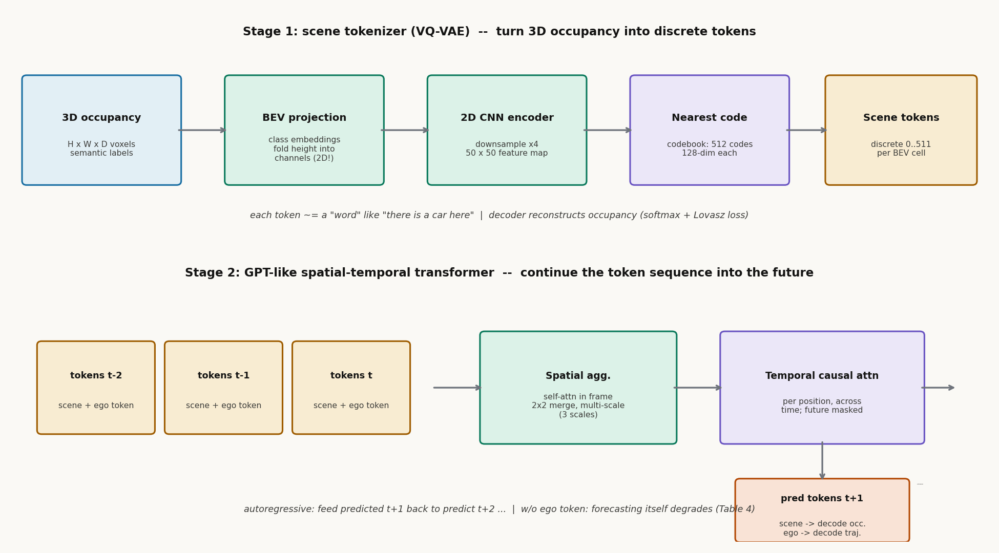

# 把 GPT 搬进三维体素：OccWorld 的占据世界模型

> ⚠️ **同名消歧（必读）**：本篇是 **OccWorld: Learning a 3D Occupancy World Model for Autonomous Driving**（Wenzhao Zheng 等，清华，ECCV 2024，arXiv 2311.16038）——用 VQ-VAE 把 3D 占据离散化成 token、再用 GPT 式时空 Transformer 自回归预测未来占据 + 自车轨迹。**不要**与库内 054 **Drive-OccWorld**（AAAI 2025）混淆：那是另一篇论文（Occupancy 世界模型 + 扩散规划器的组合，思路更接近 Drive-WM 的占据版）。两篇都姓 "OccWorld"，但作者、方法、venue 全不同。本文只讲 ECCV 2024 的 Zheng 版。

> 信息块
>
> - **论文**：OccWorld: Learning a 3D Occupancy World Model for Autonomous Driving
> - **作者**：Wenzhao Zheng, Weiliang Chen*, Yuanhui Huang*, Borui Zhang*, Yueqi Duan, Jiwen Lu（清华大学自动化系/电子系；*共同一作）
> - **发表**：ECCV 2024（arXiv 2311.16038v1，2023-11-27；venue 已用官方仓库描述 "[ECCV 2024] 3D World Model for Autonomous Driving" 及多份世界模型综述的 ECCV 2024 列表核实）
> - **链接**：https://arxiv.org/abs/2311.16038
> - **代码**：https://github.com/wzzheng/OccWorld（591 stars，最后更新 2024-04-12；公开完整，可复现——这是本批 5 篇里代码最完整的一篇）
> - **一句话核心洞见**：自动驾驶的世界模型不一定要活在像素里（Drive-WM）或隐向量里（Think2Drive），可以活在 **3D 占据（occupancy）** 里——把"未来几秒每个体素是空还是车、是路还是墙"当成一种语言，用 VQ-VAE 先把它"分词"，再用 GPT 式的 Transformer 逐帧"续写"，自车轨迹只是其中一个特殊的 token。

---

## 一个反直觉的起点

2023 年底，自动驾驶预测的主流是"预测框"：感知输出一堆 3D 框，预测模块输出每个框的未来轨迹。作者在引言里点了一个所有人都知道但没人捅破的问题：**框是稀疏的，世界是稠密的。** 路面上的水坑、施工的锥桶、没见过的异形障碍物，都塞不进"框"这个表示里。更麻烦的是，感知→预测→规划的串行管线每一级都要真值标注：框标注、地图标注、轨迹标注，全是人工。

作者的赌注是：**3D 占据（occupancy）** 这个表示，能同时解决"稠密"和"标注贵"两个问题。占据是什么？把自车周围的三维空间切成 H×W×D 个小格子（体素 voxel），每个格子标一个语义：空、车、行人、路面、植被……它稠密（每个格子都有值）、可自监督（LiDAR 点云天然就是占据的稀疏观测，多帧累积就能当伪标签）、模态无关（相机、LiDAR 都能产生占据）。

但占据有个致命缺点：**它太底层了**。一个 200×200×16 的体素网格，直接在上面学"世界怎么演化"，等于让模型在像素级噪声里找规律。作者的解法分两步走，这就是全文的骨架：

1. **先"分词"**：用 VQ-VAE 把占据压成离散的 scene token（每个 token 是 codebook 里 512 个"高层概念"之一，比如"这个位置有一辆车"）。
2. **再"续写"**：用 GPT 式的自回归 Transformer，在 token 序列上预测下一帧。

"把世界当成语言来建模"——这句话在 2023 年的 NLP 里是常识，在自动驾驶的 3D 空间里是第一次有人完整做出来。

---

## 作者的底牌

**第一张：VQ-VAE（2017）+ GPT（2020）的组合是现成的、被验证过的。** 作者不需要发明离散表示学习，也不需要发明自回归建模，只需要解决"怎么把这两样东西搬到 3D 驾驶场景"。证据：3.2 节的 tokenizer 几乎是 VQ-VAE 的标准流程（编码→最近邻量化→解码重建），3.3 节的 Transformer 是"GPT + 空间聚合 + 时序因果注意力"的拼接。真正的创新在"搬运"过程中的两个适配（见下文）。

**第二张：TPVFormer（同组前作，CVPR 2023）和 SelfOcc（arXiv 2023）提供了占据的"货源"。** OccWorld 的输入占据可以是真值（OccWorld-O）、TPVFormer 预测的（OccWorld-D/T，分别用稠密真值和稀疏 LiDAR 监督训的）、甚至是纯自监督的（OccWorld-S，用 SelfOcc）。**占据表示的"可获得性"是这篇论文敢立项的前提**——如果占据只能靠昂贵的人工标注，这篇论文的方法就没有 scale 的故事可讲。

**第三张：4D 占据预测（4D occupancy forecasting）是一个新任务。** 论文自己定义了这个任务：给定过去 2 秒的占据，预测未来 3 秒的占据（Occ3D 数据集上）。新任务意味着没有直接竞品，审稿人只能跟 "Copy&Paste"（把当前帧复制到未来）这种 trivial 基线比——表 1 里 OccWorld-O 的 mIoU 17.14 对 Copy&Paste 的 11.33，赢得干净。这是一个聪明的发表策略，但也意味着"新任务"的含金量要打折扣（见怀疑式阅读）。

---

## 背景补讲：三个术语，大白话

**Occupancy（占据）**：把三维空间切成小方块，每个方块回答两个问题："有没有东西？"和"是什么东西？"。nuScenes 上常用的 Occ3D 标注是 200×200×16 的网格。对比 BEV（鸟瞰图）：BEV 是把三维压成二维平面，只保留"俯视看有什么"；占据保留高度维，能区分"桥洞下穿"和"撞墙"——BEV 里这两者可能长得一样。

**VQ-VAE（Vector-Quantized VAE，向量量化变分自编码器）**：普通的自编码器把输入压成连续向量；VQ-VAE 多了一步"查字典"——学一个 codebook（比如 512 个向量），编码器的每个输出向量被替换成 codebook 里离它最近的那个。于是连续的特征变成了离散的 token（每个位置一个 0–511 的整数）。为什么要离散？因为 GPT 那套自回归建模是为离散 token 设计的（分类损失），连续值用回归损失建模多模态未来会很挣扎（均值塌缩）。

**Latent rollout / 自回归预测**：和 Think2Drive 的 latent rollout 一个思想，不同表示。OccWorld 的做法：用过去 T 帧的 token 预测第 T+1 帧的 token，再把预测的 T+1 帧喂回去预测 T+2 帧，以此类推。训练时用真值 token 做输入（teacher forcing）+ 因果掩码；推理时用自己预测的 token（会有误差累积，这是所有自回归模型的通病）。

---

## 方法：从朴素到最终形态

**朴素尝试**：直接在占据体素上训一个 3D CNN 预测下一帧。会死在两个地方：第一，体素网格太大（200×200×16×语义类），3D 卷积的计算量爆炸；第二，体素级是底层信号，"一辆车从 A 移到 B"在体素级是成千上万个格子的翻转，模型学不到"车"这个概念，只能学"格子翻转的统计规律"，泛化差。

**第一次修正：先分词。** 用 VQ-VAE 把占据变成离散 token。但直接对 3D 体素做 VQ-VAE 还是贵，作者做了一个关键简化（3.2）：先把 3D 占据转成 BEV 表示——给每个语义类学一个 embedding，把高度维拼到通道维（H×W×D → H×W×(D·C')），然后用 **2D** 卷积编码、下采样 4 倍。离散化在 BEV 平面上做：每个 BEV 位置的特征向量找 codebook 里最近的码。**这一步把"三维"问题降成了"二维"问题**，代价是高度信息被折叠进通道——对驾驶来说高度的变化本来就小，这个 trade-off 是划算的。

**第二次修正：GPT 搬过来要适配。** NLP 的 GPT 一次预测一个 token；这里一帧有 M₀ 个 token（下采样后约 50×50=2500 个），逐个预测太慢。作者的设计（3.3，公式 6）：

$$\hat{\mathbf{z}}^{T+1}_{j,i} = \mathrm{TA}(\mathbf{z}^T_{j,i}, \cdots, \mathbf{z}^{T-t}_{j,i})$$

- 先做**空间聚合**：在每一帧内部做自注意力，让 token 互相感知全局场景；然后 2×2 合并下采样，得到 K+1 个尺度（论文用 3 个尺度）。
- 再做**空间位置对齐的时序因果注意力**：对每个空间位置 j、每个尺度 i，沿时间维做 masked attention，用过去 t 帧同一位置的 token 预测下一帧该位置的 token。
- 最后用 **U-Net 结构**把多尺度的预测融合，保证空间一致性。

直觉：时序注意力回答"这个位置上的东西在怎么动"（一辆车沿车道往前开，就是同一条空间轨迹上 token 的语义从"空"变"车"再变"空"），空间聚合回答"全局发生了什么"（自车转弯时整个场景的相对运动）。两者缺一不可——表 4 的消融：去掉空间注意力，mIoU 从 17.14 掉到 10.07；去掉时序注意力，掉到 8.98。

下图是自绘的两阶段流程（对应论文图 3 与图 4）：

*图：OccWorld 两阶段。Stage 1 用 VQ-VAE 把 3D 占据"分词"：先投影到 BEV（把高度折进通道，3D 问题降成 2D），2D CNN 下采样 4 倍后做最近邻量化，得到每格一个 0–511 的离散 token。Stage 2 用 GPT 式 Transformer"续写"：空间聚合（帧内自注意力+多尺度）→ 时序因果注意力（同一位置跨时间）→ 预测下一帧 token，自回归展开；ego token 单独解码出自车轨迹。*

**第三次修正：把自车也变成 token。** 场景 token 之外，加一个 ego token $z_0 \in \mathbb{R}^C$ 编码自车位置，和场景 token 一起进 Transformer。用一个 ego decoder $d_{ego}$ 从预测的 ego token 回归自车位移 $\hat{p}^{T+1} = d_{ego}(\hat{z}^{T+1}_0)$，L2 损失监督。**自车轨迹和场景演化是联合建模的**——这是"世界模型"相对"预测模块"的本质区别：预测模块只预测别人，世界模型把自己也放进世界里。表 4 显示，去掉 ego token 不只规划变差（L2 从 1.17 涨到无穷大/不可算），**占据预测本身也变差**（mIoU 17.14→15.13）：因为自车运动决定了观测视角的变化，预测不准自车，场景也预测不准。这个消融是全文最有说服力的一个。

**两阶段训练**（3.4）：第一阶段训 tokenizer（重建损失：softmax + Lovász-softmax，公式 7）；第二阶段冻结 tokenizer，用 token 分类损失（softmax 选对 codebook 索引）+ ego 位移 L2（公式 8，λ₂ 平衡）。训练配置：8×RTX 4090，batch 1/GPU，AdamW，lr 1e-3，cosine 退火。Codebook：512 个码，128 维。

---

## 实验：数字的条件

**4D 占据预测**（表 1，Occ3D，过去 2 秒 → 未来 3 秒）：OccWorld-O（真值占据输入）mIoU avg 17.14 / IoU 26.63，远超 Copy&Paste（11.33 / 20.52）。OccWorld-D（相机输入+TPVFormer 占据监督）mIoU 8.62——**从真值掉到相机输入，性能腰斩**，说明占据预测的质量瓶颈在感知端，不在世界模型端。OccWorld-S（纯自监督占据）mIoU 只有 0.26，基本是"能跑但不好用"的水平——论文诚实地报告了，但摘要里 "non-trivial" 的措辞是公关腔。

**运动规划**（表 2，nuScenes）：OccWorld-O L2 avg 1.17（1s/2s/3s：0.43/1.08/1.99），不用任何框和地图标注，超过了用框+地图监督的 OccNet（1.43），接近 VAD-Base（1.30）。但**碰撞率 0.60%**，不如 UniAD（0.31%）和 VAD-Base（0.53%）——论文自己解释：没有 freespace/框的显式监督，学"哪里不能去"比较难。**1 秒的 L2（0.43）是全场最好**，但 3 秒（1.99）掉到不如 UniAD（1.65）——作者归因于世界模型的多样性生成会偏离真值轨迹。这个解释是合理的：自回归采样的随机性在长时域累积。

**Tokenizer 超参**（表 3）：codebook 512 最好，1024 过拟合；空间分辨率 100（vs 50）重建更好（mIoU 78.12 vs 66.38）但预测更差——**重建准 ≠ 预测好**，因为高分辨率 token 学的是底层细节而不是高层概念，难预测。这是一个反直觉但重要的观察：表示学习里"信息瓶颈"的经典 trade-off。

---

## 怀疑式阅读

**1. "4D 占据预测"任务的定义权在作者手里。** 没有前作做这个任务，基线只有 Copy&Paste。17.14 的 mIoU 听起来不错，但绝对值依然很低（100 分制下 17 分）——说明任务本身极难，数字的"领先"更多是"第一个做"的红利。引用时要说明这是新任务的 baseline 数字，不是和成熟方法的对比。

**2. 相机端到端的版本（OccWorld-D/T/S）和真值版本（-O）差距巨大。** mIoU 从 17.14 掉到 8.62/3.56/0.26。论文的标题是"3D Occupancy World Model"，但真正 work 的是"给定真值占据"的版本；从相机出发的版本里，世界模型的贡献被感知误差淹没了。这对 RAMP 的启示是直接的：**占据表示的世界模型，其天花板被占据感知的质量锁死**——RAMP 如果选占据路线，必须同时解决感知。

**3. 推理速度 18 FPS（表 1/2/4 的 FPS 列）是在什么硬件上？** 论文只在表注里给了 FPS 数字，没有说明 GPU 型号和 batch size。结合训练用 8×4090，18 FPS 很可能是在 4090 上单样本测的。车载 Orin 的算力大约是 4090 的 1/10，这个速度离部署还差得远。论文没有讨论车载可行性。

**4. 自回归的误差累积没有量化。** 推理时用预测的 token 喂下一步（3.4 节明确写了），但论文没有画"预测步数 vs mIoU 衰减"的曲线。表 1 显示 1s→3s mIoU 从 25.78 掉到 10.51，衰减是显然的，但没有和"用真值 token 做输入"的上限对比，无法判断多少是模型能力问题、多少是自回归固有的问题。

**5. Lovász-softmax 损失（公式 7）的 λ₁ 没有给值。** 论文只说"λ₁ is a balance factor"，正文和附录都没给具体数值——复现时要自己调。代码是公开的，可以去代码里找（这是代码公开的价值）。

**做得漂亮的地方**：表 4 的 "w/o ego" 消融——去掉自车 token，占据预测本身都变差。这个实验干净地证明了"联合建模"的必要性，不是口号。另外，图 1 的 caption 里诚实写了失败案例："fails to forecast new vehicles entering the sight"（视野外新出现的车预测不出来）——因为输入里没有，这是自回归世界模型的固有盲区，作者不藏。

---

## 与 RAMP 的血缘 / 划界

**血缘**：OccWorld 是"占据表示 + 世界模型服务规划"这条线的代表。RAMP 的世界模型如果考虑占据表示（occupancy 是 RAMP 备选表示之一），OccWorld 的 VQ-VAE tokenizer 是现成的"把占据变成 token"的方案；它的"场景演化 + 自车轨迹联合建模"（公式 5：$w(\mathbf{T}^T, \cdots) = \mathbf{T}^{T+1}$，其中 $\mathbf{T}$ 包含场景 token 和 ego token）正是 RAMP"世界模型同时输出环境演化与自车状态"的思想先驱。

**划界**，三条：

1. **离散 vs 连续**：OccWorld 把世界离散化成 512 个码，用分类损失建模未来；RAMP 的 $q(z|o)$ 是连续分布，用分布的方差/多模态表达不确定性。离散化的好处是训练稳定、能表达多模态；坏处是 codebook 的粒度锁死了表达上限（表 3 显示 1024 个码就过拟合），且**离散 token 的"不确定性"不好量化**——RAMP 的风险校验需要的是"这个未来有多不确定"的连续信号，这是连续分布的天然优势。

2. **自回归多步 vs 单次前向**：OccWorld 预测未来 3 秒要自回归 6 次（每步都过一遍 Transformer），延迟随步数线性涨；RAMP 的单次前向一次给出中间分布，rollout 在隐空间展开。这是 RAMP 相对它的实时性增量。

3. **规划的使用方式**：OccWorld 的规划是"从 ego token 解码一条轨迹"（开环单轨迹输出）；RAMP 是"对多条候选轨迹做风险校验"（评估式规划，更接近 Drive-WM 的范式）。OccWorld 的长时域 L2 衰减（3s 1.99 vs UniAD 1.65）恰恰说明"单轨迹解码"在长时域不如"多候选评估"稳——这是 RAMP 选评估式路线的旁证。

一句话：OccWorld 证明了"占据可以当世界模型的语言"，RAMP 要做的是"用连续隐分布说这种语言，并且说得足够快、还能报不确定性"。
