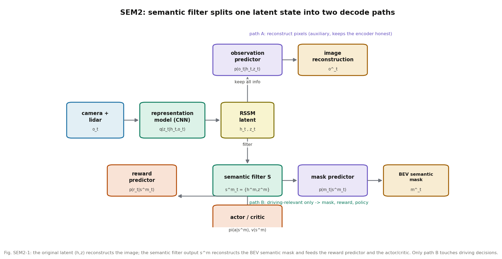

# 把开车用不上的信息挡在策略门外：SEM2 的语义过滤世界模型

**论文**: Enhance Sample Efficiency and Robustness of End-to-end Urban Autonomous Driving via Semantic Masked World Model
**作者**: Zeyu Gao, Yao Mu, Chen Chen, Jingliang Duan, Ping Luo, Yanfeng Lu, Shengbo Eben Li
**venue**: IEEE Transactions on Intelligent Transportation Systems（IEEE TITS；经作者 Yao Mu 个人主页核实确为 IEEE TITS 发表；任务给定年份 2024，arXiv v4 为 2024-05-18 的 IEEE 版式终稿）
**链接**: https://arxiv.org/abs/2210.04017
**代码**: 未找到官方代码（多方检索无结果，文档按论文正文撰写）
**版本说明**: 任务原给的 arXiv 号 2403.02622 经核实是一篇世界模型综述（"World Models for Autonomous Driving: An Initial Survey"），并非 SEM2。SEM2 真实的 arXiv 号是 **2210.04017**，以下解读以该版本为准。
**一句话核心洞见**: Dreamer 类世界模型的隐状态里塞满了开车用不上的东西（云、雨、楼的外观），策略网络被迫在噪声里找信号，又慢又脆；SEM2 加了一个"筛子"——用仿真器免费给的 BEV 语义 mask 做监督，逼出一组只含驾驶相关信息的特征，策略和奖励只看这组特征，像素重建走另一条路。

---

## 一个让 DreamerV2 难堪的具体场景

CARLA 的 town3，正午大晴天，DreamerV2 训了 30 万步，车开得像模像样。把天气切到 hard rain noon，再往相机输入里撒一把椒盐噪声（概率 0.1，模拟暴雨夜的极端输入），同一套权重，平均 return 从 1655.9 掉到 1435.1（-13.3%）。论文图 10 把两套隐状态画成热力图：DreamerV2 的隐状态在坏天气下整块变色，SEM2 的过滤后特征几乎不动。

这件事的直接含义是：DreamerV2 的隐状态 $\\{h_t, z_t\\}$ 里，有相当一部分维度在编码"现在是什么天气""楼长什么样"。策略网络 $\\pi(a|s)$ 的输入里混着这些维度，输入一扰动，动作跟着抖。作者的判断是结构性的，不是调参能救的：只要世界模型的训练目标里有"重建整张图像"这一项，隐状态就必须保留像素级细节，而像素级细节里的大头恰恰是驾驶无关的。

## 前人真正撞墙的地方

2022 年前后，端到端驾驶的 MBRL 路线是：Chen 等（TITS 2022）用随机隐状态世界模型降采样复杂度；LVM 把 Dreamer 引进来，确定性路径 + 随机性路径并行，预测更准、策略更稳。但这两条线共享一个默认假设：**隐状态是"场景的压缩"，压缩得越像原图越好**。重建损失 $-\ln p(o_t|h_t,z_t)$ 逼着编码器把云、雨、建筑立面都记下来，因为不记下来就重建不出来。

这个假设在 Atari 上没问题——Atari 画面里几乎每个像素都和游戏状态有关。在城市驾驶里它是错的：天空占画面三分之一，和"要不要刹车"毫无关系。第二个墙是数据：车 90% 的时间在直道上巡航，转弯、跟车急刹、碰撞前几秒的数据极少。世界模型在直道数据上把 mask 重建得很好，一到 corner case 就塌，策略也跟着塌。作者把这叫 modal collapse。

所以 SEM2 要同时回答两个问题：隐状态里怎么只留下开车要用的东西；训练时怎么让 corner case 的数据不被直道数据淹没。

## 作者的底牌

从论文的组织方式看，作者手里有三张牌。

第一张，**BEV 语义 mask 在仿真器里是免费的**。CARLA 能直接吐出鸟瞰语义图：车道线、目标路径、周围车辆、自车状态，一张图里全是要开车用的东西，不要的（天空、建筑外观）天然不在里面。用它做监督，不需要任何人工标注。这是整篇论文最硬的一张牌：一个不增加标注成本、不改变 Dreamer 训练流程的改动。

第二张，**DreamerV2 的机械已经成熟**。RSSM、latent imagination、actor-critic with TD-$\lambda$，整套流程照搬 Hafner 的设计，作者只需要动"特征往哪流"这一处。这意味着实验风险低，审稿人对每一块都有预期。

第三张，**corner case 数据可以按"怎么死的"自动分类**。一次 episode 非正常结束，要么撞了（collision），要么出界了（outlane），仿真器都告诉你。把最后 $4L$ 步按死因分桶，就是现成的 corner case 数据集，不用人工挑。

## 方法是怎么被一步步逼出来的

起点是标准的 RSSM（论文图 1、公式 2）。观测 $o_t$（相机 + lidar）进 representation model 得到随机状态 $z_t \sim q_\phi(z_t|h_t,o_t)$，确定性状态 $h_t = f_\phi(h_{t-1},z_{t-1},a_{t-1})$ 由 GRU 递推，transition predictor $p_\phi(\hat z_t|h_t)$ 在没有观测时也能往前滚。这部分和 DreamerV2 一字不差。

最朴素的尝试是：在 DreamerV2 上再加一个 mask predictor，用 BEV mask 做辅助重建。作者做了这个实验（图 11），结果是**几乎没用**。原因不难想：加一个重建头，只是让隐状态"顺便"也记住 mask，像素重建的压力还在，隐状态里该有的噪声一点没少。辅助任务不改变信息流向，它只是在原有瓶颈上多开了一个出水口。

于是作者换了思路：**不是多加一个头，而是把信息流劈开**。引入 semantic filter $S_\phi(s^m_t|h_t,z_t)$，一个两层 MLP（1024 宽，ELU），输入是完整的隐状态 $\{h_t,z_t\}$，输出是过滤后的特征 $s^m_t = \{h^m_t, z^m_t\}$。为了和原特征"同构"，filter 用 FC head 输出确定性部分、用 categorical head 输出离散随机部分。然后规定：mask predictor $p_\phi(\hat m_t|s^m_t)$ 和 reward predictor $p_\phi(\hat r_t|s^m_t)$ **只能**看 $s^m_t$；observation predictor $p_\phi(\hat o_t|h_t,z_t)$ 继续看完整的 $\{h_t,z_t\}$。

这个劈开是关键。mask 重建损失 $-\ln p_\phi(m_t|s^m_t)$ 的梯度只流进 filter，逼着 $s^m_t$ 里装下所有能重建 BEV mask 的信息；而像素重建的梯度走另一条路，不污染 $s^m_t$。策略 $\pi_\theta(a|s^m_t)$ 和 critic $v_\phi(s^m_t)$ 的输入也只用 $s^m_t$。用大白话说：开车要用的东西走过滤通道，像素细节走原通道，两边井水不犯河水。

损失函数（公式 3）是标准的变分下界，多了 mask 这一项：

$$\ln p(o_{1:T}, m_{1:T}, r_{1:T}) \ge \mathbb{E}\left[\sum_t -\ln p_\phi(o_t|h_t,z_t) - \ln p_\phi(m_t|s^m_t) - \ln p_\phi(r_t|s^m_t) + \mathrm{KL}[q_\phi(z_t|h_t,o_t)\|p_\phi(z_t|h_t)]\right]$$

四项各管一件事：observation loss 让编码器诚实（别丢信息）；mask loss 训练 filter；reward loss 让 $s^m_t$ 对奖励敏感；KL 让先验追上后验。注意 reward predictor 也只看 $s^m_t$，这是一个有意的设计：奖励（撞没撞、超速没超速）本来就该是驾驶相关特征的函数。

行为学习部分照搬 Dreamer：从后验状态出发，在 latent 里想象 $I=8$ 步，actor 按 $s^m$ 选动作，critic 用 TD-$\lambda$（$\lambda=0.95$）学价值，actor 最大化价值加熵正则（$\eta=10^{-4}$）。世界模型参数在行为学习时冻结。

*图 SEM2-1：完整的隐状态 $\{h_t,z_t\}$ 重建图像；过滤后的 $s^m_t$ 重建 BEV 语义 mask，并喂给奖励预测器和 actor/critic。只有下面这条路触碰驾驶决策。*

## 数据不平衡：三个回放池

第二个问题是数据。作者的做法很直接：维护三个 replay buffer——common、collision、outlane。一次 episode 如果撞了，把最后 $4L$ 步（$L=16$，即 64 步）扔进 collision 池；如果出界，扔进 outlane 池；不管怎么结束，全量数据都进 common 池。每次训练从三个池按概率采样拼成 batch（$B=16$ 条序列）。

配比是自适应的（算法 1）：每 2 万步评估一次（跑 30 个 episode），记成功率 $r_{suc}$、碰撞率 $r_{col}$、出界率 $r_{out}$。corner 数据总占比 $P_{cor} = r_{suc} \times P^{max}_{cor}$，其中 $P^{max}_{cor}=0.5$ 是上限；collision 和 outlane 在 corner 里的比例按 $r_{col}:r_{out}$ 分。逻辑是：训练早期成功率低，多看普通数据把基本功练会；成功率高了，再加 corner 数据的量。这个设计里有一个隐含的权衡：$P^{max}_{cor}=0.5$ 是拍脑袋定的，图 12 的消融显示固定 75% corner 反而掉点——corner 太多，正常驾驶的数据不够，策略变保守。

## 数字是在什么条件下得到的

实验在 CARLA town3（隧道、环岛、弯道、掉头弯都有），10Hz 同步模式，动作是油门 + 方向。输入是 64 线 lidar（50m 范围）+ 前视相机（110° FOV），图像、lidar、mask 都是 128×128×3。batch $B=16$、序列长 $L=16$、想象 horizon $I=8$。随机状态 $z_t \in \mathbb{R}^{32\times32}$（32 个 categorical，每个 32 类），确定性状态 $h_t \in \mathbb{R}^{2048}$。模型学习率 $3\times10^{-5}$，actor-critic $10^{-5}$，AdamW，$\gamma=0.99$。硬件是 RTX4090 + i7-13700KF。每个 trial 跑 30 万环境步，共 3 个 trial 取平均——这是论文明确写的，标准差都给了。

奖励函数（公式 7）是 7 项手工拼的：$r = 200r_{col} + v_{lon} + 10r_{fast} + r_{out} - 5\alpha^2 + 0.2r_{lat} + r_{cte} + 10r_{safe} - 0.1$。碰撞罚 200，出界（CTE>2m）罚 1，超速（>8m/s）罚 10，跟车太近（<8m 且刹车<0.7）罚 10，另有一个 -0.1 的常数项逼着车别停着不动。权重是手工定的，论文没给搜索过程——这是 MBRL 驾驶论文的老问题，奖励工程本身占了性能的大头，但没人展开讲。

主结果（表 I，随机路段，100 个 episode）：

| 方法 | 成功率 | 碰撞率 | 出界率 | 平均行驶距离 |
|---|---|---|---|---|
| SAC | 18.0±1.0% | 8.0±1.0% | 33.0±3.0% | 55.5±4.2m |
| DreamerV2 | 51.0±2.9% | 29.0±5.9% | 19.3±3.9% | 209.1±10.5m |
| SEM2 w/o multi-source | 64.7±2.9% | 26.3±1.3% | 8.0±2.9% | 234.4±19.0m |
| SEM2 | 79.7±2.6% | 14.3±3.3% | 5.3±0.5% | 243.5±3.2m |

两点值得细看。第一，SEM2 w/o multi-source（只有 filter，没有多源采样）已经把成功率从 51.0% 拉到 64.7%，出界率从 19.3% 砍到 8.0%——**filter 是承重结构**，多源采样是锦上添花（64.7%→79.7%）。第二，DreamerV2 的碰撞率 29.0% 比 SAC 的 8.0% 还高，不是因为 DreamerV2 更莽，而是 SAC 根本开不远（平均 55.5m 就停了，没机会撞）。比较碰撞率时要先看行驶距离，这是读表时容易踩的坑。

选中路口测试（表 II）：SEM2 成功率 96.7±1.7%，碰撞率 3.3%，DreamerV2 是 71.0%/29.0%。

鲁棒性测试（表 III，训练环境是 clear noon，测试加椒盐噪声 0.1）：DreamerV2 在 hard rain noon 掉 13.3%、wet sunset 掉 16.0%；SEM2 w/o multi-source 反而涨 3.9%/4.9%，完整 SEM2 涨 1.4%/2.1%。return 在新环境下**上涨**这件事有点反直觉。一个合理的解释（我的推断，论文没说）：训练环境 clear noon 的像素细节最丰富，filter 在训练时就被逼着忽略它们；到了坏天气，像素通道的信息量下降，决策更依赖 mask 通道，相当于测试环境比训练环境"更干净"。但这也意味着：如果测试环境引入的是 mask 本身会出错的扰动（比如 BEV 语义错乱），SEM2 可能比 DreamerV2 崩得更惨——论文没测这个。

表 IV 测了刹车效率衰减（hard rain + 噪声 + 刹车打折）：SEM2 w/o multi-source 在刹车 70% 时掉 14.0%，完整 SEM2 只掉 2.1%。作者自己承认：semantic filter 不增强对动力学变化的鲁棒性（mask 里本来就没有刹车效率的信息），这里的功劳归多源采样——corner 数据里有大量跟车急刹，策略学会了留安全距离。这是一个诚实的归因，值得肯定。

消融（图 11）：DreamerV2 加不加 mask predictor，曲线几乎重合——**光加 mask 重建头确实没用**，这反过来证明了"劈开信息流"才是有效成分。随机状态用 one-hot categorical 比 32 个 Gaussian 好，作者的解释是离散表示更好优化（这和 DreamerV2 的原结论一致）。

## 怀疑式审读

**基线的公平性**。论文说"为了公平，DreamerV2 也有 mask predictor"。但 DreamerV2 的 mask predictor 是接在完整隐状态上的辅助头，而 SEM2 的 mask predictor 接在 filter 输出上。图 11 证明辅助头不带来提升，所以这个"公平"处理实际上没有给 DreamerV2 任何好处，也没有坏处——它只是一个安慰剂。真正的对照应该是 DreamerV2 + filter（即 SEM2 w/o multi-source），论文做了，这才是有效的消融。

**mask 的 GT 来自仿真器**。这是全文最大的适用边界。BEV 语义 mask 的真值是 CARLA 直接给的，现实里没有这东西。要落地，得先有一个 BEV 感知模块，而那个模块自己的误差会污染 filter。论文对此只字不提。Raw2Drive（本系列第 140 篇）走的正是"用特权信息训老师、再蒸馏给原始传感器"的路线，可以看作 SEM2 实用化的一个答案。

**filter 没有信息瓶颈保证**。Semantic filter 只是一个 MLP，论文没有任何机制显式约束 $s^m_t$ "不含"驾驶无关信息——约束完全来自 mask 重建损失的间接压力。如果某天 mask 重建需要用到天气信息（比如"雨天"这个类别），filter 会毫不犹豫地把它装进来。"语义过滤"这个名字暗示了一种主动丢弃机制，实际只是一个"被 mask 任务塑造的表示"。叫它"mask 对齐的特征"更准确。

**超参数**。$P^{max}_{cor}=0.5$、评估间隔 2 万步、30 个 episode 评估，这些都没有敏感性分析。图 12 只给了 0%/25%/50%/75% 四个固定配比和自适应一条曲线。自适应确实最好，但 25% 和 50% 固定配比也不差——说明"加 corner 数据"这个方向是对的，但"自适应"这个具体机制的增量有多大，证据是弱的。

**奖励函数 7 项手工权重**。$200r_{col}$ 里 200 这个数、$10r_{safe}$ 里 10 这个数，都没有来源。MBRL 的 sample efficiency 数字里，有多少是 world model 的功劳、有多少是奖励塑形的功劳，分不开。这是整个子领域的通病，不只这一篇。

**规模**。town3 一张图、30 万步、3 个 trial。结论在更大规模、更多样地图上是否成立，论文没说。DreamerV2 在原论文里是 Atari 百万步量级的，这里 30 万步就收敛，部分原因是 CARLA 10Hz 下 30 万步 = 8.3 小时驾驶，信息密度和 Atari 不可比。

做得漂亮的地方也要说：表 IV 那次"filter 不增强动力学鲁棒性"的自我归因是诚实的；图 10 的热力图对比是有效的机制证据，不是装饰；消融把"辅助头无用"这个反常识结果摆出来了，而不是藏起来。

## 与 RAMP 的血缘/划界

**血缘有两条**。第一，SEM2 的"一次编码、两条解码路径"和 RAMP 的"世界模型单次前向、中间分布多消费者复用"在结构上是亲戚：都是让一次前向的不同中间产物服务于不同的下游（重建 vs 决策）。SEM2 证明了这种分流是有效的——决策只消费过滤后的分布，抗扰性直接体现在数字上（表 III 的 +1.4%/+2.1% vs -13.3%/-16.0%）。第二，多源采样器的"按死因分桶、corner 数据配比"和 RAMP 情景记忆的"别让 corner case 被平均掉"是同一个动机，只是 SEM2 做在训练时的数据层面，RAMP 做在线时的记忆层面。

**划界有三条**。第一，SEM2 的 filter 是静态的：训完就定死，对所有场景用同一套过滤。RAMP 的风险加权是在线的、自适应的——风险高时多留，风险低时敢忘，这是 SEM2 没有的维度。第二，SEM2 的监督（BEV mask）来自仿真器特权信息；RAMP 的设计约束是无特权、纯视觉可落地，这个差距决定了 SEM2 的 filter 思想不能直接搬，要换成自监督的 saliency 信号。第三，SEM2 的世界模型只做"状态转移"，不做"风险校验"；RAMP 的闭环风险校验（多规划器仲裁）在 SEM2 里不存在。 related work 里引用 SEM2 时，准确的定位是："用辅助语义监督塑造决策相关表示"的先例，而 RAMP 在此基础上加了在线风险加权与闭环校验。
