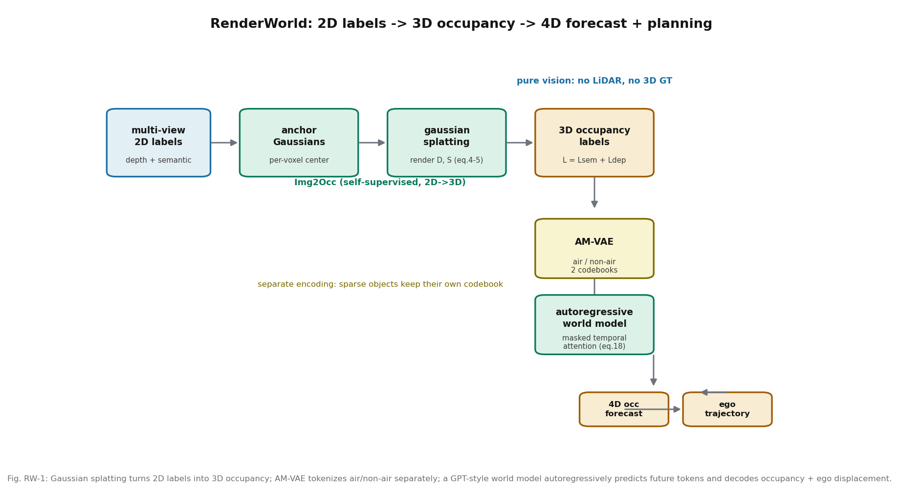

# 没有 3D 标注，就把 2D 标签"渲染"成 3D：RenderWorld 的自监督占据世界模型

**论文**: RenderWorld: World Model with Self-Supervised 3D Label
**作者**: Ziyang Yan, Wenzhen Dong, Yihua Shao, Yuhang Lu, Haiyang Liu, Jingwen Liu, Haozhe Wang, Zhe Wang, Yan Wang, Fabio Remondino, Yuexin Ma
**venue**: ICRA 2025（arXiv 注明 "Accepted in 2025 IEEE International Conference on Robotics and Automation (ICRA)"；IEEE Xplore 记录 11127609 与第三方 ICRA 2025 论文列表可佐证）
**链接**: https://arxiv.org/abs/2409.11356
**代码**: 未找到官方代码（多个论文列表的代码栏均为空）
**一句话核心洞见**: 3D 占据标注贵、NeRF 自监督吃显存，两头堵；RenderWorld 用高斯溅射把 2D 语义/深度标签可微渲染成 3D 占据伪标签，再把"空气"和"非空气"分开编码，让自回归世界模型同时做 4D 占据预测和运动规划——纯视觉输入做到接近用 3D 真值的精度。

---

## 一个具体的两难

2024 年，3D 占据预测分两拨。一拨用 3D 真值监督（CTF-Occ，mIoU 28.53），精度高但标注贵到没法规模化。另一拨用 2D 标签自监督：OccNeRF（NeRF 路线）mIoU 只有 9.53，SelfOcc 9.30——精度崩了；GaussianFormer 改用稀疏高斯，显存压到 6229M，但 mIoU 也掉到 19.10。NeRF 的问题是连续隐式场 + ray sampling，表 V 里 OccNeRF 的显存是 79000M，A30 上根本跑不动；稀疏高斯省了显存，代价是语义信息被稀释。

RenderWorld 盯的就是这个缝：**能不能既不要 3D 真值，又保住精度，还不爆显存？** 答案是 27.87 mIoU（纯 2D 输入），只比用 3D 真值的 CTF-Occ 低 0.66 个点。

## 作者的底牌

时间点很关键：3D Gaussian Splatting 是 2023 年 8 月的工作，到 2024 年 9 月 RenderWorld 投稿时，GS 正是最热的显式 3D 表示——可微、快、显存友好。作者的赌注是：GS 不只用来做新视角合成，它可以直接当"2D 监督 → 3D 标签"的桥梁。Scaffold-GS（2024）已经证明了 anchor 初始化能让高斯变密、表达力上去，RenderWorld 把这套搬到占据预测。

第二张牌是 OccWorld（ECCV 2024）刚把"占据 token + 自回归世界模型"这条路走通。RenderWorld 不需要发明世界模型，只需要解决"占据标签从哪来"和"token 怎么编更好"。

## 方法还原：三段式

### 第一段：Img2Occ，用渲染把 2D 标签变成 3D

输入是多视角图像。先用预训练的 BEVStereo4D backbone + Swin Transformer 提 2D 特征，再用已知的内外参把特征插值到 3D 空间，得到 volume 特征。然后关键的一步：在**每个 voxel 中心放一个带可学习 scale 的 anchor 点**，把 voxel 特征"高斯化"——每个 anchor 变成一个 3D 高斯，由中心 $\mu$ 和协方差 $\Sigma$ 描述，语义标签决定它的"颜色"。

$$\Sigma = RSS^TR^T, \quad \Sigma' = JW\Sigma W^TJ^T$$

协方差分解成旋转 $R$ 和缩放 $S$（保证半正定），再投影到 2D（$J$ 是投影的仿射近似雅可比，$W$ 是视角变换）。然后沿着射线做 alpha blending，把排好序的高斯"压"成每个像素的深度 $D$ 和语义 $S$（公式 4-5，和 NeRF 的体渲染是同一个数学形式，只是基元从 MLP 换成了高斯）。

损失是 $L_{i2o} = L_{sem} + L_{dep}$：语义用交叉熵；深度用 **Pearson 相关系数** $Corr(\bar d, d) = Cov/\sqrt{Var\cdot Var}$，而不是 L1/L2。这个选择值得停一下：渲染深度的绝对尺度经常对不准（scale ambiguity），L1 会逼模型去拟合一个对不准的尺度；Pearson 只要求"相对深浅关系对"，对尺度/偏移不变，监督信号更干净。这是一个小但内行的选择。

训好之后，用这个模块的 checkpoint 给所有帧生成 3D 占据标签，后面就不再需要 2D 了。

### 第二段：AM-VAE，空气和非空气分开编码

标准的 VQ-VAE 把占据整体编码，问题是：场景里 90% 以上的 voxel 是空气（空），非空 voxel（车、墙、地面）是少数。一个 codebook 要同时表示"空"和"各种物体"，容量被空气占了大头，物体的粒度就粗了。

AM-VAE 的做法是**两个 VQ-VAE**：$s_{Air}$ 和 $s_{N-Air}$ 各自有自己的 codebook $C_{Air}$、$C_{N-Air}$（公式 8-9）。重建时用一个 mask 合并（公式 13）：$\hat o = \hat o_{Air}\cdot mask + \hat o_{N-Air}\cdot(1-mask)$，其中 $mask = (\hat o_{Air} \ne 0)$。大白话：air 分支只回答"这里是不是空的"，non-air 分支只操心"有东西的话是什么、长什么样"，两者各干各的，互不抢码本容量。

消融（表 VI）验证了这个直觉：baseline 35.13 → 只加 mask 37.68 → mask + 分开编码 40.25。注意只加"分开"不加 mask（35.42）几乎没提升——**分开编码必须配合 mask 合并机制才有意义**，单独拆 latent 是不够的。

### 第三段：自回归世界模型，同时预测未来和轨迹

沿用 OccWorld 的设计：占据 tokenizer 把 3D 场景变成离散 token $T$，再加一个 vehicle token $z_0$ 编码自车位置。世界模型 $w(T_T,\dots,T_{T-t}) = T_{T+1}$，多尺度 token $\{T_0,\dots,T_K\}$ 每个尺度一个子世界模型做 masked temporal attention（公式 18）。预测出的 token 解码回 3D 占据 $\hat y_{T+1} = d(\hat z_{T+1})$，vehicle token 解码成自车位移 $\hat p_{T+1} = d_{ego}(\hat z^T_{0})$。

训练分两阶段：先训 tokenizer（$L_{soft} + \lambda_1 L_{lovasz}$），再训 world model（token 分类 CE + $\lambda_2$ 轨迹 L2）。两阶段、$\lambda_1$、$\lambda_2$ 的具体值论文正文没给——这是复现时会卡住的地方，记下来。

*图 RW-1：高斯溅射把 2D 标签变成 3D 占据；AM-VAE 把空气/非空气分开 token 化；GPT 式世界模型自回归预测未来 token，解码出占据和自车位移。*

## 数字

**3D 占据预测**（表 I，Occ3D-nuScenes 验证集）：RenderWorld mIoU 27.87，第二名，仅次于用 3D 真值的 CTF-Occ（28.53）。环境类别（vegetation 24.23、terrain 22.75、sidewalk 50.12）全场最好——高斯表示对"面状"环境元素确实友好。但注意 car 类只有 29.92，远低于 CTF-Occ 的 42.24：**车这种小而关键的动态物体，恰恰是它的弱项**。读"第二名"这个结论时要同时看这一行。

**4D 占据预测**（表 II）：3D-Occ 输入时 avg mIoU 20.80 vs OccWorld 17.14，IoU 30.08 vs 26.63，显存 13000M vs 13500M——全面小胜。Camera 输入时 2.58 vs OccWorld-S 的 0.26，"远超"没错，但**绝对值 2.58% 说明纯视觉 4D 占据预测本身还处在能用/不能用的边界上**，这个语境不能丢。

**运动规划**（表 III）：3D-Occ 输入 L2 avg 1.03m vs OccWorld 1.17m；collision rate 0.61% vs 0.60%——基本打平，规划的增益主要来自预测准了，而不是规划头本身有创新。Camera 输入 L2 1.48m vs OccWorld-S 1.83m；作者诚实地写了"competitive"，因为 UniAD（1.03m）用了一堆辅助监督，赛道不同。

**显存**（表 V）：RenderWorld 14400M（64 万高斯）vs OccNeRF 79000M——省 5 倍多；但 vs GaussianFormer 6229M 是 2.3 倍。作者的表述是"我们没为了省显存而砍高斯点数丢语义"，这个 trade-off 讲清楚了，不算吹牛。

**Tokenizer 超参**（表 IV）：(空间分辨率 50², 通道 128, 码本 512) 最好；码本 1024 反而掉（过拟合）；空间分辨率 25² 时 planning L2 直接崩到 6.04——token 太粗，规划头拿不到几何细节。这组消融其实在讲一件事：**表示的粒度同时卡着预测和规划的脖子**。

## 怀疑式审读

**两个显存数字对不上**。表 II 里 RenderWorld 的 Memory 是 13000M，表 V 里是 14400M。同一个方法，差了 1400M。可能的解释（我的推断）：表 II 是 world model 部分的，表 V 是 Img2Occ + 全流程的；但论文没解释，读者只能猜。审稿人应该问过，作者没改。

**没有闭环评估**。全文的"规划"都是开环 L2 + collision rate，没有 CARLA 闭环分数。4D 占据预测准 ≠ 开得好，这个 gap 论文没有讨论。对于 RAMP 这种要上 Bench2Drive 闭环的课题，引用时要清醒：RenderWorld 的证据全是开环的。

**没有 latency 数字**。引言说 Gaussian Splatting "greatly improves... reduces GPU memory"，但全文没有 FPS/延迟表。自回归世界模型逐 token 预测的开销，在车端实时性上是个问号。

**"自监督"的成色**。Img2Occ 的 2D 语义/深度标签是"把带 3D 分割标注的 lidar 点云投影到 2D"得到的（4.1 节原话）。也就是说，2D 标签本身是从 3D 标注派生的——这不是无标注自监督，而是"把 3D 标注费从 3D 搬到 2D"的工程技巧。在 nuScenes 上成立，因为 nuScenes 有 lidar 分割标注；到一个只有相机、没有 lidar 标注的新数据集，这套就转不动。论文标题里的 Self-Supervised 要打个折扣理解。

**GaussianFormer/GaussianOcc 的对比口径**。表 I 里 GaussianOcc mIoU 9.94、GaussianFormer 19.10，RenderWorld 27.87。但 GaussianOcc 是 fully self-supervised（连 2D 语义标签都不要，用 6D pose 网络），监督信号比 RenderWorld 弱得多。把不同监督强度的方法放一张表比 mIoU，结论"我们更好"是对的，但"为什么更好"里监督强度的贡献没被剥离。

做得好的地方：表 VI 的消融把"分开编码必须配 mask"这个条件讲清楚了；car 类弱于 CTF-Occ 这种不好看的数字没有藏；camera 输入的 2.58% 这种"赢了但绝对值难看"的数字也如实给了。

## 与 RAMP 的血缘/划界

**血缘**：RenderWorld 的世界模型输出（未来占据 token + 自车位移）是 RAMP 世界模型"中间分布"的一种具体形态——如果 RAMP 的风险校验需要"未来几秒的空间占据"作为输入，RenderWorld 的 4D 占据预测就是现成的表征参考。AM-VAE"空气/非空气分开"的动机（别让多数类吃掉表示容量）和 RAMP"风险加权"（别让低风险吃掉记忆容量）在哲学上是同一句话：**表示资源应该向决策相关的东西倾斜**。

**划界**：三条。第一，RenderWorld 是开环的预测+规划，没有闭环风险校验、没有记忆、没有调度器，和 RAMP 的 agentic 编排不在一个层。第二，它的自回归 token 预测是逐帧滚的，有累积误差（BEVWorld 第 142 篇正是拿"扩散一次生成"来打这个点）；RAMP 的"单次前向复用"走的是另一条 latency 路线。第三，它的"自监督"依赖 lidar 派生的 2D 标签，RAMP 若借鉴 Img2Occ 思路，需要确认数据源（仿真器里 BEV mask 免费，参考 SEM2 第 138 篇的讨论）。引用定位："自监督占据标签 + 占据世界模型"的技术路线参考，RAMP 的风险校验若用占据做中间表示，这篇是必引的 baseline 之一。
