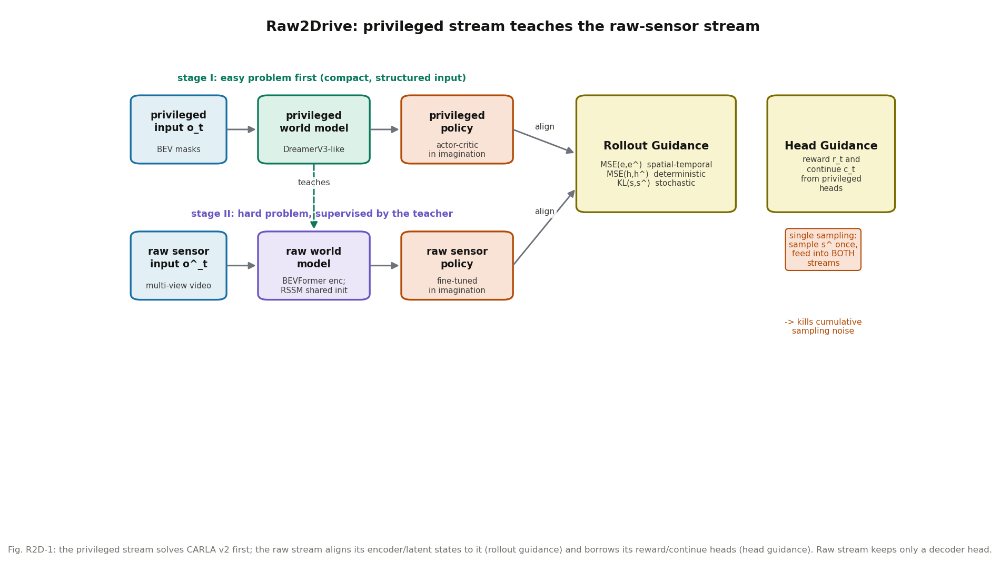

# 先训一个"开卷考"的老师，再扶着学生上路：Raw2Drive 的双流对齐 MBRL

**论文**: Raw2Drive: Reinforcement Learning with Aligned World Models for End-to-End Autonomous Driving (in CARLA v2)
**作者**: Zhenjie Yang, Xiaosong Jia, Qifeng Li, Xue Yang, Maoqing Yao, Junchi Yan（上交 + 复旦可信具身智能所 + AgiBot）
**venue**: NeurIPS 2025（arXiv 注明 "Accepted by NeurIPS 2025"；正文页脚亦为 39th Conference on NeurIPS 2025；待官网程序册最终核实）
**链接**: https://arxiv.org/abs/2505.16394
**代码**: 官方仓库已建（Thinklab-SJTU/Raw2Drive，README 确认 "Official inference code"），但截至 2026-10-11 仅含 README，训练代码未公开
**arXiv 号纠错**: arXiv:2505.16394 曾被误标为 HERMES。经 arXiv API 核实：**2505.16394 的真正主人是本篇 Raw2Drive**（Zhenjie Yang 等，2025-05-22 发布）；HERMES 另有其号，为 **arXiv:2501.14729**（"HERMES: A Unified Self-Driving World Model for Simultaneous 3D Scene Understanding and Generation"，2025-01-24 发布）。MUVO 正文引用 HERMES 时用的也是 2501.14729，可交叉印证。本文档及后续引用请用 2505.16394 = Raw2Drive。
**一句话核心洞见**: 原始传感器 MBRL 训不动（高维冗余、奖励头训崩），特权 MBRL（Think2Drive）训得动但上不了真车；Raw2Drive 先在"开卷"（BEV 语义真值）的特权流上训出老师，再用 rollout 对齐 + 头部借用两套机制，把"闭卷"（纯多目视频）的学生流扶起来——CARLA v2 和 Bench2Drive 上唯一的 RL 端到端方法。

---

## 一张表看出的格局变化

CARLA Leaderboard 2.0（表 3，Town13 validation/devtest，Driving Score）：UniAD 0.15/0.00，VAD 0.17/0.00，DriveTrans（ICLR 2025）0.85/0.68——IL 全军覆没。Raw2Drive 4.12/3.56。数字本身不大，但**在 v2 上非零就是从无到有**：v2 有 39 个 corner case 长路线，IL 的 L2/L1 训练在 ParkingExit 这种大转角场景直接学不会。

Bench2Drive（表 5，220 条短路线闭环）：Raw2Drive DS 71.36、成功率 50.24%，DriveTrans 63.46/35.01%，DriveAdapter 64.22/33.08%。而用特权的 Think2Drive 是 91.85/85.41%——**raw 和 privileged 之间还差 20 个点**，这就是 Raw2Drive 给自己定的天花板，也是它没走完的路。

## 前人撞墙的地方：两条死路

第一条，model-free RL（MaRLn，CVPR 2020）：50M 步、57 天，训不收敛，性能还不如同期 IL。高维图像输入 + 稀疏奖励，model-free 的采样效率撑不住。

第二条，MBRL + 特权输入（Think2Drive，ECCV 2024）：用 BEV 语义 mask 这种紧凑、结构化的输入，DreamerV3 那套在 v2 上跑通了。但特权输入是仿真器给的真值，真车上没有——论文里叫 "cannot be directly applied in real-world AD"。

Raw2Drive 要走的第三条路——MBRL + 原始传感器——死在哪，作者在 4.4 节用消融讲得很具体。Raw 流如果照抄 DreamerV3 的三个头（decoder + reward + continue），DS 从 83.5 掉到 34.5（表 6，Dev10）。原因：视频里相邻两帧几乎一模一样，但 reward 和 continue（是否结束）可能突变——比如碰撞那一帧和前一帧画面几乎没差，标签却从 0 变 1。网络被这种"输入一样、标签乱跳"的监督搞得无法收敛。**标量头在原始传感器流上是毒药**，这是全文最反直觉、也最实在的一个发现。

## 作者的底牌

三张牌。第一，Think2Drive 是同组（Junchi Yan 组）的工作，phase I 的特权流可以直接复用——论文明说复用 Think2Drive 可把成本从 64 省到 40 GPU days。第二，BEVFormer 的 encoder 输出的是 BEV 网格特征，和特权流的 BEV mask 在空间上天然对齐，"学生"和"老师"说同一种空间语言，对齐损失才有意义。第三，CARLA v2 的评估协议短板（长路线累积惩罚、碰撞即停）恰好是短路线 Bench2Drive 能绕开的，而短路线正是 RL 擅长的。

## 方法还原：双流 + 两套引导

记号（表 2）：特权流 $o_t \to e_t = Enc(o_t) \to h_t, s_t$，原始流 $\hat o_t \to \hat e_t = \hat{Enc}(\hat o_t) \to \hat h_t, \hat s_t$。①是训练时的递推（用 replay buffer 里的真实动作），②是推理时的递推（用策略的动作）。

**特权流**（3.1）：输入是时序 BEV 语义 mask（跟 Roach/Think2Drive 同款），世界模型照抄 DreamerV3（Encoder + RSSM + 三个头：Reward、Decoder、Continue），策略是 actor-critic，在想象中训。这部分没有新东西，新的全在下面。

**原始流**（3.2）：输入是多目视频 + IMU，encoder 用 BEVFormer（输出 BEV 网格特征，方便被特权流指导）。RSSM 参数**从特权流初始化**——不是随机初始化，这是"扶"的第一步。Head 只留 **decoder** 一个，重建的是 BEV 语义 mask，不是视频。也就是说，原始流的世界模型被训练成："看视频，想出和老师一样的 BEV 世界"。重建视频那个计算量大、信息冗余的任务，直接扔掉。

**Rollout Guidance**（3.3，公式 1）：

$$L_{Rollout} = \beta_e \sum_t\sum_{i=0}^{grid} MSE(e^i_t, \hat e^i_t) + \sum_t\left(\beta_s KL(s_t,\hat s_t) + \beta_h MSE(h_t,\hat h_t)\right)$$

三项各管一摊：encoder state 的 MSE 管空间-时间对齐（BEV 网格逐格对）；deterministic state 的 MSE 管自车意图一致；stochastic state 的 KL 管周围交通参与者的随机性一致。表 7 的消融显示三项缺一不可：全关 DS=0（车只会直行和左转）；只开 encoder 36.4；再加 deterministic 38.3；**加上 stochastic 对齐直接跳到 83.5**——随机状态的对齐是最大的一块增量。直觉是：deterministic 管自车，相对好学；stochastic 管"别人会不会急刹"这种多模态不确定性，不对齐的话，学生的想象和老师的想象说的根本不是一件事。

**单次采样技巧**（图 6c，全文最巧的工程点）：标准 RSSM 在 rollout 时每一步都要从随机状态分布里采样。如果双流各采各的，采样的随机性差异会随时间累积，到后面几步，老师的 state 和学生的 state 已经不在同一个世界里，对齐损失变成噪声。作者的做法：**只从原始流的分布采样一次，把采样到的 $\hat s$ 直接喂给特权流去递推它的下一步**。一次随机性，两处消费。双流的随机源被强制同步，累积误差从根上消除。

**Head Guidance**（图 5）：原始流不训 reward/continue 头（训了会崩，见表 6），那策略训练时的奖励从哪来？直接用特权流的头算：原始流 rollout 到 $\hat s_t$，特权流在**同一个对齐后的状态**下 rollout，它的 reward head 给出 $r_t$、continue head 给出 $c_t$，拿来训练原始策略。这叫 "pseudo-deduction"——奖励是老师"代算"的。因为 rollout 对齐保证了双流状态一致，老师算出的奖励对学生就是准的。另外还用训好的特权策略去采集 replay buffer、并把动作分布蒸馏给原始策略。

训练流程（附录算法 1）：Stage I 特权流 MBRL（世界模型和策略交替更新）；Stage II 原始流在 guidance 下训练世界模型（$L_{\hat{WM}} = L_{WM} + L_{Rollout}$），策略则在原始世界模型里想象、拿老师的头做奖励，做 fine-tune。

*图 R2D-1：特权流先解出 CARLA v2；原始流通过 rollout 对齐（三项损失）向它看齐，并借用它的 reward/continue 头。原始流只保留 decoder 头；单次采样消除双流随机性累积。*

## 数字与代价

**成本**：64 H800 GPU days 交出最终 planner；复用 Think2Drive 则 40 天。对比 UniAD 约 30 天但"只能解 3~4 个 corner case"。注意卡型号：UniAD 的 30 天是什么卡论文没写，H800 和 A100 差一截，直接比天数要打折扣——论文没提这点，记下来。

**延迟**：world model 和 policy 各 <2ms，瓶颈在视觉 encoder（BEVFormer）。这对 RAMP 是个好消息：世界模型本身很便宜，贵的是编码器——"单次前向复用"的优化空间正在这里。

**规划质量**：表 5 里 Efficiency 214.17 全场最高，但 Comfort 22.42 远低于 MomAD 的 48.63——RL 开得快但不舒服，"用舒适性换成功率"是 RL 驾驶的通病（ReCogDrive 精读里也见过同样的 trade-off）。

## 怀疑式审读

**"第一"和"唯一"的限定词**。 "first MBRL framework for E2E-AD, i.e. from raw image input to planning"——MaRLn 是 model-free + raw，Think2Drive 是 MBRL + privileged，LAW 是 IL+SSL。把"MBRL + raw + 端到端"三个限定词全加上，这个"第一"成立。但"so far the only RL based end-to-end method on CARLA Leaderboard 2.0 and Bench2Drive"是以 2025 年 5 月为界的，之后有没有来者，要持续看。

**评估协议的选择**。作者在 4.3 节花了一大段论证"CARLA v2 长路线评估不公平"（ParkingExit 首场景、碰撞即停），然后把主战场设在 Bench2Drive 短路线。这个论证本身是对的（Bench2Drive 论文也这么说），但短路线恰恰是对 RL 最友好的协议：单场景、无长程累积惩罚、每个场景独立打分。IL 在长路线上的"稳"和 RL 在短路线上的"莽"，协议选择本身就有立场。读表 3（4.12 vs 0.85）和表 5（71.36 vs 63.46）时要带着这个意识。

**消融的统计口径**。表 6–11 用 Dev10（10 条路线），每个实验重复 3 次取平均，但**没有给标准差**。83.5 vs 53.2 这种差距不怕方差；但表 7 里 38.3 vs 36.4（加不加 deterministic 对齐）这种 2 个点的差距，在 10 条路线 × 3 次重复下很可能不显著。作者把三项说成"缺一不可"，deterministic 这一项的证据其实是弱的。

**超参数黑洞**。公式 1 里的 $\beta_e, \beta_h, \beta_s$ 正文没给值；附录算法 1 里 $L_{WM} = \beta_{pred}L_{pred} + \beta_{dyn}L_{dyn} + \beta_{rep}L_{rep}$ 的权重也没给。复现时这三个数得自己搜。

**特权输入的现实边界**。Limitation 里承认：特权是 GT bbox + HD-Map，现实里要靠人工标注或感知算法。这和 SEM2（第 138 篇）的 BEV mask 问题是同一个边界。Raw2Drive 没有解决"老师从哪来"的现实问题，它解决的是"有老师怎么教学生"。

**Head guidance 的耦合风险**。奖励是老师代算的，代算的准度完全依赖 rollout 对齐的质量。如果对齐在某个 corner case 崩了，学生拿到的奖励就是错的，还蒙在鼓里——因为学生自己没有 reward head 做交叉验证。表 9 显示 head guidance 带来小幅提升（34.5 vs 26.4），但这是在"三个头全训"的退化配置下测的；最终配置（decoder only + head guidance）的 83.5 里，head guidance 的净贡献没有单独剥离。

做得漂亮的地方：表 6"标量头是毒药"的发现是真金子，而且作者没有为了故事完整硬留那两个头，直接砍掉——很多论文会舍不得；单次采样消除累积随机性是一个"想不到但想通了就觉得必然"的设计；主动承认长路线评估的缺陷而不是只报喜。

## 与 RAMP 的血缘/划界

这是五篇里和 RAMP 血缘最近的一篇，值得把异同写准。

**血缘有三条**。第一，"一次随机性、两处消费"：Raw2Drive 的单次采样（sample $\hat s$ 一次，喂给双流递推）和 RAMP 的"世界模型单次前向、中间分布被风险校验和记忆检索两个消费者复用"，在工程哲学上是同构的——都是为了省一次昂贵的前向/采样，让多个下游共享同一次随机性的结果。第二，"决策要的表示 ≠ 重建要的表示"：Raw2Drive 让原始流只重建 BEV mask、不重建视频；RAMP 让风险校验只消费中间分布、不走完整解码。都是"下游按需取用，不为重建买单"。第三，Bench2Drive 71.36/50.24 是 RAMP 未来闭环实验的**直接可比 baseline**——同一个 benchmark，ICAPS 审稿人会拿这个数卡 RAMP。

**划界有三条**，每一条都决定 related work 里怎么写。第一，Raw2Drive 的对齐发生在**训练时**、是离线的、需要一个特权老师；RAMP 的复用发生在**推理时**、每次前向都发生、不需要老师。一个回答"怎么训出 raw sensor 的世界模型"，一个回答"训好之后怎么一次前向多用"——训练 vs 推理，井水不犯河水。第二，Raw2Drive 的双流是两个世界模型（参数量 double），RAMP 是单个世界模型的一次前向——"双流对齐"不等于"单次前向双消费者"，写 related work 时不能把两者混成"都是复用"。第三，Raw2Drive 没有记忆机制、没有多规划器、没有 LLM 调度，它的"智能"全在训练流程里；RAMP 的 agentic 编排（调度+记忆+校验）是另一层。准确的引用定位是："特权对齐训练世界模型"的代表工作，RAMP 在此基础上把"复用"从训练搬到推理，并加了闭环校验。
