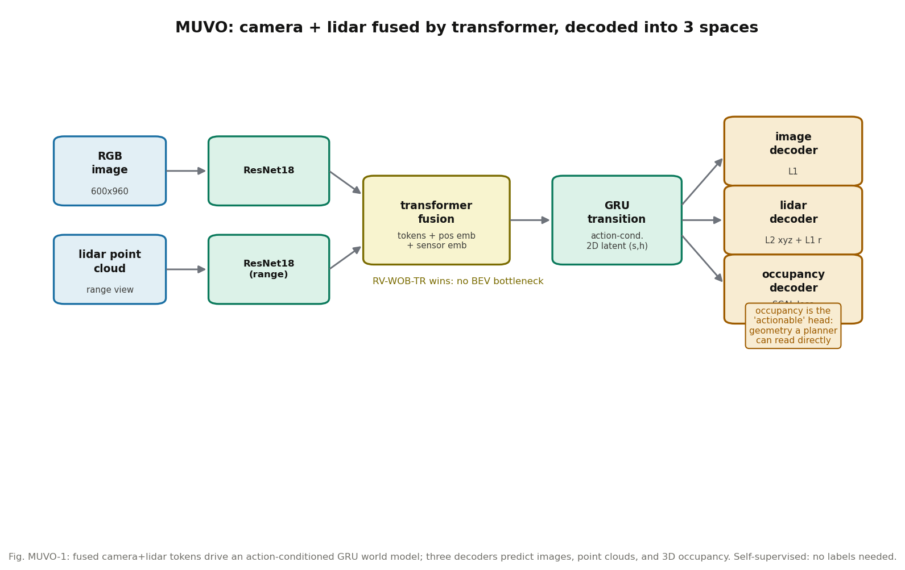

# 别让 BEV 吃掉高度信息：MUVO 的多模态融合实验

**论文**: MUVO: A Multimodal Generative World Model for Autonomous Driving with Geometric Representations
**作者**: Daniel Bogdoll, Yitian Yang, Tim Joseph, Melih Yazgan, J. Marius Zöllner（FZI + KIT，德国）
**venue**: IV 2025（arXiv 注明 "Accepted for publication at IV 2025"；IEEE Xplore 会议记录 11097718，DOI 10.1109/IV64158.2025.11097718）
**链接**: https://arxiv.org/abs/2311.11762
**代码**: 官方代码已克隆到本目录 `code/`（github.com/fzi-forschungszentrum-informatik/muvo），与正文核对一致：`muvo/models/mile.py` 用 6 层 TransformerEncoder 做融合，`muvo/losses.py` 有 VoxelLoss/SemScalLoss/KLLoss/SegmentationLoss/RegressionLoss，与正文公式 1 的五项损失对应
**一句话核心洞见**: 当时多模态世界模型流行经 BEV 融合（BEVWorld、HoloDrive），但 BEV 把 3D 压成 2D 丢了高度，是瓶颈；MUVO 用 transformer 直接融合相机特征和 lidar 的 range view（无损），配 2D 隐状态和 3D 占据解码头，用一整套消融证明：不经过 BEV 也能做多模态世界模型，而且加上占据预测后，图像和点云的预测反而变好。

---

## 一个反共识的实验结果

2023 年底，BEV 几乎是多模态融合的默认答案：图像特征 lift 到 3D、压成 BEV，lidar 也转成 BEV 伪图像，两边在 BEV 空间相遇（BEVWorld 就是这么干的）。MUVO 的图 3a/3b 显示：**加了 BEV mapping 的图像编码器，在图像预测（PSNR）上全面变差**，和 PointPillars 组合时尤其惨。而 range view（lidar 的圆柱投影，无损）+ 不做 BEV mapping（WOB）+ transformer 融合（RV-WOB-TR）这组，在相机预测上最好或持平最好。

这个结果值得停下来想：BEV 在检测/分割任务上是好表示，但在"世界模型要预测未来原始传感器"这个任务上，BEV 的高度压缩是信息损失——解码器要从压扁的特征里恢复 3D，难。MUVO 整篇论文其实就是围绕这一个判断展开的：**融合不应该经过一个有损的瓶颈**。

## 作者的底牌

作者在 3.0 节开头就明说了：实验架构 follow MILE（Wayve 的工作），"much reduced in complexity compared to other approaches"。这是一个聪明的选择：模型越简单，消融的归因越干净。8 种编码器-融合组合（PP/RV × BEV/WOB × AVG/FC/TR）全跑一遍，靠的是 CARLA 数据随便采（4 towns × 4 weathers，10FPS，25×300s = 30 万帧）和全自监督（不要任何标注）。**低成本实验 + 简单架构 = 敢做大消融**，这是这篇论文的方法论底气。它不是一篇"我刷了 SOTA"的论文，而是一篇"我把融合策略这件事测明白了"的论文——IV 这种偏应用的会吃这一套。

## 方法还原

**编码**：前视 RGB $I \in \mathbb{R}^{3\times600\times960}$；lidar 点云（最多 6 万点）投影成 2D cylindrical range view $R \in \mathbb{R}^{4\times H_r\times W_r}$——圆柱投影是双射、无损的，这是它和 PointPillars（体素化，有损）的本质区别。两边都用预训练 ResNet18 提特征，多层融合得到 $F_c, F_L$。

**融合**：把 H、W 展平成 token，加上 2D sinusoidal 位置编码 $e$（空间归纳偏置）和可学习的 sensor embedding $s$（告诉 transformer 这是哪个传感器的 token），拼起来喂进 k 层 transformer encoder，自注意力做跨模态交互。对比的 AVG（各模态压成 1D 向量再平均）和 FC（拼接+全连接）都是文献里的朴素做法。

**Transition**：输入融合特征 $o_{0:t}$ 和 MLP 编码的动作 $a_{0:t}$（油门/方向，假设有个 planner 给动作）。输出随机状态 $s$ 和确定性历史 $h$，$h_{t+1} = f_\theta(h_t,s_t)$ 用 GRU。后验 $q(s_t|o_{\le t},a_{<t})$、先验 $p(s_t|h_t,a_{t-1})$ 都是对角高斯（MLP 建模均值方差；有观测时从后验采样，预测时从先验采样）。关键改动：隐状态是 **2D** 的（$C \times \sum_j T_j$），GRU 的全连接换成卷积，概率模型用 transformer decoder（learnable embedding 做 query，$h_t,a_t,(o_t)$ 拼起来做 key-value）。图 4 证明 2D 隐状态是全文提升最大的一项：相机预测和占据预测的误差明显下降，lidar 没收益（作者的解释：相机数据比 lidar 复杂得多，更需要表示容量——合理）。

**解码**：三头。相机头输出 RGB（L1）；lidar 头输出 range view（xyz 用 L2，range 用 L1）；占据头输出 $192\times192\times64$（0.5m voxel）的二值占据，用 Scene-Class Affinity Loss（SCAL，来自 MonoScene）。总损失（公式 1）在 1/2/4 三个下采样尺度上算：

$$L = \sum_i \lambda_i\big(\lambda_{img}L^i_{img} + \lambda_{pcd}(L^{i,xyz}_p + L^{i,r}_p) + \lambda_V L^i_{V,scal}\big)$$

训练 5 万步预训练（只预测相机+lidar）→ 再开占据头。batch 16，AdamW，lr $10^{-4}$，weight decay 0.01。序列 12 帧（0.2s 间隔），验证时 6 帧做条件、6 帧做真值；开占据重建时序列减到 6 帧省算力。

**数据与评估协议**：$D^{RL}_{val}$（同分布，测表示学习）和 $D^{DS}_{val}$（新天气，测 domain shift）两个验证集。指标：图像 PSNR、点云 Chamfer、占据 IoU/Precision/Recall（分 IoU+ 占据 voxel 和 IoU- 空 voxel）。

*图 MUVO-1：相机+lidar 经 transformer 融合，动作条件的 GRU 世界模型 rollout，三头分别解码图像、点云、3D 占据。全自监督，无需标注。*

## 三组实验分别回答什么

**融合策略（图 3）**：8 种组合。图像预测：RV-WOB-TR 最好或持平；range view 全面胜过 PointPillars；BEV mapping 让图像变差。点云预测：transformer 融合也普遍好，但在 $D^{DS}_{val}$（新天气）上掉得比别的组合多——**transformer 融合的泛化性稍弱**，这是一个诚实的不利结果。结论：无损 lidar 表示 + 标准 transformer 融合 + 2D 隐状态是最优组合，但"最优"主要体现在相机上。

**占据预测（图 5）**：三个场景。NPT（从零训）后期在 Precision 上反超 PTO（预训练开权重）；PTO 在 IoU- 和 Recall 上保持领先；PTF（冻结预训练权重、只训 voxel decoder）最差但随训练缓慢变好——证明**只做相机+lidar 预测的预训练权重里，已经有一点空间几何信息**，但不多。作者的结论是"预训练总体推荐：省时间、早期好"，这个表述是克制的，没有 overclaim。

**占据对传感器预测的反哺（图 6）**：加上占据头，相机和点云的预测**小幅**变好，$D^{RL}_{val}$ 下相机提升更明显。注意是"小幅"——占据提供的几何约束有用，但不是质变。论文没有夸大这一点。

## 怀疑式审读

**"几何表示可直接被规划使用"没有证据**。摘要和引言都说占据预测 "highly actionable"、"can directly be used by downstream tasks such as planning"，但全文**没有任何规划实验**——没有把占据喂给 planner 看开得怎么样。任务描述里的"几何占据表示可直接被规划使用"是作者的 claim，不是实证。引用时要降级为"作者假设"，不能当结论用。

**纯 CARLA，无真实数据**。作者在 conclusion 里自己承认了，future work 是真实数据。PSNR/Chamfer 这些重建指标在合成数据上的好坏，迁移到真实传感器的噪声特性上要打折。

**2D 隐状态的代价没给**。2D token 数量大，显存/算力开销论文没量化。"表示容量大→效果好"这个结论里，算力变量没有被控制。

**负结果是诚实的**：perceptual loss 几乎没用（图 4，"visually poorer reconstructions"都写了）；ViT backbone 只对图像好、别的指标没动；transformer 融合在 domain shift 下掉得多。这些不好看的都给了，这是这篇论文可信度的主要来源。

**和 BEVWorld 的直接矛盾**：BEVWorld（第 142 篇）恰恰用 BEV 做统一表示且效果不错。两篇的结论打架吗？不完全：BEVWorld 的 BEV 是 4 通道压缩 latent + 体素 lift 回 3D 做渲染，它用"升维渲染"绕过了 BEV 的高度丢失；MUVO 测的是"朴素 BEV mapping"。两篇合在一起的教训是：**BEV 本身不是原罪，有没有办法把高度信息找回来才是**。

## 与 RAMP 的血缘/划界

**血缘**：MUVO 是"占据作为世界模型输出"的早期实证，RAMP 的风险校验如果需要"未来占据"这种中间表示，MUVO 提供了两个直接证据——占据头不伤害反而小幅帮助传感器预测（图 6），以及 2D 隐状态对空间预测至关重要（图 4）。它的"无损表示 + transformer 融合"结论，对 RAMP 的多源输入（如果有）融合方式选择有参考价值。

**划界**：MUVO 是纯预测世界模型，没有规划、没有记忆、没有调度，更没有闭环——它的输出从来没被用来开过车。RAMP 要的是"能指导决策的未来表示"，MUVO 只证明了"能预测的未来表示"。引用定位："多模态融合策略"的实证参考（RV-WOB-TR 那组结论），以及"占据表示"的 related work；不能引为"占据可直接用于规划"的证据，因为它自己没做规划实验。
