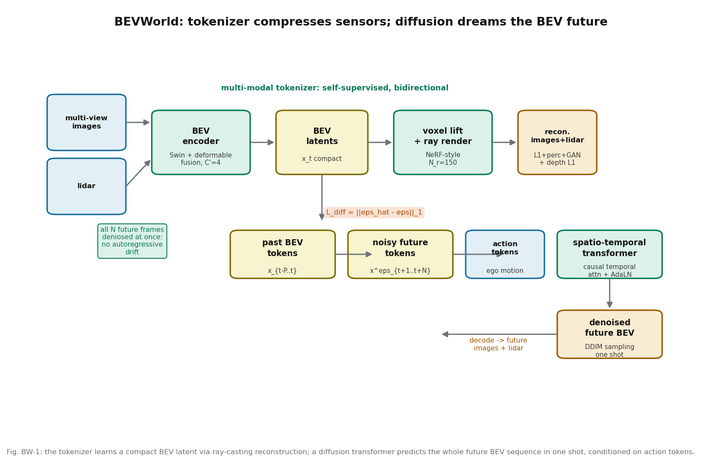

# 别一帧一帧滚，一次把未来全去噪出来：BEVWorld 的扩散式世界模拟器

**论文**: BEVWorld: A Multimodal World Simulator for Autonomous Driving via Scene-Level BEV Latents
**作者**: Yumeng Zhang, Shi Gong, Kaixin Xiong, Xiaoqing Ye, Xiaofan Li, Xiao Tan, Fan Wang, Jizhou Huang, Hua Wu, Haifeng Wang（百度）
**venue**: arXiv（v1 2024-07-08；v3 2025-04-30；截至 2026-10-11 未见正式发表记录，按 arXiv 引用）
**链接**: https://arxiv.org/abs/2407.05679
**代码**: 官方仓库已建（github.com/zympsyche/BevWorld，2024-07-01 创建，早于论文发布；正文 v2 注明 "Code will be available at https://github.com/zympsyche/BevWorld"，v3 改为 "Code will be released soon"），已克隆到本目录 `code/`，含 demo；训练代码未见公开
**一句话核心洞见**: 自回归世界模型逐帧往前滚，误差随 horizon 累积；BEVWorld 把多模态传感器压成紧凑的 BEV latent（自监督体素渲染重建保证几何不丢），再用扩散模型"一次把未来 N 帧全去噪出来"，高层动作 token 做条件——nuScenes 上 3 秒点云预测 Chamfer 0.73，比 Copilot4D（1.40）好近一倍。

---

## 自回归的累积误差长什么样

OccWorld、RenderWorld（本系列第 139 篇）都是 GPT 式的：预测 $T_{t+1}$，拿它当输入再预测 $T_{t+2}$。第 1 秒的 mIoU 28.69，到第 3 秒掉到 14.83（RenderWorld 表 II）——后段的预测吃的是自己前面造出来的 token，错上加错。BEVWorld 的赌注是：**扩散模型天生就是"多帧并行"的**，训练时给未来 N 帧统一加噪、统一去噪，测试时从纯噪声一次采样出全部未来帧，没有"拿自己的输出当输入"这个环节，累积误差无从谈起。

## 作者的底牌

百度自动驾驶部门的工业界工作，底气和学术界不一样。第一，数据：CARLA 自采 300 万帧（8 towns × 14 weathers，4 相机 1600×900 + 32 线 lidar），nuScenes 全量——"自监督、可扩展"是全文反复出现的词，因为数据管够。第二，NeRF 式体渲染做自监督重建在 2023 年已经成熟（Yang et al. 2023 的 ray-based 方法），作者直接拿来当 tokenizer 的解码器。第三，Sora/DiT（2024）证明了 transformer 扩散的可扩展性，作者赌的是同一条技术曲线。

## 方法还原：两段式

### 第一段：多模态 tokenizer，把传感器压进 BEV

编码器：图像用 Swin-Transformer 提多视角特征；lidar 先按 BEV 切 pillar，再用 Swin 提 BEV 特征。融合用 deformable transformer：lidar BEV 特征做 query，在 pillar 的高度维采 $K=4$ 个点，投影到图像上采样对应特征做 value。注意这个设计——**query 是有几何的（lidar），value 是有语义的（图像），deformable attention 只在投影点附近采样**，比全局 attention 便宜，比纯拼接准。融合后再把通道压到 $C'=4$，得到紧凑 BEV latent $x_t$。

解码器解决一个真问题：BEV 压扁了高度，直接解码回图像/lidar 有歧义。作者先把 BEV token 用"上采样 + swin blocks" lift 回 3D 体素特征，再做 NeRF 式体渲染。图像分支：从相机中心向像素发射射线 $r(t)=o+td$，均匀采 $N_r=150$ 个点，三线性插值拿特征 $v_i$，权重 $w_i = \alpha_i\prod_{j<i}(1-\alpha_j)$，$\alpha_i = \sigma(\text{MLP}(v_i))$——和 NeRF 的体渲染公式一字不差，只是密度换成了 MLP 预测的 $\alpha$。聚合出 2D 特征图再经 CNN 解码 8× 上采样到 RGB。lidar 分支：在球坐标下同样采样，渲染的是**期望深度** $D_g(r) = \sum w_i t_i$，转回笛卡尔坐标就是点云。

损失：图像 $L_{rgb} = \|I_g-I_t\|_1 + \lambda_{perc}\|\phi(I_g)-\phi(I_t)\| + \lambda_{gan}L_{gan}$（L1 + VGG 感知 + GAN），lidar 深度 L1。总损失 $L_{Total} = L_{Lidar} + L_{rgb}$，全自监督。

表 2 的消融是全文最有信息量的一张小表：(a) attention-based 渲染（几何投影靠全局 attention 隐式学）FID 67.28、PSNR 9.45，直接崩了；(b) ray-based（显式用传感器位姿）FID 5.54、PSNR 25.68。**把几何先验写进架构，比让网络自己学，便宜一个数量级**。这是一个可以迁移的教训。

### 第二段：latent BEV 序列扩散，一次生成未来

tokenizer 冻结后，把历史 BEV token $(x_{t-P},\dots,x_t)$ 做条件，未来 $(x_{t+1},\dots,x_{t+N})$ 加噪。去噪网络是 spatial-temporal transformer：先过 **causal** temporal attention（因果 mask 防时间混淆），再过 spatial attention。动作 token $\{a_i\}$（自车运动/转向）和扩散时间戳 $\hat t$ 拼成条件 $c$，经 AdaLN 调制每一层：$\text{AdaLN}(\hat x,\gamma,\beta) = \text{LayerNorm}(\hat x)\cdot(1+\gamma)+\beta$，$\gamma,\beta = \text{Linear}(c)$。损失就是 noise prediction 的 L1（公式 7）。

测试时：历史 token + 纯噪声 token 拼起来，DDIM 一次采样出全部未来 BEV token，再经 tokenizer 解码器渲染成未来图像和点云。**N 帧未来，一次推理**——这是和自回归路线最根本的区别。

训练分三阶段（nuScenes）：next-BEV 预训练（2 万 iters，batch 128）→ 短序列 5 帧（0.5s）→ 长序列 6 帧（3s key-frame，3 万 iters）。lr $5\times10^{-4}$，AdamW。**不用 classifier-free guidance**——作者明说 CFG 要多一次前向、推理成本翻倍，为了和下游任务集成，宁可不要那点生成质量。这个取舍是工业界口味。

*图 BW-1：tokenizer 用光线投射重建把多模态传感器压成紧凑 BEV latent；扩散 transformer 以动作为条件，一次去噪出全部未来帧。*

## 数字

**Tokenizer 本身**（表 1）：L&C 输入输出最好（FID 5.54，Chamfer 0.15）。有意思的细节：多模态的 PSNR（25.68）比纯相机（26.95）略低，但 FID 更好（5.54 vs 19.18）——作者指出 PSNR 对模糊不敏感、可视化上多模态明显更锐，**用 FID 说话**。这是一个内行的指标讨论。

**下游任务**（表 3）：tokenizer 做预训练，检测 NDS +8.4%（0.392→0.476，two-frame）、mAP +13.4%（0.253→0.387）；motion 预测 minADE -0.455m、minFDE -0.749m。作者没为检测任务专门调优（BEV 范围 [-80,80] 比常规 [-60,60] 更粗、不用数据增强），相对提升可信。

**视频生成**（表 4）：无手工标注条件下 FID 19.0 / FVD 154.0 最好；Drive-WM 用标注做到 15.8/122.7——作者承认差距，没藏。

**未来预测**（表 5）：nuScenes 3s Chamfer **0.73** vs Copilot4D 1.40（无 CFG 公平比）——好近一倍；但 Copilot4D*（开 CFG）是 0.58，还是更好。作者选了无 CFG 对比并明说原因（"considering the large memory cost"），这个口径是公平的。Carla 上 0.17 vs 4D-Occ 0.44。注意 BEVWorld 只用 3 帧历史做 3 秒预测，Copilot4D 用 6 帧——**更少历史、更好结果**，这个对比是有力的。

**可控性**（图 6）：action token 翻译成 left turn / right turn / speed up / slow down，生成对应的未来——what-if 推演的雏形。

## 怀疑式审读

**没有规划，没有闭环**。Action 条件生成 ≠ 规划。what-if 的"if"有了（给定动作推演未来），"选哪个动作"的决策器没接。任务描述里的"高层动作 token 条件做 what-if 未来推演"是准确的，但止于推演。

**无正式发表**。v1 2024-07 → v3 2025-04，近一年没有 venue。百度工业界工作，不求发表也正常；引用时按 arXiv 处理，related work 里放"生成式世界模型"一栏时注明未发表。

**CFG 的取舍**。不用 CFG 省了一半推理 cost，但生成质量天花板（0.58 vs 0.73）就让给 Copilot4D 了。RAMP 如果借鉴扩散路线，这个取舍要重做：RAMP 的瓶颈是 latency，结论可能和作者一样（不用 CFG），但理由要自己算。

**推理步数没给**。DDIM 采样用多少步，全文没提。扩散模型的 latency 全看步数，这是一个关键的缺失数字。

**Carla 数据是自采的**（3M 帧），nuScenes 预训练 → Carla 微调只用了 3 万 iters——迁移成本低，说明 BEV latent 的跨域性不错。这是加分项。

**和 MUVO 的对照**：MUVO（第 141 篇）说 BEV 是瓶颈，BEVWorld 恰恰用 BEV 做统一表示。调和点在解码器：BEVWorld 用"体素 lift + 光线渲染"把高度信息找回来，MUVO 批评的是"朴素 BEV mapping"。两篇合读的结论：BEV 可用，但必须配一个能恢复高度的解码器。

## 与 RAMP 的血缘/划界

**血缘有两条**。第一，动机同构：BEVWorld 用"扩散一次生成"干掉自回归的累积误差和多次前向，RAMP 用"单次前向复用"干掉多次前向的 latency——**都是对"一次前向干多件事"的追求**，只是 BEVWorld 的敌人是误差累积，RAMP 的敌人是延迟。第二，接口同构：BEVWorld 的"动作 token 条件 → 未来场景"是 RAMP 多规划器 what-if 推演需要的标准接口——给定候选动作，推演未来，再由风险校验打分。RAMP 的闭环风险校验可以直接消费这种"动作条件未来"的输出格式。

**划界有两条**。第一，BEVWorld 是**生成式**的（生成未来图像/点云），RAMP 的风险校验是**判别式**的（给未来打风险分）——related work 里准确的写法是"生成式 what-if（BEVWorld）vs 判别式风险评估（RAMP）"，两者互补，不是替代。第二，BEVWorld 没有记忆、没有调度、没有 LLM，它的 action token 是底层运动指令，不是 RAMP 的"自然语言指令→多规划器"。引用定位："动作条件未来推演"的生成式路线代表，RAMP 若用扩散做 what-if，这篇是必引的架构参考；若用 RSSM 式世界模型，这篇是"另一条已验证的路线"。
