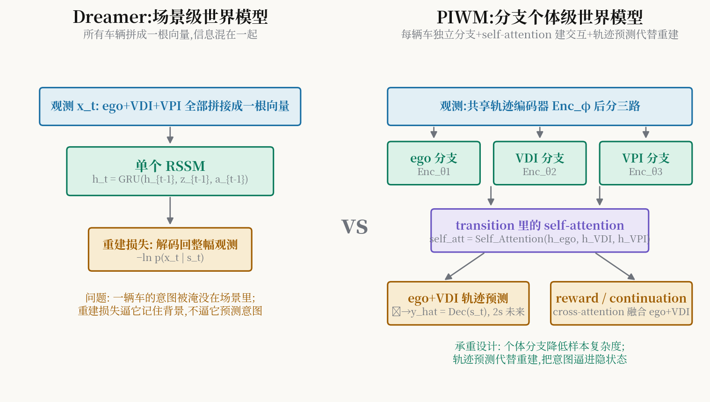

# 把世界模型从"整幅画面"拆成"每辆车":PIWM 如何让 Dreamer 学会看懂交互

> **信息块**
> - 标题：PIWM: Dream to Drive with Predictive Individual World Model
> - 作者：Yinfeng Gao（与 Qichao Zhang 同等贡献）、Da-Wei Ding、Dongbin Zhao（CASIA/中国科学院自动化所、北京科技大学）
> - venue：IEEE Transactions on Intelligent Vehicles（T-IV），2025；arXiv:2501.16733v1（2025-01-28）。PDF 版头为 "VOL. , NO. , 2024"，属录用后早见（early access）排版，期刊正式卷期信息缺省。
> - 链接：https://arxiv.org/abs/2501.16733
> - 代码：官方开源 https://github.com/gaoyinfeng/PIWM（已 clone 到本目录 `code/`，DreamerV3 分叉实现，nets_PIWM.py 含 ego/vdi/vpi 三分支 RSSM，configs.yaml 证实 imag_horizon=15）
> - 一句话核心洞见：**Dreamer 的世界模型把整幅场景混成一个隐向量、用"重建当前画面"训练它；PIWM 把每辆车拆成独立分支、用"预测每辆车的未来轨迹"训练它——重建逼模型记住背景，预测逼模型学会议意，而决策恰恰需要后者。**

## 先看那个反直觉的现象:重建做得越好,开车不一定越好

DreamerV3 在这篇论文的无信号交叉口实验里只拿到 40.00%（小规模）和 55.98%（大规模）的成功率。注意 DreamerV3 是通用 MBRL 的 SOTA，在 Atari、DMC 上横扫千军。为什么一到交互式驾驶就垮？作者的回答分两层，图 1 直接画了出来。

第一层是**表示的粒度**。Dreamer 的 RSSM 吃的是场景级（scene-level）表示:ego 和所有社会车辆的观测拼成一根长向量，塞进一个 GRU，得到一个混在一起的隐状态。要在这个隐状态上"做梦"——预测下一步、算回报——模型必须先学会把混在一起的信息再分开。一个行人的意图信号，在这根向量里只占几维，和红绿灯、路沿的纹理挤在一起，梯度要穿过整个场景表示才能摸到它。样本复杂度因此爆炸。

第二层更狠:**重建损失教错了东西**。Dreamer 用"把当前观测解码回来"（reconstruction）做表示学习。在驾驶里，观测的大部分像素是静态背景——路面、建筑、天空。重建损失逼模型把容量花在记住这些最容易重建、却对决策最没用的东西上。而真正决定你该不该左转的，是对向那辆车"它是不是打算抢行"的意图，这东西在当前帧里根本不存在，只能从未来里学。重建损失对它一字不提。

PIWM 的两个改动正好各修一层:分支个体建模修粒度，交互式轨迹预测修训练目标。下面逐个看它们是怎么被逼出来的。

## 车辆分三类:ego、VDI、VPI,这个划分从哪来

PIWM 先做了一个看似武断、实则有出处的决定:把社会车辆按**与 ego 的距离**分成两类——

- **VDI（vehicles with direct influence，直接影响车辆）**：离 ego 最近的 $N_d=5$ 辆；
- **VPI（vehicles with potential influence，潜在影响车辆）**：次近的 $N_p=5$ 辆。

加上 ego 自己，一共 $N=10$ 辆车（不足补零）。这个划分借自 DIPP（Huang 等），动机是决策导向的:影响 ego 决策的主要是近车；远车要么通过近车间接影响，要么没影响。作者的消融显示 VDI/VPI 取 5/5 这个比例对最终性能只有轻微影响，所以它更像一个工程上的归纳偏置，而不是精密调出来的超参数。

输入是每辆车过去 2 秒的轨迹（0.1s 间隔，20 个点），向量化成 $[d_{i-1}, d_i, \text{yaw}_i]$ 的序列，全部转到 ego 坐标系下（位置不变性）。动作空间是离散的目标车速 $\{0, 3, 6, 9\}$ m/s，车沿着导航给定的路线走，纵向 PID 追速度、横向 PID 追路径——也就是说**这篇论文只解决纵向决策**（什么时候加速、什么时候让行），横向是写死的。这是理解它所有实验数字的前提:它的"成功"不包括换道、绕障。

## 分支编码:先共享,再分家

$$
e^{ego}_t = \text{Enc}_{\theta_1}(\text{Enc}_{\phi}(x^{ego}_t)),\quad
e^{VDI}_t = \text{Enc}_{\theta_2}(\text{Enc}_{\phi}(x^{VDI}_t)),\quad
e^{VPI}_t = \text{Enc}_{\theta_3}(\text{Enc}_{\phi}(x^{VPI}_t))
\tag{1}
$$

所有车辆先过一个**共享**的轨迹编码器 $\text{Enc}_{\phi}$（学"车是怎么动的"这种通用知识），再各自过**分支**编码器 $\theta_1,\theta_2,\theta_3$（学"ego/VDI/VPI 各自的特殊性"）。GRU 的转移也是分支式的:

$$
\begin{aligned}
h^{ego}_t &= \text{GRU}_{ego}(h^{ego}_{t-1}, z_{t-1}, a_{t-1}) \
h^{VDI}_t &= \text{GRU}_{VDI}(h^{VDI}_{t-1}, z_{t-1}, a_{t-1}) \
h^{VPI}_t &= \text{GRU}_{VPI}(h^{VPI}_{t-1}, z_{t-1}, a_{t-1})
\end{aligned}
\tag{2}
$$

关键点:动作 $a_{t-1}$ 只进 ego 和 VDI 的转移——因为只有 ego 的动作是已知的、可控的；VPI 的转移也接收 $a_{t-1}$？按公式 (2) VPI 的 GRU 也输入了 $a_{t-1}$。注意这里有个微妙之处:公式里三个分支的 GRU 都吃了 $a_{t-1}$，但随机状态的先验/后验是分支独立的。

## 转移模型里的 self-attention:交互关系就藏在注意力权重里

这是 PIWM 相对 Dreamer 最实质的改动。在算出各分支的确定性状态 $h_t$ 之后，作者加了一层 self-attention:

$$
\text{self\_att}_t = \text{Self\_Attention}(h^{ego}_t, h^{VDI}_t, h^{VPI}_t)
$$

Q、K、V 都是各车的 $h_t$ 经过线性投影。直觉上:这层 attention 让每辆车的隐状态"看到"别的车。注意力权重本身就是车辆间关系的显式表示——谁在关注谁，权重矩阵里写着。

然后随机状态的先验和后验都以 $h_t$ 和 $\text{self\_att}_t$ 为条件:

$$
\bar{z}_t \sim p(\bar{z}_t \mid h_t, \text{self\_att}_t), \qquad
z_t \sim q(z_t \mid h_t, \text{self\_att}_t, e_t)
\tag{3}
$$

先验 $\bar{z}$ 看不到当前观测 embedding $e_t$（做梦时用），后验 $z_t$ 看得到（训练时用），KL 散度把两者拉近——这是标准 RSSM 套路，$\beta=0.5$ 照抄 DreamerV3。

**"为什么我想不到"**: 一般人想给世界模型加交互，会去改输入（把关系特征拼进观测）或者改损失。PIWM 把交互塞进**转移模型内部**，让它成为隐状态生成过程的一部分。这样做的好处是:做梦（imagination）的时候，交互关系会随着每一步 rollout 自然演化，而不是只在编码那一刻存在一次。代价是 VDI/VPI 的成员随距离动态变化，新加入的车辆隐状态从零初始化——这是一个明显的工程补丁，论文诚实地写出来了。

## 为什么解码器只预测 ego 和 VDI 的未来,不预测 VPI

未来解码是这样的:

$$
\hat{y}^{ego}_t = \text{Dec}_{\phi_1}(s^{ego}_t), \qquad
\hat{y}^{VDI}_t = \text{Dec}_{\phi_2}(s^{VDI}_t)
\tag{4}
$$

VPI 没有解码器。作者给了两个理由，都值得细看。第一，**决策导向**:VPI 的状态存在的意义是"通过交互关系影响 ego 和 VDI 的状态"，如果给 VPI 也加一个轨迹预测头，VPI 的隐状态会被逼着去拟合远车的精确未来——这和它"配角"的定位冲突，会把表示学习带偏。第二，**数据**:在线 RL 采集的数据里，VPI 时有时无、样本不足，训不好一个解码器。

这个设计很能体现作者的取舍观:表示学习的目标函数必须和下游任务对齐，而不是"能预测的都预测"。这也是全文最有迁移价值的一句话。

## 损失函数逐项过:每一项在罚什么

$$
\mathcal{L}_{PIWM} = \mathbb{E}\Big\{ \underbrace{-\ln p(y^{ego}_t \mid s^{ego}_t) - \ln p(y^{VDI}_t \mid s^{VDI}_t)}_{\text{轨迹预测}} \underbrace{-\ln p(r_t\mid\cdot)}_{\text{回报预测}} \underbrace{-\ln p(c_t\mid\cdot)}_{\text{终止预测}} + \beta \cdot \text{KL}_{ego} + \beta \cdot \text{KL}_{VDI} + \beta \cdot \text{KL}_{VPI} \Big\}
\tag{7}
$$

- **轨迹预测项**:核心，2 秒未来轨迹的对数似然。注意它取代了 Dreamer 的观测重建项——整个表示学习的"考题"从"画出当前"换成了"说出未来"。
- **回报/终止项**:标准 Dreamer 套路，输入是 ego 状态和 cross-attention 融合的 VDI 状态（query 只用 ego 的编码——"ego 中心"的任务就用 ego 做 query，这个选择是一致的）。
- **三项 KL**:三个分支各一项，把后验往先验上拉。VPI 也有 KL 项，尽管它没有预测头——VPI 的隐状态靠 KL 和 attention 里的梯度活着。

行为模型（actor-critic）完全在想象中训练，imagination horizon $H=15$，$\lambda=0.95$ 的 $\lambda$-return，critic 用 two-hot 离散回归（DreamerV3 同款），$\eta=10^{-3}$ 熵正则。梯度从 actor/critic 处截断，不回流进世界模型——表示学习纯粹发生在世界模型阶段。

## 一个具体场景:无保护左转,PIWM 在哪一步赢了 Dreamer

场景:ego 要无保护左转，对向一辆 VDI 以 8 m/s 驶来，后面还跟了一辆 VPI。基线（DreamerV3/DQN）在这里的失败模式论文用图 9 展示了:DQN 式的方法要么过度保守（cut-in 场景里一直让行直到超时），要么直接撞上（左转场景）。

PIWM 的处理链条:

1. **编码**:对向车进 VDI 分支，它的 2 秒历史轨迹被 $\text{Enc}_{\phi}$ 编成"正在加速直行"的 embedding；后车进 VPI 分支。
2. **交互**:self-attention 里，ego 的 query 对这辆 VDI 的 key 给出高权重——隐状态里现在写着"这辆车和我的左转路径冲突"。
3. **预测**:解码器从 $s^{VDI}_t$ 解出它未来 2 秒的轨迹:继续直行、占据路口。这个预测的对数似然就是训练信号，逼着隐状态把"它要抢行"这个意图编码进去。
4. **做梦**:actor 在想象中 rollout 15 步，reward 预测器告诉它"现在冲出去 $r_{collision}=-30(1+v_{norm})$"，critic 的 $\lambda$-return 把这次试错记下来。
5. **执行**:输出目标车速 0 m/s（四个离散动作之一），等 VDI 通过后再走。

Dreamer 在哪一步掉队?第 2 步:场景级隐状态里，对向车的意图信号和背景混在一起；第 3 步根本不存在——Dreamer 的"考题"是重建当前帧，意图不在考纲里。消融表 II 是铁证:只加分支（IWM）不大规模上只从 55.98% 提到 61.11%，加上交互预测（PIWM）才跳到 74.79%。**分支是必要条件，预测才是充分条件。**

## 怀疑式阅读:数字的条件和没说的事

先看硬数字（大规模实验，476 训 / 156 测，3 次运行）:

| 方法 | 成功率 | 碰撞率 | 完成比 |
|---|---|---|---|
| DreamerV3 | 55.98±1.21% | 32.05±1.05% | 78.46±0.95% |
| PIWM | **74.79±2.58%** | **23.93±3.07%** | **88.07±1.29%** |

摘要里"18.81% boost on success rate"指的是**百分点差值**（74.79−55.98=18.81），不是相对提升（相对是 +33.6%）。写论文时这种表述要小心，审稿人会按相对提升去理解。

四个诚实的保留:

1. **背景车不做反应**:I-SIM 是 log-replay，社会车辆按记录重放、不对 ego 的行为做反应。作者在结论里承认了。这意味着"交互"是单向的——ego 学会了读意图，但没学会应对"对方也在读我"。所有数字都是在这个简化设定下的。
2. **只做纵向**:动作是四个离散目标车速，横向走固定路线。无保护左转的"转"本身是写死的，学的是"何时转"。这是一个纵向决策论文，不要按完整驾驶系统去理解它的成功率。
3. **无地图**:作者自己指出 VDI 预测误差偏大，部分原因就是没用地图信息约束轨迹。预测 horizon $H^+=20$（2 秒）是试出来的甜点:10–15 步太短看不见意图，35–40 步误差爆炸。
4. **泛化仍是 open 问题**:大规模实验里成功率从小规模的 85% 掉到 74.79%，作者直言"model-based RL 的泛化仍是挑战"。训练 50 万环境步，在 RTX 2080Ti 上跑——算力门槛不高，这是优点。

超参数方面:KL 的 $\beta=0.5$、$\lambda=0.95$、熵 $10^{-3}$ 全部照抄 DreamerV3，没有重新搜索——这既是优点（改动少、归因干净），也是风险（分支结构下的最优值可能不一样，论文没给敏感性分析）。

## 与 RAMP 的血缘/划界

PIWM 和 RAMP 处在"世界模型 for 驾驶"的同一条大河里，但几乎是**互补的两岸**。

血缘有三处。第一，PIWM 用"轨迹预测"代替"观测重建"做表示学习，这正是 RAMP"世界模型引导"的早期回声:世界模型的价值不在于把世界画出来，而在于把**对决策有用的未来**编码进隐状态。第二，PIWM 的分支结构（ego/VDI/VPI）是一种朴素的**对象级分解**，RAMP 的多规划器调度也可以看作"把驾驶任务按对象/风险源分解"的更激进版本。第三，PIWM 把交互关系显式写进转移模型（self-attention），RAMP 的情景记忆+风险校验本质上也是在做"交互关系的显式建模"，只是从参数记忆换成了非参数记忆。

划界更重要，有三条是 RAMP 写 related work 时可以直接用的:

1. **在线 RL vs 离线/闭环评测**:PIWM 是纯在线 RL，需要和环境交互 50 万步才能训出来，依赖 I-SIM 这种可交互的仿真器；RAMP 跑在 Bench2Drive 闭环基准上，世界模型服务于规划器调度，不需要在线试错。这是方法论层面的根本差异——PIWM 回答"怎么在梦里学会开车"，RAMP 回答"怎么在开车时用梦做决策"。
2. **表示学习的监督信号**:PIWM 的预测头只服务于表示学习（训完了解码器就扔了，决策只用隐状态）；RAMP 的世界模型输出是直接被下游消费的（调度先验、风险校验）。一个是"预测为了表示"，一个是"预测为了使用"。
3. **交互建模的粒度**:PIWM 的交互是"车辆之间"的 attention，风险是隐式的（藏在 reward 预测里）；RAMP 把风险显式化（风险校验、冲突仲裁）。如果 RAMP 要引用 PIWM，最合适的句式是:"PIWM 证明了交互式预测表示对决策的价值，但它把风险留在隐式 reward 里，且需要在线交互；我们把风险显式化，并把世界模型从训练时的表示学习器转为运行时的决策组件。"

*图:左为 Dreamer 的场景级 RSSM（信息混杂、重建训练），右为 PIWM 的三分支个体建模（self-attention 建交互、轨迹预测训练）。*

## 带走什么

PIWM 留给后人的真正遗产不是那 18.81 个百分点，而是一个可迁移的判断:**世界模型的训练目标必须和它的用途对齐**。当用途是决策时，"重建当前"是一个错位的考题，"预测未来"是及格线，而"预测**谁**的未来、预测**多远**"（ego+VDI、2 秒）才是拿分的关键。RAMP 的"世界模型中间分布复用"可以看作这个思想的下一站:既然预测是考题，那考出来的这份"未来分布"就不要只用一次——调度用一次，风险校验再用一次。
