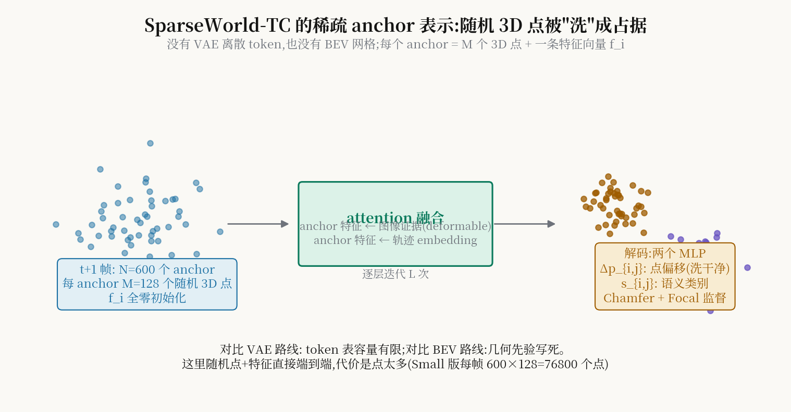

# 不要 BEV、不要 VAE:把随机 3D 点"洗"成未来占据的 SparseWorld-TC

> **信息块**
> - 标题：SparseWorld-TC: Trajectory-Conditioned Sparse Occupancy World Model
> - 作者：Jiayuan Du（同济大学）*、Yiming Zhao（理想汽车）*（共同一作）、Zhenglong Guo、Yong Pan、Wenbo Hou、Zhihui Hao、Kun Zhan（理想汽车）、Qijun Chen（同济，通讯）
> - venue：**CVPR 2026 Oral**（已核实：CVF Open Access 已收录 `content/CVPR2026/papers/Du_SparseWorld-TC...`；作者官方 GitHub 仓库标题自标 "[CVPR 2026 Oral]"；arXiv:2511.22039，v3 修订至 2026-04-14）
> - 链接：https://arxiv.org/abs/2511.22039
> - 代码：官方开源 https://github.com/MrPicklesGG/SparseWorld（已 clone 到本目录 `code/`，`configs/sw-tc.py` 证实 `num_query=600` 与论文 Small 版一致，`models/sparse_world_head.py` 含 Chamfer/Focal 损失实现）
> - 一句话核心洞见：**占据世界模型的标准路线是"图像→BEV→VAE token→自回归/扩散"，每一步都在丢信息；SparseWorld-TC 把这三步全扔了——场景就是一堆随机撒的 3D 点加特征向量，transformer 直接把它们"洗"成未来的占据，一次前向给出全部未来帧。**

## 先看图 1:作者押的赌注

论文图 1 把两条路线并排画出来。左边是"常见两阶段 VAE-BEV 占据世界模型":编码器把过去的占据压成离散 token（codebook），解码器自回归地吐出未来。右边是他们的方法:没有 codebook，没有 BEV，一堆随机 3D 点经过 transformer，直接变成未来占据。

作者赌的是两件事。第一，**离散 token 的容量瓶颈是真实存在的**:VQ-VAE 的 codebook 通常几千个 entry，整个 3D 场景的几何+语义要被量化到这几千个离散符号里，细粒度信息必然丢失。OccWorld、RenderWorld 走的都是这条路。第二，**BEV 的几何先验是写死的约束**:BEV 把 3D 世界压到一个固定分辨率的 2D 网格上，特征交互被限制在这个网格的邻域结构里；跨尺度、跨时间的长程依赖要穿过这个瓶颈。

赌注的另一面是代价:随机点表示没有几何归纳偏置，全靠 attention 从图像证据里学。一个 anchor 有 $M$ 个点，Small 版 $N=600$ anchors、$M=128$——每帧 76800 个 3D 点，Large 版 $N=4800$、$M=16$ 也是 76800 个。点数守恒，变的是"anchor 多但每 anchor 点少"vs"anchor 少但每 anchor 点密"。这个设计选择本身就很说明问题:作者把容量放在了 anchor 数量（场景覆盖）上，而不是单 anchor 的点密度上。

## Anchor 到底是什么:一句话+一个公式

$$
A_i = (P_i, f_i), \qquad M = \{A_i\}_{i=1}^{N}
\tag{2}
$$

第 $i$ 个 anchor 由两部分组成:$P_i = \{p_{i,j} \in \mathbb{R}^3\}_{j=1}^{M}$ 是一组 3D 点，$f_i \in \mathbb{R}^D$ 是一条特征向量。初始化时:anchor 中心 $\{c_i\}$ 在 3D 空间均匀撒点 $c_i \sim U(\text{Space})$；每个 anchor 的点在中心周围加高斯噪声 $p_{i,j} \leftarrow c_i + \epsilon_{i,j}$；**所有特征向量初始化为零** $f_i \leftarrow 0$。

然后特征向量 $f_i$ 被两个 MLP 解码:一个输出每个点的几何偏移 $\Delta p_{i,j} \in \mathbb{R}^3$（把随机点"洗"到真实占据位置），一个输出语义类别 logits $s_{i,j} \in \mathbb{R}^C$。注意这个设计的巧妙之处:**点的坐标本身不可学习**（公式 (4) 明确说 $P_i$ 是 non-learnable 的随机坐标，输入里省略），学的是"偏移量"和"语义"。这相当于把"在哪里"和"是什么"解耦:位置靠偏移修正，类别靠分类头。

用 DETR 的语言说:anchor 就是 3D 版的 object query，只不过 query 的不是框，而是"一团点的占据+语义"。

## 轨迹怎么喂进去:7 维 waypoint 到时空 embedding

世界模型的完整签名是:

$$
O_{1:T} = \mathcal{F}(M_{1:T}, S_{-T':0}, \tau)
$$

$M_{1:T}$ 是未来各帧的 anchor 初始表示（随机点），$S_{-T':0}$ 是过去 $T'$ 帧的传感器观测，$\tau = \{x_t\}_{t=1}^{T}$ 是给定的未来轨迹。每个 waypoint 状态 $x_t$ 包含平面位置 $(x,y)$、朝向角 $\theta$ 和时间戳 $t$。

轨迹 embedding 分三步。第一步**位置 embedding**:每个 waypoint 写成 7 维全局坐标 $(x,y,z,q_0,q_1,q_2,q_3)$（位置+四元数），转成相对 ego 的 16 维齐次矩阵，过 MLP 得到 $f^{Pn}_i$。第二步**时间 embedding**:时间戳按整数 $[0,1,\dots,n]$ 做标准正弦位置编码得 $f^{Tn}_i$——注意这里**不假设均匀采样**，每个 waypoint 的时间戳独立编码，所以模型能吃"非等间隔"的规划输出，这对接规划器很友好。第三步**时空融合**，借自 MLN（motion-aware layer normalization）的思想:

$$
f''_t = \gamma(f^{Pn}_i)\cdot(f_i + f^{Tn}_i) + \beta(f^{Pn}_i)
$$

两个线性层 $\gamma,\beta$ 从位置特征学出仿射变换的参数，去调制"特征+时间"的和。这是一个轻量的条件调制，比把轨迹拼进 attention 的 Q/K/V 更便宜。

## 融合架构:三层 attention 各管什么

对每个未来帧 $t$，三步走（图 3，堆叠 $L$ 次迭代）：

1. **Sensor-occupancy cross-attention**:anchor 特征 $\{f^t_i\}$ 去查过去 $T'$ 帧的图像特征。实现用 deformable attention:anchor 中心 $c_i$ 按相机内外参投影到多尺度图像特征图上采样；多视角重叠取平均；每个 anchor 从过去 $T'$ 帧各采一份，再加正弦时间 embedding。这一步是"随机点长出眼睛"。
2. **Frame-level self-attention**:更新后的 anchor 特征和轨迹 embedding 做帧内融合——轨迹条件在这里注入。
3. **Temporal attention**:跨所有未来帧的 self-attention，联合精修 $\{f^t_i\}$，抓长程时空依赖。

注意:**没有自回归**。全部 $T$ 个未来帧的 anchor 是同时初始化、同时精修的，一次前向给出所有帧。这和 OccWorld 的逐帧自回归、DOME/COME 的扩散去噪都不同——作者选的是 VGGT 式的 feed-forward 范式。代价是显存随 $T$ 线性涨，好处是快、且没有自回归的误差累积。长时预测（8–10 秒）不崩，很大程度上要归功于这个选择。

## 损失:Chamfer + Focal,为什么是这个组合

$$
\mathcal{L}_{CD} = \frac{1}{|P|}\sum_{p\in P} D(p,P_g) + \frac{1}{|P_g|}\sum_{p_g\in P_g} D(p_g,P),\quad D(x,Y)=\min_{y\in Y}\|x-y\|_1
\tag{5}
$$

$$
\mathcal{L} = \mathcal{L}_{CD} + \mathcal{L}_{focal}
\tag{6}
$$

Chamfer 距离管几何:预测点集 $P$ 和真值体素中心点集 $P_g$ 双向最近邻对齐。Focal loss 管语义:按 [40] 的做法，匹配上的真值点同时给出语义标签，分类用 focal 对付占据里严重的类别不平衡（空体素占 95% 以上）。

**"为什么我想不到"**:占据预测的标准监督是体素级的交叉熵（dense grid）。但 anchor 表示是**点集**，不是网格——体素 CE 用不上。作者借了点云处理的 Chamfer，这是表示选择倒逼出来的损失选择。反过来想:如果你一开始就决定用 Chamfer，你就不能用 dense BEV 表示。表示、架构、损失三者是互相锁定的，这篇论文的每一处设计都能从这个锁定关系里推出来。

## 训练技巧:random ensemble 解决"horizon 写死"的问题

nuScenes 的占据预测 benchmark 考 1–3 秒，但有些应用要 10 秒。作者的做法:设最大 horizon $T$，训练时**随机**选目标长度 $L \in \{2,\dots,T\}$，只监督前 $L$ 帧。因为没有固定的时间步长，场景演化完全由轨迹 embedding 里的时间信息驱动——模型被迫学会"任意 horizon、任意间隔"的预测。消融表 4:random ensemble 长时平均 mIoU 22.33 vs 固定帧监督 20.36。这是一个零架构成本的技巧，值得抄。

## 数字:都在什么条件下拿到的

Occ3D-nuScenes，输入为**纯相机**（对比方法里很多用真值占据做输入，作者把这两类分开列，做法诚实）:

| 方法 | 输入 | 平均 mIoU（1–3s） | 平均 IoU |
|---|---|---|---|
| I2-World（之前 SOTA） | 相机 | 22.26 | 44.07 |
| SparseWorld-TC-Small | 相机 | 25.60 | 49.02 |
| SparseWorld-TC-Large | 相机 | **26.42** | **49.21** |
| SparseWorld-TC-Large*（DINOv3） | 相机 | **29.89** | **53.52** |

相对之前 SOTA：mIoU +18.7%（26.42 vs 22.26），IoU +11.7%（49.21 vs 44.07）。长时（1–8 秒）:平均 mIoU 22.33 vs COME 19.07（+17.1%），平均 IoU 45.35 vs 29.96（+51.4%）。注意长时对比里 DOME/COME 用的是**真值占据**做输入，作者用纯相机还赢了——这个对比其实对作者有利得不公平，但作者没有藏着掖着，表格里 Input 列写得清清楚楚。

轨迹条件的消融（表 3，Small 版）最有信息量:

| 轨迹输入 | mIoU | IoU |
|---|---|---|
| 无轨迹 | 15.44 | 32.19 |
| BEVPlanner 预测轨迹 | 21.57 | 44.76 |
| 真值轨迹 | 25.60 | 49.02 |

无轨迹直接掉 10 个点——说明轨迹条件不是装饰，是承重墙。而且用**预测**的轨迹（BEVPlanner 输出）也能拿到 21.57，接近真值条件性能的 84%，这对"世界模型接规划器"的链路是利好:规划器输出的噪声轨迹不至于让世界模型崩掉。

训练成本:70 epoch，8×H20，batch size 8，AdamW，lr $2\times10^{-4}$ cosine。Small 版速度约为 Large 和 I2-World 的两倍。

## 怀疑式阅读

1. **点的总数是守恒的**:Small（600×128）和 Large（4800×16）每帧都是 76800 个点。Large 的赢面来自 anchor 更多（场景覆盖更密），不是点更多。这意味着"稀疏"的程度其实没变，变的是分配。推理时 76800 个点 × T 帧的 attention，显存墙是真实存在的——论文没给显存数字。
2. **长时评测的公平性质疑作者自己提了**:10 秒后的未来有多种可能，用单一真值评测 inherently 不公平。作者的辩护是"可视化+指标结合看"，这个态度诚实，但数字的水分要自己掂量。
3. **"任意轨迹条件"的鲁棒性**:图 6 展示了分叉路口左转/直走两种条件下的预测，看起来都合理。但消融只试了"无/预测/真值"三种轨迹，没有试**对抗性**轨迹（比如规划器输出一条穿墙的轨迹，世界模型会怎么补）。"high accuracy under arbitrary future trajectory conditioning"这个摘要表述，实证只覆盖了合理轨迹。
4. **理想汽车的作者构成**:6/8 作者来自理想汽车。这通常意味着工程实现扎实、但学术增量叙事会偏向"我们把 X 做到了极致"。这篇的学术增量其实是实在的（表示范式的切换），不是调参。
5. **Sensor 扩展的承诺**:4.4 节说加几个 MLP 就能预测未来传感器观测（3D Gaussian 参数），细节甩给了补充材料。正文里这只是一个"我们也能"的声明，没有数字支撑。

## 与 RAMP 的血缘/划界

SparseWorld-TC 是 RAMP 创新点 B（世界模型中间分布复用）的一面**镜子**，照出的是"如果不复用，代价是什么"。

血缘:它就是 RAMP 需要的那种"轨迹条件世界模型"——给定候选轨迹，预测未来场景演化；RAMP 的"世界模型引导多规划器"在概念上需要的正是这样一个"候选轨迹→未来后果"的评估器。它的轨迹 embedding 设计（非等间隔时间戳、MLN 式调制）对 RAMP 接规划器输出有直接参考价值。

划界有三层，一层比一层关键:

1. **它不做选择，只做预测**。SparseWorld-TC 的输出是占据，没有"哪个轨迹更好"的判断。它的 benchmark 是预测精度（mIoU/IoU），不是规划分数。RAMP 要引用它，位置是"世界模型 backbone"，不是"决策方法"。
2. **它的条件机制恰恰是"不复用"的**：每评估一条候选轨迹，就要做一次以该轨迹为条件的完整前向（公式 $O_{1:T}=\mathcal{F}(M_{1:T},S_{-T':0},\tau)$ 里 $\tau$ 是输入）。K 条候选 = K 次前向。这是 RAMP 创新点 B 要消灭的成本——RAMP 的主张是"单次前向的中间分布同时服务调度先验和风险校验"。写 related work 时，这是一个现成的对比句式:"Trajectory-conditioned models like SparseWorld-TC require one conditioned forward per candidate; we amortize a single forward across heterogeneous consumers."
3. **开环 vs 闭环**：它的评测是开环预测（nuScenes occupancy forecasting），没有闭环驾驶分数；RAMP 在 Bench2Drive 闭环上验证。引用时不要把它的 mIoU 数字和规划数字混为一谈。

*图:每帧 N 个 anchor（随机 3D 点 + 零初始化特征），经图像证据与轨迹条件的 attention 融合后，两个 MLP 分别输出点偏移（几何去噪）与语义类别，Chamfer + Focal 监督。*

## 带走什么

这篇论文最大的方法论启示是**表示、架构、损失三者的锁定关系**:一旦你决定不用 BEV、不用 VAE，你的监督就不能是体素 CE，只能是点集的 Chamfer；你的条件机制就不能是拼网格，只能是 embedding 调制。很多"换表示"的工作失败，不是因为新表示不好，而是只换了表示、没换与之锁定的另外两件。RAMP 如果要动世界模型的表示（比如从占据换成别的），这个教训直接适用:先问"我的损失还能不能用"，再问"我的复用机制还成不成立"。
