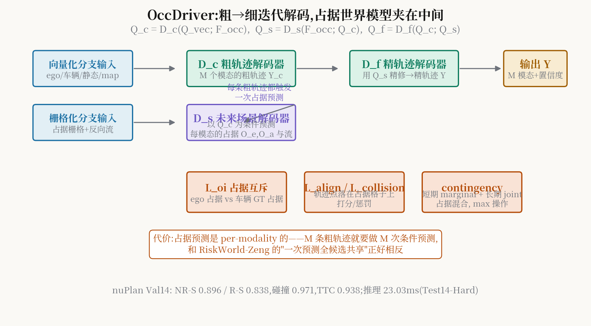

# 粗轨迹先开一枪,占据世界模型再修正弹道:OccDriver 的双分支迭代解码

> **信息块**
> - 标题：OccDriver: Future Occupancy Guided Dual-Branch Trajectory Planner in Autonomous Driving
> - 作者：Zhao Huang、Bowen Zhang、Zhongzhu Li、Di Lin（天津大学 + SenseAuto，Huang 为 SenseAuto 实习期间完成）
> - venue：**ICLR 2026 已发表**（OpenReview 页面明确标注 "Published as a conference paper at ICLR 2026"）
> - 链接：https://openreview.net/pdf/903be19d414df075445f33c7634a785f5ac24c9a.pdf（直接下载返回 403，本文依据 OpenReview 全文文本逐段精读；附录 A.2/C/D/E/F 未能获取，相关细节以正文为准并已标注）
> - 代码：**未找到官方开源代码**（全网检索无作者发布仓库）
> - 一句话核心洞见：**纯向量化方法看不见未来的交互，纯栅格化方法丢了个体的精度；OccDriver 让向量化分支先画出 M 条粗轨迹，栅格化分支对每条粗轨迹各做一次"假如我这么开、世界会怎样"的占据推演，再把推演结果蒸回向量化分支做精修——世界模型在这里不是独立模块，而是插在解码器中间的一个"未来咨询"步骤。**

## 先回答:为什么表示空间的选择是 planning 的第一性问题

引言 2.1 节花了整整一节讲表示，这不是凑篇幅。作者把规划的表示分成两派:

- **栅格化（rasterized）**:把场景画成 BEV 占据网格。优点是天然的联合建模——一张网格同时写下所有智能体的未来，不怕遮挡，概率视角自然。缺点是离散化 artifact，以及**个体信息被抹平**（网格分不清"这辆车要左转"和"那辆车要直行"，只知道"这个格子 0.7 概率被占"）。
- **向量化（vectorized）**:每个智能体一条轨迹向量。优点是精度高、个体语义完整。缺点是未来的交互演化被过度简化，不确定性要靠手工特征工程去凑。

OccDriver 的赌注是:**这两派的缺点恰好是对方的优点**。粗轨迹需要个体的精度（向量化），未来交互需要联合的概率视角（栅格化）。所以它不选边，而是让两者交替工作三次。

## 三个解码器:公式 (4)(5)(6) 到底在说什么

先记符号:$F_{vec}$ 是向量化场景特征，$F_{occ}$ 是占据场景特征，$Q_{vec}$ 是 M 个模态的解码 query。三个解码器串行:

$$
\begin{aligned}
Q_c &= D_c(Q{=}Q_{vec}; K,V{=}F_{occ}; \{F_S,F_M\}) \tag{4}\
Q_s &= D_s(Q{=}F_{occ}; K,V{=}Q_c; \{F_S,F_M\}) \tag{5}\
Q_f &= D_f(Q{=}Q_c; K,V{=}Q_s; \{F_S,F_M\}) \tag{6}
\end{aligned}
$$

翻译成大白话:

1. **$D_c$（粗轨迹解码器）**:拿着多模态 query，先在模态内做 self-attention（智能体间的社交交互），再 cross-attention 查静态障碍和地图，最后**cross-attention 查 $F_{occ}$**（建立空间场景理解）。输出粗轨迹 query $Q_c$，MLP 解码成 M 条粗轨迹 $Y_c$。
2. **$D_s$（未来场景解码器——作者自称的"2D 占据世界模型"）**:反过来，拿着占据特征 $F_{occ}$ 做 query，去查 $Q_c$（粗轨迹的实例级特征）和地图。输出 $Q_s$——"给定这些粗轨迹，未来场景会怎么演化"的直觉先验。然后上采样+两个 2D-CNN，输出 M 个模态各自的未来占据场和流场。**关键:占据预测被解耦成 ego 的 $O_e$ 和周围车辆的 $O_a`**，为后面的损失函数做准备。
3. **$D_f$（精轨迹解码器）**:架构和 $D_c$ 一样，只是第三个 cross-attention 的 K/V 从 $F_{occ}$ 换成 $Q_s$。拿着粗轨迹 query $Q_c$，去查"未来场景长什么样"，输出精修后的 $Q_f$，解码成最终的 M 模态轨迹 $Y$ 和置信度。

**"为什么我想不到"**:直觉的做法是"预测和规划各做各的，最后加个损失连起来"。OccDriver 把占据预测**插进了解码流程的中间**，让精修步骤的 attention 直接 attend 到"未来"。这意味着梯度从最终轨迹可以一路流回占据预测——未来场景的表示是被"怎么对规划有用"塑造的，而不是被"怎么重建得准"塑造的。这和 PIWM"预测为了表示"的思想是同一个血脉。

## 四个专用损失:把占据的直觉翻译成轨迹的语言

除了常规的 $L_{traj}$ 和 $L_{occ}$（细节在拿不到的附录 E），四个专用损失是这篇论文的"手艺"所在:

**1. 占据互斥损失 $L_{oi}$（公式 8）**。ego 的预测占据和车辆的真值占据不该重叠，反之亦然。用 teacher forcing 算"对方 GT 占据区域内我的预测占据的平均值"。这是在占据空间里做规划:你占的地方我就不占。

**2. 轨迹-占据对齐损失 $L_{align}$（公式 9）**。把 ego 轨迹点 $(x_t,y_t)$ 按车辆形状展开成 $N_v$ 个圆心 $\{P^t_i\}$，投影到**ego 自己的预测占据格**上双线性插值查概率。低于阈值 $\tau$ 就罚:

$$
L_{align} = \sum_{t=1}^{T_f}\sum_{i=1}^{N_v} \max(0, \tau - O(P^t_i))
$$

翻译:你规划的轨迹，应该落在"你自己预测自己会占的地方"。这听起来像同义反复，但它真正的作用是**把两个分支的输出锁在一起**——轨迹分支不能瞎指一个占据分支不认的方向。

**3. 轨迹-占据碰撞损失 $L_{collision}$（公式 10）**。同样把轨迹点投影到**周围车辆的预测占据格**上，算到高占据区域的最小欧氏距离 $d^t_i$，小于安全 margin $\delta$ 就罚。这是显式的"别往车堆里开"。

**4. Contingency（公式 11）**：这是最有想法的部分。传统 contingency planning 是轨迹级的场景树，复杂度指数爆炸。OccDriver 把它搬到占据空间:短期（$T_s < T_f$）用**marginal 占据**（每个交互智能体的个体分布，不分模态），长期用 **joint 占据**（多模态联合分布）。实现上简单到出乎意料——在短期时段内对联合占据和 marginal 占据做**逐元素取 max**:

$$
\tilde{O}^t_a = \max(O^t_a, \max_i O^t_{m,i}), \quad t \le T_s
$$

短期看"最危险的那个可能"，长期看"模态一致的演化"。marginal 预测只在训练时跑（推理时不算），是个纯粹的正则化器——用训练成本换推理速度，这个取舍值得记下来。

总损失 $L = L_{traj} + L_{occ} + L_{oi} + L_{og}$，其中 $L_{og} = w_1 L_{align} + w_2 L_{collision}$。$w_1, w_2$ 的值正文没给（附录 E 拿不到），这是个小遗憾。

## 数字:nuPlan 闭环双 SOTA，以及那个 23ms

nuPlan Val14 闭环（分数越高越好）:

| 方法 | NR-S | R-S | 碰撞 | TTC | 舒适 | 进展 |
|---|---|---|---|---|---|---|
| DiffusionPlanner | 0.899 | 0.828 | – | – | – | – |
| PLUTO | 0.890 | 0.800 | 0.962 | 0.933 | 0.964 | 0.896 |
| BeTopNet | 0.883 | 0.837 | 0.966 | 0.916 | 0.932 | 0.866 |
| **OccDriver** | **0.896** | **0.838** | **0.971** | **0.938** | 0.969 | 0.885 |

NR-S 0.896、R-S 0.838 都是学习类方法里最高，安全指标（碰撞 0.971、TTC 0.938）也是最高。注意 NR-S 上只比 DiffusionPlanner 高 0.003——"SOTA"这个词在这里是**以 0.3 个百分点的优势**拿到的，显著性要打个问号（论文没给随机种子数）。

Test14-Hard（更难的划分）:NR-S 0.794 / R-S 0.759，同样最高；**推理 23.03ms**，对比 BeTopNet 70ms、DiffusionPlanner 40ms、PLUTO 7.39ms。作者强调"比扩散范式快"，这个对比是成立的——但 PLUTO 的 7.39ms 提醒我们:纯向量化方法依然更快，OccDriver 的双分支是有代价的。

消融表 3（Val14）:基础双分支（无 marginal）NR-S 0.859/R-S 0.787；+marginal 预测 → 0.863/0.800；+$L_{oi}$ → 0.864/0.807；+$L_{collision}$ → 0.879/0.825（碰撞 0.943→0.960，TTC 0.914→0.931，**这是涨幅最大的一项**）；+$L_{align}$ 主要涨进展；+contingency 到顶 0.896/0.838，进展小幅回落（为安全付的保守税）。**承重设计是 $L_{collision}$**——显式的占据碰撞惩罚，不是花哨的 contingency。

另外两个实用的消融:占据预测 horizon $T=6s$ 最好，8s 反而掉（不确定性累积的坏处超过了长程信息的好处）；高占据阈值 $\tau=0.7$ 最优（0.5 太保守、0.8 丢不确定性）。粗轨迹 vs 精轨迹:精修把碰撞 0.931→0.946、NR-S 0.836→0.845——"咨询未来"确实有用，但幅度不大（约 1 个点），说明粗轨迹本身已经不错。

## 怀疑式阅读

1. **0.003 的 SOTA**:NR-S 0.896 vs DiffusionPlanner 0.899（Val14 表里 DiffusionPlanner NR-S 0.899 实际更高！）。仔细看表 1:DiffusionPlanner 的 NR-S 是 **0.899**，OccDriver 是 0.896——NR-S 上 OccDriver 并没有超过 DiffusionPlanner！正文 4.2 节写 "gains SOTA planning scores of 0.896 NR-Score and 0.838 R-Score"，R-S 0.838 > 0.828 确实是 SOTA，但 NR-S 的说法不严谨。严格来说:OccDriver 是 R-S 的 SOTA，NR-S 是第二。这是审稿人级别的较真，但数字就是数字。
2. **per-modality 的占据预测成本**:摘要明确说"predicts future scene evolutions conditioned on each coarse trajectory"——M 个模态各做一次占据预测。这是和 RiskWorld-Zeng 最直接的对照:OccDriver 为了"条件准确"付了 M 倍的预测成本，RiskWorld-Zeng 为了"摊销成本"放弃了条件（共享预测）。两种选择各有代价，论文没有量化 M 次预测占总耗时的比例。
3. **marginal 预测的 agent 剪枝**:只保留"未来框会和 ego 路径交叉"的交互车辆，还因为"GPU 显存限制"只取 8 个最近的非交互车辆。消融显示剪枝后安全小幅掉、进展涨——作者说这是"好的权衡"，但本质上是被显存逼出来的。
4. **1M 帧训练集**:nuPlan 标准训练集，2 秒历史、8 秒 horizon。没有给训练时长和 GPU 型号——"23ms 推理"很亮眼，但训练成本未知。
5. **附录拿不到**:附录 C（架构细节）、E（基础损失）、F（实验参数）都在拿不到的附录里。$w_1,w_2$、Swin block 的具体配置、$T_s$ 的取值，都没法核实。引用它的损失设计时要注明这些数来自正文公式、权重未知。

## 与 RAMP 的血缘/划界

OccDriver 是 RAMP 世界模型线的**正向血缘**，也是"复用"问题的一个**反例**。

血缘有三处。第一，它把世界模型（占据预测）当作规划的"未来咨询"步骤，而不是独立模块——这正是 RAMP"世界模型引导"的结构雏形。第二，它的 $L_{align}$/"$L_{collision}$"把占据分布翻译成轨迹约束，RAMP 的"风险校验"在功能上是同一件事（把预测的未来变成对候选轨迹的打分/否决）。第三，它的 contingency（短期 marginal + 长期 joint）是一种朴素的**风险时间尺度分解**，RAMP 的风险加权衰减记忆可以看作这个思想在记忆维度的延续。

划界也有三条，条条是 RAMP 的 related work 弹药:

1. **预测成本不摊销**:OccDriver 对每条粗轨迹各做一次条件占据预测（M 次前向）；RAMP 创新点 B 的主张是单次前向的中间分布被两个异构消费者复用。注意和 RiskWorld-Zeng 的三角关系:OccDriver（per-candidate 条件预测，贵但准）— RiskWorld-Zeng（一次共享预测，多候选复用，便宜但动作无关）— RAMP（一次前向，异构双消费者）。三者在"条件性-成本"光谱上各占一个点，RAMP 写 related work 时可以把这条光谱画出来。
2. **开环监督的闭环**:OccDriver 的占据预测是用开环真值监督的（$L_{occ}$），闭环性能来自 nuPlan 仿真器。RAMP 在 Bench2Drive 闭环上验证，且世界模型的复用发生在**运行时**。OccDriver 的"复用"（如果算的话）发生在训练时——$Q_s$ 同时被精修和损失消费，但推理时依然是串行三次解码。
3. **候选是模态，不是规划器**:OccDriver 的 M 个候选是同一解码器的 M 个模态（multimodal trajectories）；RAMP 调度的是**多个不同的规划器**。这是"多模态"和"多规划器"的本质区别——前者是输出多样性，后者是决策架构。ICAPS 的审稿人会对这个区分很敏感，RAMP 的 framing 里要一开始就讲清。

*图:三个解码器串行工作，D_s（占据世界模型）以每条粗轨迹为条件做未来推演，D_f 用推演结果精修。注意占据预测是 per-modality 的，这是它与 RiskWorld-Zeng 共享预测的根本区别。*

## 带走什么

OccDriver 教会我们两件事。第一，**世界模型插在解码器中间比放在旁边更有效**:让精修步骤的 attention 直接 attend 到未来，比"各做各的再加损失"能让梯度流得更深。第二，**消融表里涨得最多的往往是最不花哨的那个**:$L_{collision}$ 一个显式的"别撞"惩罚，贡献了最大的安全涨幅；contingency、marginal 这些概念漂亮的设计，涨幅反而不如它。做 RAMP 的风险校验时，先把"显式碰撞惩罚"这个 baseline 做扎实，再谈优雅。
