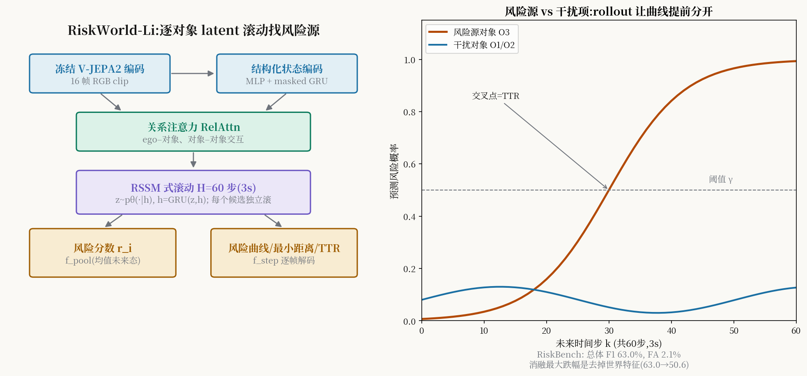

# 不预测场景,只预测"谁会撞我":RiskWorld-Li 的对象级风险滚动

> **信息块**
> - 标题：RiskWorld: Object-Centric Latent World Modeling for Autonomous Driving Risk Identification
> - 作者：Jingzheng Li、Yufei Ge、Qianren Mao、Zhijun Chen、Bing Li、Xingyu Peng、Baochang Zhang、Xianglong Liu（中关村实验室、天津大学、香港理工、南洋理工、北航）
> - venue：**arXiv 预印本** arXiv:2608.21414v1（2026-08-12，cs.RO）。PDF 带 "Copyright © 2027, AAAI" 页脚——表明投向 AAAI 2027，**录用与否截至 2026-10-11 未确认**，引用时按 arXiv 预印本处理。
> - 链接：https://arxiv.org/abs/2608.21414
> - 代码：**未找到官方开源代码**
> - 一句话核心洞见：**风险不是一张场景级的分数，而是一个"对象-自我关系"随时间演化的结果；RiskWorld-Li 不生成未来场景，而是让每个候选对象的"关系隐状态"在 latent 空间里往前滚 60 步，从滚出来的关系轨迹里直接读出"谁是风险源、还有多久撞上"。**
> - **消歧声明（S 级关键）**:本文是 **Li 版 RiskWorld（arXiv:2608.21414）**，与 **Zeng 版 RiskWorld（arXiv:2609.18442，147 篇）** 同名但**作者、方法、任务完全不同**。Li 版回答"**哪个对象**是风险源"（风险识别/监控）；Zeng 版回答"**哪条候选轨迹**更安全"（规划选择）。RAMP 引用的是 Zeng 版。两版唯一的共同点是都用了"RiskWorld"这个名字和"世界模型+风险"的叙事——引用时必须用 arXiv 号区分，写错一处就会张冠李戴。

## 先看图 1:三种旧范式为什么都差一口气

作者把现有风险识别归成三类，图 1(a) 画了它们的通病:

1. **事故 anticipation**（dashcam 预测"会不会撞"）:输出是场景级的分数，告诉你"危险"，不告诉你"谁危险"。
2. **行为反推**（从 ego 的刹车/停让反推哪个对象吓到了它）:间接——ego 没反应不代表没风险（比如 ego 还没看到那个行人）。
3. **轨迹+几何检查**（先预测所有轨迹，再算距离/重叠）:风险判定发生在预测**之后**，是后处理规则，不是学出来的。

三者的共同病根: **"对象条件的未来关系"没有被直接优化** 。RiskWorld-Li 的 formulation（公式 1）把问题重写成:

$$
r^i_t = \Pr(y^i_t = 1 \mid H_t, O_t)
$$

$y^i_t$ 表示候选对象 $i$ 是不是 ego 相关的风险源。关键在下一句:**$r^i_t$ 不是从当前帧算的，而是从 $H$ 步 latent rollout 滚出来的未来关系里算的**。风险被定义为"关系的演化结果"，而不是"当前画面的属性"——一个静止的障碍物现在无害，但如果 ego 的路径正在向它收敛，它就是风险源。这个定义是全文的哲学地基。

## 四阶段管线:从 RGB 到风险分数

**阶段 1:冻结的 V-JEPA2 编码场景。** $K=16$ 帧 RGB clip 进冻结的 V-JEPA2 ViT-L（Bardes 2024 / Assran 2025 的预测式视频表示，**预测 latent 目标而不是重建像素**）。时空 token 平均池化得全局场景特征 $s_t$，在当前框 $B_t$ 内做 box pooling 得每个对象的视觉特征 $v^i_t$。注意"冻结"——视觉 backbone 不训练，这是把大模型的预测性表示当免费午餐。

**阶段 2:对象中心的状态编码+关系融合。** MLP 编码每个候选的 ego 相对状态（位置、速度、框几何、类别），masked GRU 总结它的历史轨迹，两者融合成 $e^i_t$；同样编出 ego 运动特征。然后：

$$
\tilde{x}^{ego}_t, \tilde{x}^1_t, \dots, \tilde{x}^N_t = \text{RelAttn}(x^{ego}_t, x^1_t, \dots, x^N_t; 1, \nu^1_t, \dots, \nu^N_t)
\tag{3}
$$

masked 多头 self-attention 建模 ego–对象、对象–对象交互，$\nu^i_t$ 是有效性 mask。输出 $\tilde{x}^i_t$ 是"关系感知"的对象 token——rollout 的起点。

**阶段 3:RSSM 式对象级 latent 滚动。** 每个 token 先映射到确定性初态 $h^i_{init} = f_{init}(\tilde{x}^i_t)$，再：

$$
z^i_0 \sim q_\phi(z^i_0 \mid h^i_{init}, \tilde{x}^i_t), \quad h^i_0 = \text{GRU}(z^i_0, h^i_{init}) \tag{5}
$$

$$
z^i_k \sim p_\theta(z^i_k \mid h^i_{k-1}), \quad h^i_k = \text{GRU}(z^i_k, h^i_{k-1}), \quad k=1,\dots,H \tag{6}
$$

$H=60$ 步（20 FPS 下 3 秒）。注意三个细节:一是**每个候选对象独立滚**（动力学参数跨候选共享），二是 rollout 只用先验 $p_\theta$（不看未来观测），三是训练时后验用随机采样、推理时用均值。KL 正则（公式 7）把后验往先验上拉，防止 latent 初始化失控。

**阶段 4:风险解码。** 共享的 step-wise 头 $f_{step}$ 把每个未来隐状态解成 ego 相对位置 $\hat{p}^i_{t+k}$、距离 $\hat{d}^i_{t+k}$、**时序风险概率** $\hat{R}^i_{t+k}$；horizon 级头 $f_{pool}$ 对平均未来态 $\bar{h}^i_t = \frac{1}{H}\sum_k h^i_k$ 输出风险分数 $r^i_t$（公式 8）。最小距离和 **TTR（time-to-risk）** 从解码轨迹里**推导**出来，不单独预测:

$$
\text{TTR}^i = \Delta t \cdot \min\{k : \hat{R}^i_{t+k} \ge \gamma_{ttr}\} \tag{10}
$$

风险曲线 $R^{i,*} _{t+k}$ 的真值长什么样（公式 9）?它在事件起点 $a$ 之前按时间衰减爬升、在标注的行为区间 $[a,b]$ 内保持为 1、其他对象全零。这是一个**手工设计**的监督曲线——"风险是逐渐逼近的"这个先验被写进了 label，而不是学出来的。

总损失（公式 11）:$L = \lambda_{obj}L_{obj} + \lambda_{xy}L_{xy} + \lambda_{dist}L_{dist} + \lambda_{min}L_{min} + \lambda_{curve}L_{curve} + \beta L_{kl}$。六项，$\lambda$ 们的取值正文没给——超参数透明度是这篇的一个小短板。

## 一个具体场景:它怎么在撞车前 2 秒锁定那个行人

场景（RiskBench 的 interactive 类）:ego 直行，一个行人从右侧盲区走向路口，当前帧行人还在路沿上，距离 12 米，看起来"安全"。

1. **编码**:V-JEPA2 给出行人的视觉 token（含运动趋势——预测式表示的优势：它编码的是"会怎么动"，不只是"长什么样"）；masked GRU 总结出行人"正在加速走向车道"的历史。
2. **关系融合**:RelAttn 里 ego token 和行人 token 的 attention 权重升高——"这个对象和我的未来路径有关系"。
3. **滚动**:行人的隐状态往前滚 60 步。step-wise 头解出的 $\hat{p}^i_{t+k}$ 显示它在 $k=40$（2 秒后）进入 ego 车道；$\hat{R}^i_{t+k}$ 曲线从 $k=20$ 开始爬升，在 $k=40$ 穿过阈值 $\gamma_{ttr}$。
4. **输出**:$r^i_t$ 超过阈值 $\eta=0.70$→ 标记为风险源；TTR = 2.0s；最小距离从轨迹读出。

对比三个旧范式:事故 anticipation 会说"场景风险 0.6"（但不知道是行人）;行为反推要等 ego 踩刹车（已经晚了）;轨迹+几何要先把行人未来 2 秒的轨迹预测准——而 RiskWorld-Li 不需要显式预测出行人的像素级未来，它只预测**关系**（相对位置、距离、风险概率），维度低得多，学起来更容易。这就是"task-oriented latent prediction"的含义:**不重建整个未来场景，只滚动决策需要的那个量**。

## 数字与消融:承重的是"世界特征",不是"滚动"

RiskBench（6,916 个 CARLA 场景）:

- 总体 micro-F1 **63.0%**，比最强 baseline 高 1.2 个点；非交互场景误报率 FA **2.1%** 最低。
- 分项精度:interactive 70.2%、collision 91.5%、obstacle 67.3%——三项都是最高，但注意这是**精度**（precision），不是召回。作者诚实地指出:它的优势是 precision–recall–FA 的平衡，而不是召回单项大幅领先。

消融表 2（All F1 从 63.0% 开始掉）:

| 去掉 | All F1 | 掉点 |
|---|---|---|
| 世界特征（V-JEPA2） | 50.6 | **−12.4** |
| 对象视觉 token | 54.6 | −8.4 |
| 关系注意力 | 54.3 | −8.7 |
| 未来滚动（直接用当前态） | 60.2 | −2.8 |
| 未来监督 | 61.6 | −1.4 |
| 随机→确定性 GRU | 62.0 | −1.0 |

**最承重的是冻结的 V-JEPA2 特征（−12.4），不是 RSSM 滚动（−2.8）**。这个结果很值得玩味:论文标题叫"Latent World Modeling"，但消融说真正的功臣是**预训练的预测式视觉表示**。RSSM 滚动的增量只有 2.8 个点——"rollout"更多是叙事框架，底牌是 V-JEPA2。审稿人如果问"你的 world model 到底贡献了多少"，作者的答案只能是"2.8 个点+TTR/风险曲线的解释性"。

另外两个扎实的分析:一是**它不是学出来的距离规则**——在 10–20 米区间（两个固定距离规则都不激活的地方）仍有 25% 召回，而近处把误报率从 100%（距离规则）压到 22.7%/13.2%。二是阈值 $\eta=0.70$ 附近 F1 有宽平台，不是窄峰调参。

## 怀疑式阅读

1. **风险曲线的 label 是手工的**:公式 (9) 的"爬升→保持 1→归零"是作者设计的形状，时间衰减常数 $T$ 的取值没给。用手工曲线监督"风险演化"，然后报告"模型捕捉了风险演化"——有循环论证的味道。Brier 分数对比 persistence baseline 的改进是真实的，但改进里有多少来自学到的动力学、多少来自 label 的形状，分不开。
2. **CARLA 评测**:RiskBench 是仿真场景。V-JEPA2 是在真实视频上预训练的，跨到 CARLA 的 domain gap 论文没讨论。F1 63.0% 的绝对值在真实数据上会是多少，未知。
3. **每对象独立滚动的成本**:最多 64 个候选，每个滚 60 步——论文没给推理耗时。"rollout 很轻"是因为 latent 维度小（确定性 256 + 随机 64），但 64×60 次 GRU 前向的实际 latency 应该报告，没报告。
4. **与规划的关系是"过滤"不是"指导"**:RQ4 的 planning-aware 评测是把非风险对象 mask 掉、看规划信息保留了多少（IR/CR 指标）。这证明了它是个好的**风险监控器/注意力过滤器**，但它不输出轨迹、不参与决策。RAMP 引用时不要把它当成规划方法。
5. **未来工作暴露了边界**:结论明确说未来做 "uncertainty-aware, planner-conditioned counterfactual rollouts"——**规划器条件的反事实 rollout 现在还没有**。这正是 Zeng 版（147）已经在做的事（候选轨迹查询共享预测）。两版 RiskWorld 的关系在这里交汇:Li 版缺的那块，正是 Zeng 版的起点。

## 与 RAMP 的血缘/划界

Li 版与 RAMP 的关系是**远亲**，不是竞品。写 related work 时，它应该出现在"风险识别/监控"那一段，而不是"世界模型复用"那一段。

血缘只有一处，但很正:它论证了"**未来关系比当前观测更能定义风险**"——风险是演化的结果，不是静态属性。RAMP 的"闭环风险校验"建立在同一个哲学上:校验的不是当前场景，而是"规划器意图与未来演化的冲突"。引用句式:"RiskWorld-Li shows that object-level risk is best identified from imagined future relations rather than current observations; we extend this future-grounded view from risk monitoring to closed-loop planning verification."

划界三条，每条都和 Zeng 版形成对照:

1. **问题不同**:Li 版输出"哪个对象危险"（per-object risk score），Zeng 版输出"哪条轨迹安全"（trajectory selection）。RAMP 需要的是后者。Li 版的 rollout 以**观测到的 ego 运动**为条件，不以候选规划为条件——它的未来是"世界会怎样"，不是"如果我这么开世界会怎样"。
2. **复用机制不存在**:Li 版没有"一次预测多方复用"的设计——每个对象独立滚动 60 步，成本随对象数线性涨。它和 RAMP 创新点 B（单次前向中间分布复用）**没有交集**，不构成划界压力。RAMP 的论文里提到 Li 版时，一句话带过即可，重点火力留给 Zeng 版。
3. **动作无关 vs 动作条件**:Li 版结论的未来工作（planner-conditioned counterfactual rollouts）恰好是 Zeng 版已经实现的东西。RAMP 可以站在这个链条的末端:"Li et al. identify risk objects via unconditional relation rollout; Zeng et al. share one forecast across candidate trajectories for selection; we reuse a single forward's intermediate distributions across heterogeneous consumers (scheduler prior + risk verification) in closed-loop multi-planner scheduling."——三句话把三者的位置钉死。

*图:左为四阶段管线（冻结 V-JEPA2→关系融合→每对象 RSSM 滚动 60 步→风险解码）；右为风险源与干扰项的风险曲线分离示意，曲线首次穿过阈值的位置即 TTR。RiskBench 总体 F1 63.0%，FA 2.1%。*

## 带走什么

Li 版的最大启示是一个**减法原则**:预测未来时，只滚动决策真正需要的那个量（对象-自我关系），不重建整个场景。它的消融（世界特征 −12.4 vs 滚动 −2.8）则是一个提醒:**预训练表示的红利常常大于精巧动力学的红利**。RAMP 的世界模型如果也要训，第一个问题应该是"有没有现成的预测式表示可以冻住白嫖"，而不是"我设计一个什么精巧的 rollout"。以及，引用这篇时永远带上 arXiv 号——和 Zeng 版同名，写错名字等于引用了另一篇论文。
