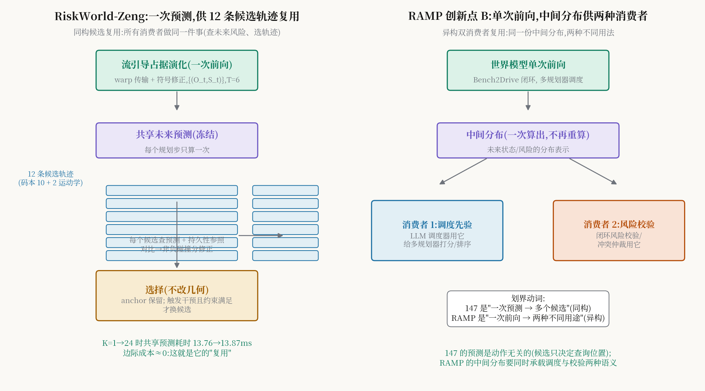

# 一次预测,十二条轨迹分着用:RiskWorld-Zeng 的共享预测与持久性参照干预

> **信息块**
> - 标题：RiskWorld: Risk-Aware World Modeling with Flow-Guided Occupancy Evolution for Selective Trajectory Planning in Automated Driving
> - 作者：Rongxiang Zeng*、Linsen Cai*（共同一作）、Jiafu Zhang、Yijie Zhong、Yide Tao、Shuai Wang、Nan Zheng、Hai L. Vu、Alvaro Garcia Hernandez、Yongqi Dong（通讯，RWTH Aachen University；另有 Monash University、TUM 作者；德国卓越战略/ERS 资助）
> - venue：**arXiv 预印本** arXiv:2609.18442v1（2026-09-16，cs.AI）。IEEE 会议排版风格，**截至 2026-10-11 无任何会议/期刊录用信息**，引用时按预印本处理。
> - 链接：https://arxiv.org/abs/2609.18442
> - 代码：**未找到官方开源代码**
> - 一句话核心洞见：**规划不需要为每条候选轨迹各做一次世界推演——因为候选轨迹不改变世界的演化，只改变"你站在哪里看世界"；所以每个规划步只做一次流引导的占据预测，让 12 条候选轨迹都来"查询"这份预测，再用"未来 vs 当前"的对比决定要不要换掉原来的选择。**
> - **消歧声明（S 级关键）**:本文是 **Zeng 版 RiskWorld（arXiv:2609.18442）**，与 **Li 版 RiskWorld（arXiv:2608.21414，146 篇）** 同名但完全不同。Zeng 版做"**选哪条轨迹**"（规划选择，nuScenes 开环），Li 版做"**哪个对象危险**"（风险识别，RiskBench）。**用户 RAMP 论文引用的是本文（Zeng 版）**，它是 RAMP 创新点 B（世界模型单次前向中间分布复用）最接近的已发表工作，划界必须精确到机制动词。

## 先看摘要里那句最重要的话

"One forecast is generated per planning step and reused across candidates."（每个规划步只生成一次预测，供所有候选复用。）

这句话是全文的赌注。主流做法（OccDriver、ScePT、DTPP）是**动作条件预测**:每条候选轨迹各做一次"如果我这么开"的条件推演，K 条候选 = K 次前向。Zeng 版反其道而行:**预测一次，查询多次**。它的底气是一个简单但有力的观察——候选轨迹改变的是 ego 的位置，不改变其他交通参与者的演化（至少在一阶近似下）。所以世界的未来演化可以只算一次，每条候选轨迹只需要去这份"未来地图"上查自己经过的地方。

这个选择的代价作者在 related work 里诚实地承认了:它放弃了**动作条件**（action-conditioned）的交互建模——即"我的动作会引起别人反应"的那部分。ScePT/DTPP 建模的是"候选相关的交互"，Zeng 版建模的是"候选无关的共享未来"。论文原话大意是:候选决定查询位置，不决定 actor 的响应。这是一个清醒的取舍:用交互精度的损失，换 K 条候选的摊销成本。

## 风险场:把"危险"画成 BEV 上的地形图

在讲预测之前，先看输入。作者定义了一个 BEV 域上的非负标量势:

$$
r_t : \Omega \to \mathbb{R}_{\ge 0}, \quad x \mapsto r_t(x) \tag{1}
$$

$\Omega \subset \mathbb{R}^2$ 是 BEV 空间。直觉:把"危险"画成地形图，哪里危险哪里"高"。多通道风险张量 $R_\tau \in \mathbb{R}^{C_r \times H_r \times W_r}$ 包含:

- **静态地图风险**:不可行驶区惩罚 + 车道线/人行横道/路沿的接近势；
- **actor 占据**:把每个 actor 的有向 footprint 光栅化，按车辆/行人/自行车分组取并；
- **运动诱导风险**（公式 3）:每个 actor 一个各向异性的高斯型势
$$
\phi_i(x) = A_i\,\omega_i(x)\,\exp\left(-\frac{u_i^2}{2(s_{i,x}+\epsilon_{ker})} - \frac{v_i^2}{2(s_{i,y}+\epsilon_{ker})}\right)
$$
$u_i,v_i$ 是点 $x$ 在 actor 朝向系下的纵/横向偏移，$A_i$ 是类别相关的幅值，$\omega_i(x)$ 是速度相关的方向权重，$s_{i,x},s_{i,y}$ 是由尺寸/运动/类别决定的空间范围。说人话:**车越快、它前方的"危险阴影"拖得越长**，$\omega_i$ 让这个阴影朝运动方向偏。
- **两两交互/TTC 启发场**:等速最近接近点之间放势，按 clearance、时间和类别加权。

所有通道经对数压缩、5–95 百分位缩放、clip 到 $[0,1]$。**注意作者的措辞**:这些通道编码的是"场景结构和空间风险线索"，**不是标定的碰撞概率**。这个诚实很重要——风险场是启发式的，后面的碰撞分数另有标定。

时空编码:共享卷积编码器把每帧风险图变成空间 token 网格，时间 self-attention 在每个网格位置聚合历史，残差 MLP 并入地图 token；两个 GRU 分别编码 actor 和 ego 历史，通过 cross-attention（以 risk token 为 query）进入。然后和 GeoBEV 的视觉特征融合:

$$
\Delta = f_\Delta([V, R, |V-R|, V\odot R, M]), \qquad W_0 = R + G \odot \Delta \tag{4,5}
$$

$V,R$ 是对齐后的视觉/风险特征，$M$ 是风险网格覆盖 mask，$G$ 是覆盖相关的门控。这个融合式的写法（拼 $[V,R,|V-R|,V\odot R]$ 再学残差）是典型的"让网络自己决定怎么结合"——$|V-R|$ 和 $V\odot R$ 分别给差异和共识的显式信号。

## 流引导的占据演化:搬运工 + 修正员

这是世界模型的核心（图 1b）。从 $W_0$ 出发:

1. **初始化**:场景特征 $S_0 = f_{scene}(W_0)$，当前占据 $O_0 = \sigma(f_O(S_0))$，运动状态 $m_0 = S_0 + f_C(W_0)$（$C$ 固定，在整个 rollout 里提供当前场景上下文）。
2. **流预测**:$F_t = s_F \tanh(f_F(m_{t-1}))$，位移场，$s_F$ 限幅（米）。
3. **搬运（warp）**:同一个位移场同时搬运占据、运动状态、场景特征
$$
\hat{O}_t = \Pi_\epsilon(\mathcal{W}(O_{t-1}, F_t)), \quad \hat{m}_t = \mathcal{W}(m_{t-1}, F_t), \quad \hat{S}_t = \mathcal{W}(S_{t-1}, F_t) \tag{6}
$$
$\mathcal{W}$ 是后向 warp（在 $x - F(x)$ 处双线性采样），$\Pi_\epsilon$ 把占据 clip 到 $[\epsilon, 1-\epsilon]$。**三个量用同一个 warp**——这保证了后续轨迹查询时，占据和特征采的是"同一个源位置"，空间对应关系不错乱。
4. **运动状态更新**（公式 7）:搬运后的状态 + 初始上下文 $C$ + 时间 embedding + 占据反馈 $f_{fb}(\hat{O}_t - O_0)$，过 ConvGRU。$\hat{O}_t - O_0$ 这一项是"搬运后的占据偏离当前预测多少"——让 recurrent 更新能感知占据的演化。
5. **符号修正**（公式 8）:光靠搬运解释不了所有占据变化（比如新出现的车、消失的车）。两个头预测源/汇 $B_t = f_{src}(m_t)$、$D_t = f_{snk}(m_t)$:
$$
\Delta O_t = \alpha[\tanh(B_t) - \tanh(D_t)], \qquad O_t = \Pi_\epsilon(\hat{O}_t + \Delta O_t)
$$
$\tanh(B_t)$ 加占据（源：新出现），$\tanh(D_t)$ 减占据（汇：消失），$\alpha$ 控幅度。**注意修正只动占据 $O_t$，不动场景特征 $\hat{S}_t$**——特征保持搬运后的样子，占据单独修正。这个不对称设计是深思熟虑的:特征是给查询用的"上下文"，占据是给风险算分的"证据"，两者解耦。

滚 $T=6$ 步（0.5s 间隔，3 秒），得到**共享**的未来序列 $\{(O_t, S_t)\}_{t=1}^T$。**整个 rollout 每个规划步只算一次**——这是"复用"的供给侧。

## 候选集与持久性参照干预:复用的需求侧

**候选集**（公式 2）:$K=12$ 条。10 条来自码本——训练集真值 ego 轨迹相对"等速直线参照"的残差聚类；推理时按 ego 速度和导航指令选组。外加 2 条确定性的低速运动学候选。每条 6 个未来位姿（3 秒 @0.5s）。

选择流程分两步。第一步**当前世界评分（CSR）**:base candidate scorer（BCS）用当前证据给每条候选打碰撞分，选出 **anchor** $a^C_k$。第二步**持久性参照干预（PRI，公式 9–12）**，这是全文最精巧的部分:

每条候选 $k$ 在未来时刻 $t$ 的 footprint 位置上，查两样东西:
- **未来证据**:共享预测 $(O_t, S_t)$ 在该位置的 patch；
- **持久性参照**:把**当前** $(O_0, S_0)$ 重复放到同一位置——"如果世界静止不动，这里应该是什么样"。

共享的 evidence encoder 分别编码两者得 $E^F_{k,t}$、$E^C_{k,t}$，footprint 内最大占据得 $\rho^F_{k,t}$、$\rho^C_{k,t}$。对比量 $\delta E_{k,t} = E^F_{k,t} - E^C_{k,t}$、$\delta\rho_{k,t} = \rho^F_{k,t} - \rho^C_{k,t}$。时序编码器把特征对比映成 $z_{k,t}$，非负增益 $\gamma_{k,t} = [\text{softplus}(z_{k,t}) - \log 2]_+$，碰撞 logit 修正:

$$
b_{k,t} = \beta\,\gamma_{k,t}\,\tanh\!\left(\frac{\|\delta E_{k,t}\|_2}{\sqrt{d}}\right)\,[\delta\rho_{k,t}]_+, \qquad p^F_{k,t} = \sigma(c^C_{k,t} + b_{k,t}) \tag{9}
$$

三个构造细节保证**修正非负**（$p^F \ge p^C$，未来证据只能加风险、不能减）:
1. $\gamma_{k,t} \ge 0$（softplus 减 $\log 2$ 再取正部）；
2. $\tanh(\cdot) \ge 0$（范数非负）；
3. $[\delta\rho_{k,t}]_+$——**只有 footprint 最大占据真的增加了**，修正才生效。光是特征变了、占据没涨，不算风险。

大白话:**未来必须拿出"这里真的变危险了"的证据（占据增加），才能推翻当前的选择**。这是一个保守的干预哲学——默认信任当前世界，未来证据要"自证"才有发言权。作者在引言里为这个哲学辩护:未来的风险分可能反映的是当前评估已经涵盖的危险，也可能是不确定性带来的噪音；不加区分地响应未来，等于把规划的决定权交给了一个更不确定的信号。

**替换规则**（公式 11–12）:干预需要 anchor 的未来修正为正，且某个分量 $j$ 上 $r^{F}_{k^C,j} > r^{C}_{k^C,j} + \eta$（或跨过阈值 $\tau_j$）。备选 $k$ 必须**分量-wise**同时满足:预测风险不比 anchor 差（$r^F_k \le r^F_{k^C}$）、至少一个分量好出 margin $\eta$、预测轨迹误差也在容忍带内（$\bar{\ell}_k \le \bar{\ell}_{k^C} + \delta_{mean}$）。合格者里按 $J_k = w_{max}\max_j r^F_{k,j} + w_{avg}\bar{r}^F_k + \bar{\ell}_k$ 选最小。**候选几何不变**——只做选择，不做精修（和 OccDriver 的精修形成对照）。

训练分阶段:先预训练 RiskExpert（未来风险场重建），再训融合与当前评分，再训占据演化（占据监督 + 掩码 smooth-L1 位移损失 + 源/汇事件 BCE）。最后**校准阶段冻结一切**，只训 incoming-risk bridge（公式 13:$L_{cal}$ 含 BCE、Brier、focal、hard-example、$b_{k,t}^2$ 二次惩罚——最后一项是"别让修正太大"的缰绳）。

## 数字:开环 nuScenes，3 秒碰撞率最低

评测是 **nuScenes 开环规划**（6,019 样本/150 验证场景，5,119 有完整未来标注），指标 L2（m）和碰撞率（%），1/2/3 秒 horizon：

| 方法 | 平均 L2 | 平均碰撞率 | 3s 碰撞率 |
|---|---|---|---|
| DiffusionDrive | 0.47 | 0.08% | 0.16% |
| ResWorld | 0.35 | 0.07% | 0.16% |
| SparseDrive-S | 0.57 | 0.08% | 0.18% |
| **RiskWorld-Zeng** | **0.40（第二）** | **0.09%** | **0.14%（最低）** |

摘要的表述是精确的:"3 秒 horizon 碰撞率最低（0.14% vs DiffusionDrive/ResWorld 的 0.16%），平均 L2 第二（0.40m）"。注意平均碰撞率 0.09% 实际排第二（ResWorld 0.07%）——摘要没声称平均最低，措辞诚实。

效率:90.81M 参数，RTX 4090 上 **11.5 FPS**，是表中相机输入方法里最高的（OccWorld-O 的 18 FPS 用的是真值占据输入、无图像处理，不可比，作者明确标注了）。

消融（表 III）:Full vs CSR（只用当前证据）——平均碰撞率 0.09% vs 0.12%，**未来证据的净贡献是 0.03 个百分点**；No-Transport（flow 置零）3s 碰撞率 0.18% vs Full 0.14%，流搬运的贡献可测但不大。风险特征置零/打乱:碰撞率 0.09%→0.28%/0.27%，L2 0.40→0.63/0.49——风险特征是承重的。

**复用的关键数字**（4.D 末）:BEV 特征和候选轨迹给定的情况下，候选数 $K=1 \to 24$，共享世界预测耗时 **13.76ms → 13.87ms**（几乎不变），总耗时 44.16ms → 45.20ms。**每增加一条候选，边际成本约 0.05ms**——这就是"一次预测供多候选复用"的实证形态。注意测量排除了视觉前端。

## 怀疑式阅读

1. **开环评测的天花板**:所有规划数字都是开环 L2/碰撞率。开环碰撞率 0.09% 听起来很低，但开环指标对"因果混淆"免疫力差（模型可能只是在拟合数据集的驾驶风格）。作者没有闭环（nuPlan CLS 或 CARLA）数字——和 OccDriver（nuPlan 闭环双 SOTA）比，这是硬伤。引用它的"最低碰撞率"时必须注明"开环"。
2. **未来证据的净增益很小**:Full 0.09% vs CSR 0.12%——整个 PRI 机制（论文的半壁江山）只换来 0.03 个百分点的碰撞率下降。L2 完全没动（都是 0.40）。一个诚实的解读:当前世界评分已经很强，未来干预是"锦上添花"而非"雪中送炭"。审稿人如果问"PRI 值不值得"，作者的最好答案是那个 K=1→24 的摊销数字，而不是 0.03。
3. **输入用了真值**:推理输入含"标注导出的当前/历史 actor 状态"（GT-Tr）和数据集地图。表头 Input 列 RiskWorld 写的是 "C+M+GT-Tr"——相机+地图+真值 tracks。这比纯视觉方法（VAD 的 C+M+B+Mo）占了便宜。作者在表注里写清楚了，不算隐瞒，但横向对比时要打折。
4. **动作无关假设的边界**:共享预测成立的前提是"候选不改变他车演化"。在高度交互场景（无保护左转、并道），这个假设是错的——你的动作会改变别人的反应。作者用 related work 的一句话承认了与动作条件预测的区别，但没有量化这个近似在交互场景里损失多少。这正是 RAMP 可以进攻的方向（如果 RAMP 的世界模型是动作条件的）。
5. **超参数森林**:$\eta$、$\tau_j$、$\delta_{mean}$、$\delta_{prefix}$、$w_{max}$、$w_{avg}$、$\alpha$、$\beta$、$s_F$、$\epsilon$……干预规则里的可调旋钮很多，正文没给任何敏感性分析。分量-wise 约束的阈值怎么定的，完全没说。
6. **v1 预印本**:2026-09-16 的 v1，Related Work 里引用的 IR-WM、ResWorld 等都是同期工作。这篇的"新"要打引号——它站在 2026 年中的世界模型热潮上，增量是"共享预测+持久性参照"这个组合，不是某个单点突破。

## 与 RAMP 的血缘/划界（核心节）

这是 RAMP 创新点 B 的**划界主战场**，必须精确到机制动词。下面分六层讲清。

**第一层:问题陈述的相似性——这是它成为"最接近竞品"的原因。** Zeng 版和 RAMP 都在回答同一个工程问题:"世界模型的前向很贵，多个候选/多个消费者都要用，怎么摊销？"Zeng 版的答案是"每规划步只做一次预测、多候选轨迹复用"（摘要原话），RAMP 创新点 B 的答案是"单次前向的中间分布同时服务调度先验和风险校验"。在"摊销一次前向的成本"这个抽象层面上，两者是同构的——这就是为什么 RAMP 的 related work 必须正面引用它，而不是绕开。绕开会被审稿人（很可能就是做世界模型的人）一眼看穿。

**第二层:复用机制的动词差异——"查询" vs "消费"。** 这是划界的第一把刀。Zeng 版的复用动词是**查询（query）**:12 条候选轨迹是 12 个"读者"，它们到共享预测 $\{(O_t,S_t)\}$ 上按自己的 footprint 位置"查"未来占据和特征，查完算一个碰撞分修正。12 个读者做的是**同一件事**（homogeneous consumers），读的是**同一个最终产物**（occupancy + scene features，预测的输出端）。RAMP 的复用动词是**消费（consume）**:单次前向产生的**中间分布**（不是最终输出，是中间层的分布表示）被两个**异构**消费者以**不同方式**使用——LLM 调度器拿它当多规划器的打分先验（"哪个规划器更可能对"），风险校验拿它当冲突仲裁的证据（"这个调度决策安不安全"）。一个是"一份报纸十二个人看同一版"，一个是"一份中间产物两个人各取所需"。机制动词写进论文时建议这样写:"Zeng et al. share the final forecast across homogeneous candidates via querying; we share intermediate distributions across heterogeneous consumers (scheduler prior vs. risk verification)."

**第三层:预测的动作相关性——这是最硬的 technical 差异。** Zeng 版的共享预测是**动作无关**的（action-agnostic）:预测 $\{(O_t,S_t)\}$ 的计算不依赖任何候选轨迹，候选只决定"查哪里"（论文原话:"Candidates determine query locations, not actor responses"）。这意味着它的世界模型回答的是"世界会怎样"，而不是"如果我这么开世界会怎样"。RAMP 的世界模型（按创新点 B 的设计）是**动作条件**的:中间分布要承载"不同规划器意图下的未来"，调度先验的意义正在于区分"规划器 A 的意图导致的未来"和"规划器 B 的意图导致的未来"。如果 RAMP 的世界模型也是动作无关的，那创新点 B 就退化成 Zeng 版的翻版——所以 RAMP 的方法章节必须明确写出动作条件性，这是和 Zeng 版划清界限的**充要条件**。

**第四层:决策的形态——"选择" vs "调度+校验"。** Zeng 版的决策是**选择（selection）**:12 条固定几何的候选，选一条，几何不变（"Candidate geometries remain unchanged"）。它的 PRI 是一个"要不要换 anchor"的二元干预，触发条件苛刻（非负修正+分量约束+误差容忍）。RAMP 的决策是**调度（scheduling）+ 校验（verification）** 的双层结构:LLM 调度器在多个**不同**规划器之间做选择（不是同一解码器的多模态，是异构规划器），风险校验独立地对调度结果做否决/仲裁。Zeng 版没有"校验"这个独立环节——它的风险就是选择的标准本身。RAMP 可以这样写:"In RiskWorld-Zeng, risk assessment and selection are fused in a single intervention rule; we decouple them into scheduling (prior-driven) and verification (risk-driven), allowing the verifier to veto the scheduler—a structure motivated by closed-loop safety rather than open-loop scoring."

**第五层:评测语境——开环 vs 闭环。** Zeng 版是 nuScenes **开环**规划（L2/碰撞率），RAMP 是 Bench2Drive **闭环**。这个差异不只是数字不可比，更是机制合理性的来源:开环下"一次预测多次查询"是安全的（真值未来固定）；闭环下，单次前向的中间分布必须在**多步 rollout 中保持一致性**，RAMP 的复用机制要回答"中间分布在闭环时序展开中是否漂移"——这是 Zeng 版完全没有触及的问题，也是 RAMP 实验章节（4.3–4.5 节 Bench2Drive）可以建立壁垒的地方。

**第六层:引用策略建议。** RAMP 的 related work 应该给 Zeng 版一个**独立的、尊重的段落**，而不是一句话带过。建议结构:(1) 承认它是"单次预测多候选复用"思想最接近的已发表工作，引用它的摊销数字（K=1→24，13.76→13.87ms）作为"复用有价值"的证据——用它的数据为 RAMP 的动机背书；(2) 用第二、三层的动词差异划界：homogeneous querying of an action-agnostic final forecast vs. heterogeneous consumption of action-conditioned intermediate distributions；(3) 指出它的开放缺口（动作无关假设在交互场景的失效、开环评测），正是 RAMP 切入的位置。这样的写法把最危险的竞品变成"垫脚石"：审稿人看到作者比他更懂这篇论文，质疑的矛头就会转向别处。

**一句话版本**（可直接进 RAMP 论文）:"Closest to our reuse mechanism is RiskWorld-Zeng, which generates one shared occupancy forecast per planning step for all candidates to query; however, its forecast is action-agnostic and consumed homogeneously for selection only, whereas our single forward's intermediate distributions are action-conditioned and consumed heterogeneously—as both the scheduler's prior over planners and the closed-loop risk verifier's evidence."

*图:左为 Zeng 版——一次流引导占据预测（冻结），12 条候选轨迹同构地查询它做碰撞分修正，只做选择不改几何；右为 RAMP 创新点 B——单次前向的中间分布被两个异构消费者（调度先验、风险校验）以不同方式消费。划界动词：同构查询 vs 异构消费；动作无关 vs 动作条件。*

## 带走什么

Zeng 版留给 RAMP 的有三样东西。第一，**摊销的实证数字**（13.76→13.87ms）——"复用"不是空话，它真的把边际成本打到了接近零，RAMP 的动机段落可以直接引用这个数字。第二，**持久性参照的设计哲学**——"未来证据必须自证才能推翻当前选择"（非负修正+占据增加门槛），这是一种保守干预的优雅实现，RAMP 的风险校验在设计"何时否决调度器"时可以借鉴它的数学形状（softplus 增益 × 对比范数 × 正部占据差）。第三，**一个反面教材**——动作无关的共享预测在交互场景下是近似，RAMP 只要把动作条件性做实，划界就立住了。最后，永远用 arXiv 号引用它：2609.18442 是 Zeng 版，2608.21414 是 Li 版，名字一样，论文完全不同。
