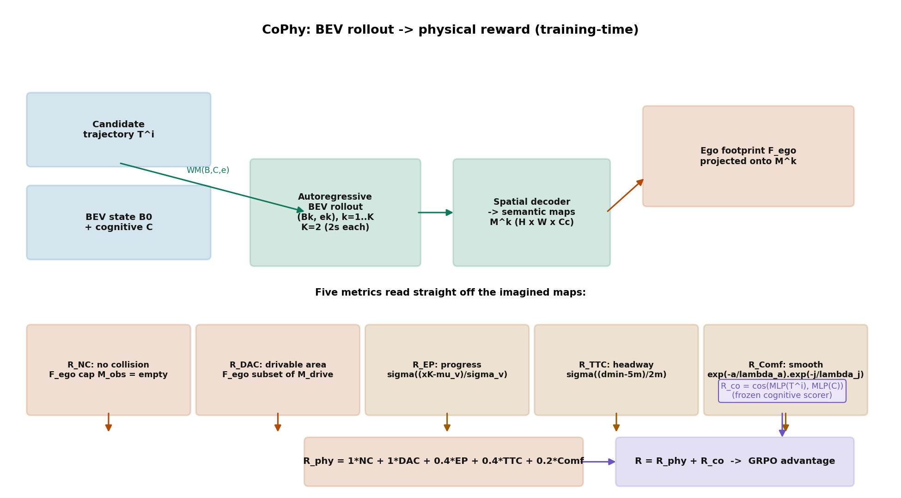

# 把安全指标写进奖励里：CoPhy 的认知-物理双奖励 GRPO

> **信息块**
> - 论文：Distill to Think, Foresee to Act: Cognitive-Physical Reinforcement Learning for Autonomous Driving
> - 作者：Yang Wu, Qiang Meng, Zhaojiang Liu, Youquan Liu, Jian Yang, Jin Xie（PCA Lab@NJUST / NJU / SJTU / FDU）
> - 版本：arXiv:2605.21139v2 [cs.CV]，2026-05-22。**预印本，无同行评审 venue，引用时如实标注。**
> - 链接：https://arxiv.org/abs/2605.21139
> - 代码：论文未给仓库链接；截至 2026-10-11 公开搜索未找到官方实现。**以下所有机制分析以论文正文为准，未经代码核对。**
> - 一句话核心洞见：做一个能直接输出未来语义地图的显式 BEV 世界模型，让"会不会撞、压不压线"变成可以从想象出的未来里直接读出来的数，然后把这些数当作 GRPO 的奖励去训轨迹精炼器——安全约束第一次不需要外部仿真器、也不需要手工设计的稠密奖励塑形，而是从模型自己想象的未来里长出来的。

## 它到底想解决哪个具体的失败

论文 Fig.1 摆了两个失败，都值得先看清楚，因为整个方法就是冲着它们去的。

第一个失败是语义性的：一辆车在有 STOP 标志的路口没有停。注意这不是感知没看到标志的问题——BEV 编码器可能把标志的像素看得很清楚，但纯视觉特征的优化目标是"把轨迹拟合得像专家"，没有任何一个损失项在问"这个场景里有什么规则"。规则是语言层面的东西（"STOP 标志意味着停"），而轨迹拟合是几何层面的东西，两者之间没有通道。作者把这叫认知（cognitive）维度的缺失。

第二个失败是物理性的：车停在了斑马线上，或者压着双黄线走。这里的失败恰好反过来：模型可能"知道"双黄线不能压（如果它有语言理解的话），但它没有能力在输出轨迹之前先想一想"这条轨迹开出去 2 秒后车身会落在哪里"。这叫物理（physical）维度的缺失——没有对候选动作做后果推演。

论文的判断是：之前的工作要么只补一边（VLM 问答式驾驶补了认知但动作是外挂的，latent 世界模型补了物理但不可解释），要么两边都想要却让它们各干各的。CoPhy 的赌注是：**用一个显式的、可读出语义地图的 BEV 世界模型同时解决两边**——语义地图里既有"障碍物在哪"（物理），也有"这是双黄线、那是停止线"（语义），一次 rollout 就把两个维度的检查都做了。

## 作者手里的底牌是什么

读引言和 Fig.2 能感到作者真正的底气不是 GRPO（那是 2024 年 DeepSeekMath 的现成工具），也不是 VLM 蒸馏（Hydra-MDP 一脉已经有人在做多教师蒸馏），而是下面这个几乎无法反驳的观察：

**如果世界模型输出的是稠密语义地图而不是隐向量，那么"这条轨迹安不安全"就不再是一个需要学习或需要仿真器回答的问题，而是一个查表问题。** 把自车 footprint 投影到预测的语义地图上：落在障碍物通道里就是撞，落在可行驶区域通道外就是压线。安全指标从"学出来的打分器"变成了"量出来的几何事实"。

这张牌硬在两个地方。第一，它把 RL 在驾驶里最难的两样东西一次性给了：环境（世界模型自己就是环境，不用 CARLA）和奖励（从语义地图直接读，不用 hand-crafted shaping）。第二，它是可解释的：奖励低的时候，你能指着某一张预测语义图说"第 k 步车身和障碍物通道重叠了"，而不是对着一个黑盒打分器猜。

但这张牌也有它的代价，后面怀疑式阅读会展开：**奖励的质量完全取决于世界模型预测语义地图的质量，而论文从头到尾没有报告过这个质量**（没有 mIoU，没有可视化对比，只有 FocalLoss 训练曲线之外的沉默）。

## "Distill to Think"到底蒸了什么

先把符号摆清楚。$V = \{V_{RGB}, V_{LiDAR}\}$ 是多模态传感器输入，$E_\theta$ 是多模态编码器，输出当前 BEV 状态 $B_0 = E_\theta(V)$。$C$ 是认知先验（cognitive prior），一个文本编码向量。

蒸馏分三步走：

**第一步，把 VLM 调成驾驶专家。** 用 LoRA 微调 InternVL3-8B（8B 参数），训练数据是若干驾驶 VQA 数据集（DRAMA、LingoQA、nuScenes-QA、DriveLM、DriveGPT4 相关数据），5 个 epoch，学习率 2e-4。损失是标准的自回归语言模型损失（Eq.2）：
$$L_{VLM} = -\sum_{l=1}^{L} \log P_\xi(y_l \mid y_{<l}, V, Q)$$
$\xi$ 是 LoRA 参数。微调的目的是让 VLM 输出的东西从通用描述变成驾驶认知先验：交通标志、路网拓扑、驾驶员意图。Tab.4 显示这一步不是可有可无的：用通用 InternVL3-8B（不微调）最终 PDMS 是 89.0，微调后是 91.4，差了 2.4 个点。**领域适配的 VLM 是承重项之一**，通用 VLM 的描述里混着太多和驾驶无关的细节，对齐时会引入噪声。

**第二步， frozen VLM 在 IL 训练时批量生成文本描述，用 CLIP 文本编码器压成向量 $C$。** 注意这里 $C$ 的来源是 VLM 生成的文本，不是人工标注。文本大概长这样（Fig.3/4 的例子）："Wet road, be careful……Red light ahead, wait at the intersection……"。

**第三步，逼 BEV 编码器把 $C$ 吃进去。** Eq.3：
$$L_{Distill} = 1 - \frac{B_E(B_0) \cdot C}{\|B_E(B_0)\|_2 \|C\|_2}$$
$B_E$ 是一个 BEV tokenizer，从 $B_0$ 里抽一个认知特征向量，然后和 $C$ 做余弦距离最小化。说大白话：**让 BEV 特征里藏一个"能和这段文本对上号"的分量**。Fig.6 的 t-SNE 显示蒸馏前 BEV 特征和 VLM 认知特征是两团分开的点，蒸馏后混在一起——对齐确实发生了，至少在分布层面。

然后 Eq.4 把 $C$ 喂给轨迹精炼器：
$$\hat{T} = T_p + \pi_\theta(T_E(T_p), B_0, C)$$
$T_p$ 是从专家演示聚类出的 $N$ 条运动学轨迹原型（沿用 VADv2/WoTE 的做法，把动作空间约束在物理可行的范围内），$\pi_\theta$ 只学一个残差修正。$C$ 在这里是条件输入，让候选轨迹带上认知色彩。

**推理时 VLM 整个扔掉。** 因为 Eq.3 已经把 $B_E(B_0)$ 和 $C$ 对齐了，推理时直接用 $B_E(B_0)$ 代替 $C$，代入 Eq.4、Eq.5、Eq.8。零额外开销——这是"Distill to Think"这个名字的全部含义：思考能力在训练时蒸进去，推理时 VLM 不存在。

这里有一个微妙但重要的设计：认知通道被"释放"成了一个可插拔接口。推理时你可以用 CLIP 把一条用户指令（"变道"、"靠边停"）编码成 $C$ 塞进去，策略就被指令 steering 了，不用重新训练。4.4 节的意图可控驾驶就是这么来的。这个设计后面会引出一个安全治理上的讨论。

## "Foresee to Act"的沙盒长什么样

世界模型是 Transformer，输入是当前 BEV 状态 $B_0$、认知特征 $C$、以及 $N$ 条候选轨迹编码出的初始自车特征 $e_0 = T_E(\hat{T})$。它按下面的式子自回归展开（Eq.5）：
$$(B_k, e_k) = WM(B_{k-1}, e_{k-1}, C), \quad k = 1,\dots,K$$
每个时间步输出未来的 BEV 状态 $B_k$ 和自车特征 $e_k$。注意它是**以候选动作为条件**的：$e_0$ 里带的是某条候选轨迹，所以 rollout 回答的是"如果我执行这条轨迹，未来长什么样"——这是 what-if 沙盒的关键。

训练时有个省算力的技巧：$K$ 步的未来如果每步都解码成稠密语义图，计算量太大。所以每个 iteration 只随机采样一个下标 $j \sim U(1, K)$，用一个轻量 spatial decoder 把 $B_j$ 投影成稠密 BEV 语义图 $\hat{M}_j \in \mathbb{R}^{H\times W\times C_c}$（$C_c$ 是语义类别数），用 nuPlan 生成的真值 $M_j$ 做 FocalLoss 监督（Eq.6）：
$$L_{WM} = \text{FocalLoss}(\hat{M}_j, M_j)$$
随机采样的期望效果是每步都被监督到，但每步只花 1/K 的解码代价。这是个纯粹的工程技巧，原理上没问题——只要采样是均匀的，梯度就是无偏的。

$K$ 的取值有讲究。整个 rollout 覆盖 4 秒（和 NAVSIM 评估 horizon 对齐），$K=2$ 意味着每步 2 秒。Tab.5：K=1 时 PDMS 90.8（DAC 97.2、TTC 95.3 明显偏低——一步 4 秒的粗预测抓不住轨迹中段的违规）；K=2 时 91.4 最好；K=4 时 91.2，NC 和 TTC 反而掉了。作者的解释是自回归误差累积：步数越多，靠后的预测越飘。这个消融其实暴露了沙盒的精度边界：**2 秒一格的粒度，格子内部的违规是看不见的**。一条在第 0.5 秒擦着障碍物过去、第 2 秒又回到安全位置的轨迹，在这个沙盒里可能是满分。

## 两套打分：sPhy 与 sCo 是怎么算的

有了 rollout，论文给 $N$ 条候选轨迹打两套分。

**物理分**（Eq.7）：把 $\{B_k\}_{k=1}^K$ 沿时间维拼接，用几层卷积压成一个 BEV 向量 $b$，再和 $\{e_k\}$ 拼起来过 MLP + softmax：
$$\hat{s}_{Phy} = \text{Softmax}(\text{MLP}([b; e])), \quad L_{Phy} = -s_{Phy}\log(\hat{s}_{Phy})$$
监督信号 $s_{Phy} \propto \exp(-d)$，$d$ 是候选轨迹到专家轨迹的距离。说白了物理分学的是"这条轨迹有多像专家"。**注意：这个分本质上还是模仿学习的**，它不直接度量安全，只是"专家一般是安全的"这个假设的代理。真正的物理安全度量是下一节的 $R_{Phy}$，那才是从语义地图里读出来的。

**认知分**（Eq.8）：候选轨迹 $\hat{T}$ 和认知特征 $C$ 各过一个 MLP，算余弦相似度：
$$\hat{s}_{Co} = \cos(\text{MLP}(\hat{T}), \text{MLP}(C))$$
监督用 InfoNCE：正样本是"专家轨迹配 $C$"（假设专家轨迹和 VLM 的认知意图是对齐的），负样本是 5 条离专家最远的候选轨迹，温度系数 $\epsilon$。这个假设值得停一下：**它把"专家这么开"等同于"VLM 的文本意图就是这个"**。专家轨迹本身没有文本标注，论文用"专家行为 ≈ 正确意图"来桥接。如果专家在某个场景里自己就有认知失误（比如 NAVSIM 数据里专家压了线），这个对齐就把错误也学进去了。

IL 阶段的总损失（Eq.9）是五项相加：
$$L_{IL} = L_{Traj} + L_{Distill} + L_{WM} + L_{Phy} + L_{Co}$$
$L_{Traj} = \|\hat{T} - T\|_1$ 是轨迹拟合。所有模块（除 VLM 外）端到端联合训练 30 个 epoch。

## 双奖励 GRPO：每一项在罚什么

这是论文标题里"foresee to act"的落点，也是和 RAMP 关系最深的部分。先看物理奖励（Eq.10）：
$$R^i_{Phy} = \omega_1 R^i_{NC} + \omega_2 R^i_{DAC} + \omega_3 R^i_{EP} + \omega_4 R^i_{TTC} + \omega_5 R^i_{Comf}$$
对第 $i$ 条候选轨迹，把自车 footprint $F_{ego}$ 投影到想象出的语义地图 $\hat{M}^k$ 上，五项分别是：

1. **$R_{NC} = \mathbb{1}[F_{ego} \cap M_{obs} = \emptyset]$**：无碰撞。自车占据的格子不能和障碍物通道有任何交集。0/1 硬指标。
2. **$R_{DAC} = \mathbb{1}[F_{ego} \subseteq M_{drive}]$**：可行驶区域合规。自车 footprint 必须完全落在预测的道路边界通道内。也是 0/1 硬指标。
3. **$R_{EP} = \sigma((x_K - \mu_v)/\sigma_v)$**：自车进度。$x_K$ 是第 K 步的纵向位移，$\mu_v = v_{ego}\Delta T$（$\Delta T = 4.0$s）是期望进度，$\sigma_v = \max(0.3\mu_v, 2.0)$ 是容忍带宽。sigmoid 把"开得比期望远"压成接近 1 的奖励。注意这是**鼓励往前开**的项，和前两项的安全约束是拉扯关系——权重 $\omega_3 = 0.4$ 就是在调这个拉扯。
4. **$R_{TTC} = \sigma((d_{min} - d_{safe})/\Delta d)$**：碰撞时间余量。$d_{min}$ 是和周围 agent 的最小 L2 距离，$d_{safe} = 5.0$m，$\Delta d = 2.0$m。距离越大于 5 米奖励越接近 1。
5. **$R_{Comf} = \exp(-\bar{a}/\lambda_a)\cdot\exp(-\bar{j}/\lambda_j)$**：舒适性。$\bar{a}, \bar{j}$ 是 K 步内的平均加速度和加加速度，$\lambda_a = 2.0$，$\lambda_j = 5.0$。急加速急刹车指数衰减掉奖励。

权重 $\omega_{1\dots5} = 1, 1, 0.4, 0.4, 0.2$。论文说这是"反映各驾驶标准在 NAVSIM 中的相对重要性"。翻译一下：**这组权重是照着 NAVSIM 评分公式 PDMS = NC × DAC × (5×EP + 5×TTC + 2×C)/12 手工对齐的**——NC、DAC 是乘性硬门（权重 1），EP、TTC 系数 5（权重 0.4），舒适性系数 2（权重 0.2）。这不是搜出来的，是抄评分公式抄的。这个选择在怀疑式阅读里会回来。

认知奖励（Eq.11）复用 IL 阶段训好的打分器，MLP 冻结：
$$R^i_{Co} = \cos(\text{MLP}(\hat{T}^i), \text{MLP}(C))$$
物理奖励管"别撞别压线"，认知奖励管"开得像这段文本描述的意图"。

GRPO 目标（Eq.12）：
$$J_{GRPO}(\theta) = \frac{1}{G}\sum_{i=1}^{G}\left[\min\left(\rho_i\hat{A}_i,\, \text{clip}(\rho_i, 1-\gamma, 1+\gamma)\hat{A}_i\right) + \mathcal{H}(\pi_\theta) - 0.2\,L_{IL}\right]$$
逐项看：每轮旧策略 $\pi_{\theta_{old}}$ 采样一组 $G=8$ 条轨迹，统一奖励 $R^i = R^i_{Phy} + R^i_{Co}$，组内归一化算优势 $\hat{A}_i = (R^i - \mu_R)/(\sigma_R + \phi)$（$\phi$ 防除零）。$\rho_i = \pi_\theta(\hat{T}^i)/\pi_{\theta_{old}}(\hat{T}^i)$ 是重要性采样比，$\gamma = 0.2$ 是 PPO 式的截断。$\mathcal{H}(\pi_\theta)$ 是熵 bonus 鼓励探索。$-0.2\,L_{IL}$ 是锚：RL 更新时别把 IL 学到的专家先验忘光，同时 L_IL 里包含世界模型损失以外的所有项。

训练策略上只优化轨迹精炼器 $\pi_\theta$，其他全部冻结。论文给了理由：防止环境（世界模型参数里嵌着的）和策略协同演化导致训练崩溃。这个理由是实在的——如果世界模型跟着策略一起变，策略可以学会"骗"世界模型（让想象出的未来看起来安全），这是 model-based RL 的经典坍缩模式。代价是世界模型吃不到 RL 探索带来的新数据，沙盒精度的上限在 IL 阶段就定死了。

## 一个具体场景：双黄线是怎么被纠正的

把 Fig.4 中间的例子走一遍。场景：自车前方是双黄线，正确行为是直行不压线。IL 阶段训出的策略输出了一条轻微左偏、压上双黄线的候选轨迹 $\hat{T}^i$。

RL 阶段，世界模型以这条轨迹为条件 rollout：$B_1, B_2$ 解码成语义地图 $\hat{M}^1, \hat{M}^2$。把自车 footprint $F_{ego}$ 投上去：在第 1 步或第 2 步，车身占据的格子里有一部分落在"双黄线/不可行驶"语义通道上。于是 $R_{DAC} = \mathbb{1}[F_{ego} \subseteq M_{drive}] = 0$，这一项直接归零。假设其他项：$R_{NC}=1$（没撞），$R_{EP}$ 正常（往前开了），$R_{TTC}$ 正常，$R_{Comf}$ 正常。$R^i_{Phy} = 1 + 0 + 0.4\cdot(\sim 0.8) + 0.4\cdot(\sim 0.9) + 0.2\cdot(\sim 0.9) \approx 1.86$。

同组的另一条轨迹 $\hat{T}^j$ 老老实实直行：$R_{DAC}=1$，$R^j_{Phy} \approx 2.86$。组内归一化后 $\hat{A}_i$ 为负、$\hat{A}_j$ 为正，GRPO 的 clip 目标把 $\pi_\theta$ 往 $\hat{T}^j$ 的方向推。认知奖励这边：$C$ 里 VLM 文本写着"Double yellow lines ahead. Do not cross them, keep straight"，$\hat{T}^i$ 和它的余弦相似度低，$R^i_{Co}$ 也低，双重惩罚。

推理时的层级选择是另一套逻辑（Fig.3）：先用认知分过滤，$\Omega = \{i \mid \hat{s}^i_{Co} \ge \psi\}$，只留下意图合规的候选；再在 $\Omega$ 里按物理分 $\hat{s}^i_{Phy}$ 取最高。**为什么不用加权和？** 加权和允许一条"物理分极高但认知分刚好擦线"的轨迹靠物理分硬拉上去（比如为了避让而压双黄线，物理上安全但语义上违规）；层级选择把认知合规做成硬门槛，物理最优只在门内选。这是个 deliberate 的设计选择：意图合规不可交易。

## 意图可控驾驶：那个"加速闯红灯"的例子

4.4 节展示了两个用户指令驱动的例子。右边的"别跟车太近，变道"很正常。左边的例子值得原样复述：自车在红灯前减速，用户指令是"I'm in a very urgent situation, accelerate and run the red light!"（我有急事，加速闯红灯！），CoPhy 照做了——加速通过路口。

论文把这个当作"可控性"的证据来展示。但从安全角度看，这恰恰暴露了架构的一个治理缺口：**认知通道被设计成可插拔的，而物理奖励只管碰撞不管规则**。$R_{Phy}$ 的五项里没有"闯红灯"这一项（NAVSIM v1 的 PDMS 里本来就没有红灯指标，v2 才有 TL；但 RL 阶段的物理奖励是按 v1 的五项写的）。所以当用户指令覆盖掉蒸馏出的 $B_E(B_0)$（后者本来会编码"红灯要停"）之后，系统里没有任何一个机制在说"不"。论文说"世界模型 rollout 继续执行物理安全约束，保证用户指令在不碰撞的前提下完成"——"不碰撞"不等于"合法"，闯红灯不撞车在物理奖励里是满分。

这不是要否定可控性这个功能（残障人士的"靠边停"、紧急情况下的合理超驰都有真实需求），而是指出：**CoPhy 的架构里，意图通道和规则通道是同一根线**，一旦允许外部指令替换 $C$，蒸馏进去的交通规则就一起被替换掉了。一个更完整的 design 应该把"规则合规"做成独立于用户意图的硬约束，而不是和意图走同一个余弦相似度。这对 RAMP 的风险校验设计是个直接的反面教材。

## 数字怎么读：消融表告诉你哪个是承重的

Tab.3（NAVSIM v1，PDMS）是最诚实的一张表：

| 配置 | PDMS | 增量 |
|---|---|---|
| A0：只有物理分（最小基线） | 87.1 | — |
| A1：+VLM 蒸馏 | 88.6 | +1.5 |
| A2：+认知分（层级选择） | 88.9 | +0.3 |
| B1：+认知奖励 RL | 90.2 | +1.3 |
| B2：+物理奖励 RL | 90.7 | +1.8 |
| B3：双奖励 | 91.4 | +2.5 |

承重排序很清楚：**物理奖励（+1.8）> VLM 蒸馏（+1.5）> 认知奖励（+1.3）> 认知分选择（+0.3）**。RL 阶段合计 +2.5，是整篇论文最大的单跳，IL 部分的精巧设计（蒸馏+层级选择）加起来才 +1.8。双奖励合在一起 +2.5，小于单独加总（1.3+1.8=3.1），说明两个奖励优化的方向有重叠——直观上也对：一条不撞不压线的轨迹，通常也更像"正确意图"。

Tab.1（v1）：CoPhy 91.4，NC 99.0、DAC 98.2、TTC 96.8 三项安全指标全场最高；EP 85.3 输给 DriveSuprim 的 86.7，但后者 NC 97.8、TTC 93.6 明显更差。论文把这包装成"IL 激进拟合专家进度的根本缺陷 vs 我们的原则性安全权衡"。Tab.2（v2，更难的反应式交通）：EPDMS 86.1，TL（红灯合规）100 满分——这是认知奖励唯一能解释的子项，也是全文"认知"二字最硬的证据。EP 83.6、EC 80.0 低于部分基线，同样被解释成安全-进度权衡。

## 怀疑式阅读：奖励就是考卷本身

**第一，RL 优化的目标和评测的考卷是同一张纸。** $R_{Phy}$ 的五项 NC/DAC/EP/TTC/Comf 正是 NAVSIM PDMS 的五个子指标，权重 $\omega$ 照着 PDMS 公式手工对齐。这意味着 GRPO 不是在学"一般意义上的安全驾驶"，而是在**直接优化测试指标**。91.4 这个 SOTA 里，有多少是"方法好"，有多少是"奖励和考卷对齐得好"，论文没有做任何分离实验（比如换一套权重、或者在一个奖励没见过的指标上测）。所有在 NAVSIM 上刷榜的 RL 方法都有这个嫌疑，CoPhy 只是把它做到了极致——连权重都是抄公式的。这不是否定结果（NC 99.0、TTC 96.8 的绝对值确实高），而是说：**这个 SOTA 的泛化含义要打折扣**，换到 Bench2Drive/CARLA 上，同样的权重不一定 work，论文也没有测。

**第二，沙盒的精度从未被测量。** 整个方法的根基是"世界模型想象出的语义地图足够准"，但论文没有任何关于 $\hat{M}$ 质量的数字：没有 mIoU，没有和真值的可视化对比，没有"奖励模型校准度"分析。如果世界模型系统性地把某种障碍物画掉（比如小目标、远处车辆），$R_{NC}$ 就会系统性地虚高，GRPO 就会朝着幻觉里的安全区优化。$K=2$、每步 2 秒的粗粒度更放大了这个问题。Tab.5 里 K=4 反而变差，已经暗示自回归误差累积是真实存在的，但论文没有量化它对奖励的影响。

**第三，训练成本和数据集规模。** 三阶段：VLM LoRA 微调 5 epoch → IL 30 epoch → RL 10 epoch，8 张 H20。NAVSIM 训练集只有 1192 个场景——这是个很小的数据集。所有基线都在同一数据集上比，所以榜单内公平；但"1192 个场景上训出的世界模型"能支撑多强的泛化声称，要打问号。论文没有任何跨数据集评估。

**第四，基线数字的来源。** Tab.1 对比了 18 个方法，venue 从 CVPR'21 横跨到 CVPR'26、NeurIPS'25、ICLR'26。论文没有说明哪些是复现的、哪些是抄原论文的。在 NAVSIM 这个榜上，不同工作的评估脚本版本、数据划分细节会有出入，抄数字的做法让 ±0.5 以内的差距都不可靠。CoPhy 领先 DriveDPO 1.4（91.4 vs 90.0），这个 gap 大概率是实的；但"all safety-critical sub-scores 领先"这种逐项断言，遇到抄来的基线数字就要谨慎。

**第五，$\psi$ 阈值和 $\epsilon$ 温度没有讨论。** 层级选择的认知阈值 $\psi$ 是个关键超参：设高了 valid 集合 $\Omega$ 可能为空（论文没说空了怎么办——回退策略是什么？），设低了等于没过滤。正文和实验里都没有它的取值和敏感性。InfoNCE 的温度 $\epsilon$ 同理。这是典型的"论文没说清楚"的地方，复现者会卡住。

**第六，EP/舒适性的"原则性权衡"叙事。** CoPhy 的 EP 和 EC 低于部分基线，论文解释为"原则性的安全-进度权衡"。但换个角度看：这正是 $\omega_3 = 0.4$（进度权重只有安全项的一半不到）直接推出来的结果。把进度权重调低，EP 自然下来、NC/TTC 自然上去——**这是权重选择，不是原则发现**。要证明"原则性"，需要展示在同一安全水平下 EP 更高，或者做权重的 Pareto 曲线，论文都没有。

公平地说，论文也有做得漂亮的地方。只优化 $\pi_\theta$、冻结世界模型的决定是对 model-based RL 坍缩模式的清醒认识，很多工作在这里是含糊的。随机采样 $j$ 做稀疏语义监督是个干净的省算力技巧。Fig.4 的定性对比把"认知失误"和"物理违规"两类修正分开展示，而不是混在一起报一个总分，这比很多只报榜的工作诚实。

## 与 RAMP 的血缘/划界

这是三篇里和 RAMP 血缘最近的一篇，值得逐项对照。

**"世界模型 rollout 直接做 safety reward" vs RAMP 的门控用法——同形而不同命。** 相同点：两者都相信"不实际执行、先在想象中看后果"是打破纯模仿的关键；都用可解释的未来预测（语义地图/中间分布）做载体；都面向边侧实时约束做减法（CoPhy 蒸馏掉 VLM，RAMP 复用单次前向的中间分布）。不同点有三层：

1. **信号的去向不同。** CoPhy 把 rollout 读出的安全指标做成**奖励**，进 GRPO 的优化目标——是训练时的"老师"，推理时只做打分排序。RAMP 的设计是把风险校验做成**门控**：在线的硬开关，风险超阈直接否决当前规划器输出、触发切换或重规划。一个是 soft 的优化信号，一个是 hard 的执行开关。CoPhy 的安全是"期望意义上"的（RL 收敛后策略大概率安全），RAMP 要的是"当下这一帧"的确定性拦截。
2. **与评测的关系不同。** CoPhy 的奖励权重照抄 NAVSIM 评分公式，优化目标和考卷同构；RAMP 的门控阈值应该是独立于评测集的安全判据（否则门控就退化成"在测试集上调阈值"）。这是 RAMP 写 related work 时可以直接拿来划界的一句话：**我们不把评测指标做进优化目标，风险校验的阈值来自物理先验而非榜单公式**。
3. **实时性假设不同。** CoPhy 推理时要对 $N$ 条候选轨迹各 rollout $K$ 步（论文 $N$ 未明确给，但原型聚类通常 6-12 条），再加层级选择——这是"效果优先"的设计。RAMP 的"单次前向中间分布复用"恰恰是针对这种开销的回答：一次前向同时拿到规划和校验用的分布，不做 $N \times K$ 次重复 rollout。CoPhy 的做法在边侧是跑不动的（这也是它只敢报 NAVSIM 离线分数的原因之一）。

**认知通道的血缘。** CoPhy 的"蒸馏 VLM、推理时扔掉、留一个可插拔语言接口"和 RAMP 的"LLM 在线调度多规划器"走了相反的路：CoPhy 把语言能力压缩成离线先验、在线只剩一个被动的条件向量；RAMP 让 LLM 在线 active 地做调度决策。两者对"语言在驾驶系统里应该是什么位置"的回答不同：CoPhy 说语言是先验，RAMP 说语言是调度器。这在 ICAPS 的 planning 口味下是个可以展开的 discussion 点：离线先验 vs 在线推理的取舍。

**可直接借用的。** 一是"只训策略、冻结世界模型"的防坍缩原则，RAMP 的风险校验器如果也用学习式打分，同样要面对"校验器和策略协同作弊"的问题，CoPhy 的冻结策略是个现成答案。二是 $R_{Phy}$ 五项的**物理量定义**（footprint 投影、$d_{safe}=5.0$m、$\sigma_v$ 容忍带宽）可以直接作为 RAMP 风险校验门控的候选判据——定义本身是扎实的，有问题的是"拿它当 RL 奖励去刷榜"这个用法。三是"闯红灯"例子的反面教材：RAMP 的风险校验必须和用户意图通道解耦，规则合规做成独立硬约束。

**一句话划界：** CoPhy 是"世界模型当老师"（训练时奖励 + 推理时排序），RAMP 是"世界模型当交警"（在线门控拦截）；前者优化的是榜单分数，后者拦截的是当下风险。
