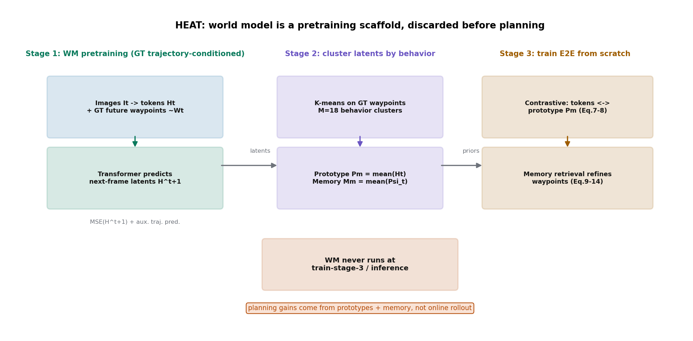

# 世界模型只出现一次：HEAT 的轨迹驱动异构学习

> **信息块**
> - 论文：HEAT: Heterogeneous End-to-End Autonomous Driving via Trajectory-Guided World Models
> - 作者：Hoonhee Cho, Giwon Lee, Jae-Young Kang, Hyemin Yang, Heejun Park, Kuk-Jin Yoon（KAIST）
> - 版本：arXiv:2605.19631v1 [cs.RO]，2026-05-19。**预印本，无同行评审 venue**（正文套用了 IEEE 期刊模板，但无任何发表记录，模板页眉 "JOURNAL OF LATEX CLASS FILES" 是 LaTeX 模板残留，不能当作 venue）。
> - 链接：https://arxiv.org/abs/2605.19631
> - 代码：论文写 "We will make our code publicly available"；截至 2026-10-11 公开搜索未找到仓库，**承诺未兑现，以下分析以正文为准，未经代码核对**。
> - 一句话核心洞见：世界模型在这篇论文里只是一个一次性的预训练脚手架——它用真值轨迹做条件学会"把视觉和动作绑在一起"的表征，然后就被丢弃；真正让多域联合训练不掉点的，是第二阶段按轨迹聚类建起来的原型库和动作记忆。标题里的 "via Trajectory-Guided World Models" 容易让人以为世界模型在线参与规划，实际不是。

## 它到底在解决哪个具体的失败

Fig.1 左边摆的现象很直观：同一个端到端模型，在 nuScenes 上单训 L2 误差 0.35，三个数据集（nuScenes + NAVSIM + Waymo）混在一起训，反而在每个域上都变差。作者的诊断是：多域数据里"域特有的外观信号"（某个城市的建筑风格、某种相机配置的畸变、某种交通流密度）之间互相冲突，模型被这些信号拉扯，最后学出一个"哪个域都不像"的折中表示。

注意作者刻意缩小了问题范围：他们不碰"泛化到完全没见过的域"（zero-shot domain generalization），只要求"在已知的几个异构域上联合训练不掉点"。这个自我设限是诚实的——连已知多域的稳定训练都做不到，谈未知域是空话。

他们的回答是一个直觉：**外观会变，但"要做什么动作"不变**。波士顿的左转和拉斯维加斯的左转，看起来完全不同，但方向盘和油门要做的事是一样的。如果训练是按"轨迹"而不是按"域"来组织的，模型就会去学行为层面的不变量，而不是外观层面的域指纹。

## Stage 1：那个"以 ego 动作为条件"的世界模型，条件到底是什么

先把摘要里的话和正文对一下。摘要说世界模型 "predicts future latent features conditioned on ego actions"。正文 Eq.1-2 是这么写的：

$$\psi^l_t = \text{MLP}([h^l_t, \tilde{w}'_t]), \quad l = 1,\dots,L \tag{1}$$
$$\hat{H}_{t+1} = \text{Transformer}(\Psi_t) \tag{2}$$

$h^l_t \in \mathbb{R}^D$ 是第 $t$ 帧图像编码出的第 $l$ 个视觉 token（共 $L$ 个），$\tilde{W}_t = \{\tilde{w}^1_t,\dots,\tilde{w}^T_t\}$ 是**真值未来轨迹**（ground-truth waypoints），$\tilde{w}'_t \in \mathbb{R}^{3T}$ 是它展平后的向量（每个 waypoint 是 $(x, y, \phi)$ 三维）。每个视觉 token 都和这个真值轨迹向量拼起来过 MLP，得到"视觉-动作耦合"的 latent $\psi^l_t$，再过 Transformer 预测下一帧的视觉 latent $\hat{H}_{t+1}$，用 MSE 和真实的 $H_{t+1}$ 对齐。

这里"conditioned on ego actions"的真实含义是：**条件是已经发生过的真值未来轨迹**。这和"给定一个候选动作，预测它会导致什么未来"（CoPhy 那种 counterfactual 用法）是两回事。这个世界模型回答不了"如果我左转会怎样"，因为它训练时只见过"实际发生的未来"这一种条件输入。它是一个**表征学习辅助器**：逼视觉编码器在预测下一帧时把"未来要做什么动作"这个信息揉进特征里，从而让视觉特征和动作信号绑得更紧。

另外还有一个防坍缩的辅助监督（引自 LAW [6]）：除了预测未来 latent，还要从视觉 latent 直接预测未来轨迹。没有这一项，模型可以学出一个常数解——$\hat{H}_{t+1}$ 恒等于 $H_{t+1}$ 的均值，MSE 照样很小，什么都没学到。这是 latent 世界模型的老坑，作者直接用了前人的解法，处理得干净。

所以 Stage 1 的产出只是一个"轨迹条件化"的编码器。它做完就退场：**论文明确写了，Stage 3 训练和推理时世界模型都不用**。

## Stage 2：K-means + 平均，朴素到让人意外的跨域机制

这一步是全文最朴素、也最值得细看的地方。把三个数据集训练集里所有样本的行为三元组收拢起来：
$$\mathcal{B} = \{(H_t, \Psi_t, \tilde{W}_t)\}$$
然后**只对真值轨迹 waypoint $\tilde{W}_t$ 做 K-means**，聚成 $M=18$ 个行为簇（Eq.3）：
$$C_m = \{(H_t, \Psi_t, \tilde{W}_t) \mid \tilde{W}_t \in \text{cluster } m\}$$

注意聚类的依据只有轨迹几何，不看图像、不看域标签。一个簇里可能同时有波士顿的直行、拉斯维加斯的直行、Waymo 某保密城市的直行——这正是"按行为组织"的含义。

然后对每个簇算两个平均（Eq.4-6）：

**视觉原型** $P_m = \frac{1}{|C_m|}\sum_{s\in C_m} H^{(s)}_t \in \mathbb{R}^{L\times D}$：簇内所有样本的视觉 latent 逐 token 平均。保留 $L$ 个 token 的维度，所以每个簇的原型不是一个向量，而是一组 $L$ 个 token——论文强调这是"token 级的丰富原型"。

**动作记忆** $M_m = \frac{1}{|C_m|}\sum_{s\in C_m} \Psi^{(s)}_t \in \mathbb{R}^{L\times D}$：簇内所有样本的"视觉-动作耦合 latent"逐 token 平均。$M$ 个簇堆起来得到记忆张量 $\mathbf{M} = \text{Stack}(M_1,\dots,M_M) \in \mathbb{R}^{M\times L\times D}$。

把跨域的魔法说穿：**它就是按行为分组求平均**。同一个行为在不同域里的视觉特征被平均到一起，域特有的外观细节在平均中被抹掉，剩下的是"做这个动作时视觉上共有的东西"。这个想法朴素到近乎粗暴，但 Tab.III 的消融显示它管用（后面展开）。

这里有个工程细节值得记下来：nuScenes 只有 6 个相机，NAVSIM 和 Waymo 用 8 个。为了统一输入维度，作者给 nuScenes **补了 2 张全黑图**凑 8 视图。这意味着 nuScenes 样本的 $H_t$ 里有 2 个 token 是恒定的黑图编码，它们也被平均进了原型、参与了对比学习。这个 hack 在正文里一笔带过，没有做任何"去掉黑图会怎样"的对照。从机制上讲，黑图 token 是常数，对比学习里它们对所有 nuScenes 样本都一样，相当于给原型加了一个域相关的偏置——恰好是这篇论文声称要消除的东西。它居然没把结果搞坏，说明对比学习和记忆检索对这种偏置不敏感，但"不敏感"不等于"没影响"，复现者如果换一种补齐方式（比如复制相邻视角），结果可能会动。

## Stage 3：从零训练，用原型做对比、用记忆做精炼

Stage 3 的 E2E 模型从零训练（不用 Stage 1 的权重，只用 Stage 2 产出的原型和记忆），结构是感知无关（perception-free）的：视觉编码器 + 航点预测头，没有显式的检测/分割监督。

**对比学习**（Eq.7-8）：输入图像 $I_t$ 编码出视觉 token $V_t = \{v^l_t\}$。这张图属于轨迹簇 $m$（训练时真值轨迹已知），就把 $P_m$ 当正样本、其他 $M-1$ 个原型当负样本：
$$\mathcal{L}^l_{con} = -\log\frac{\exp(\text{sim}(v^l_t, P^l_m)/\tau)}{\sum_{m'=1}^{M}\exp(\text{sim}(v^l_t, P^l_{m'})/\tau)}, \quad \mathcal{L}_{con} = \frac{1}{L}\sum_{l=1}^{L}\mathcal{L}^l_{con}$$
$\text{sim}$ 是余弦相似度，$\tau$ 是温度。注意这是 **token 级**的对比：每个视觉 token 都要和自己簇的原型 token 对齐、和其他簇的原型拉开。直觉是：逼编码器输出的特征按"未来要做什么动作"来组织，而不是按"这是哪个城市"来组织。

**记忆精炼**（Eq.9-14）：先用一个初始航点查询 $q^{init}_w$ 对视觉 token 做交叉注意力，得到初始轨迹 $\hat{W}_t$；把初始轨迹展平后和视觉 token 拼起来得到动作-视觉融合特征 $a_t$（Eq.11）；然后用 $a_t$ 去注意力检索记忆 $\mathbf{M}$：
$$Q = \Phi(a_t) \in \mathbb{R}^{L\times H}, \quad K = \Phi(\mathbf{M}) \in \mathbb{R}^{M\times L\times H}$$
$$A_{l,m} = \text{softmax}_m\left(\frac{Q_l \cdot K_{m,l}}{\tau}\right), \quad C_l = \sum_{m=1}^{M} A_{l,m} M_{m,l} \tag{13}$$
每个 token 位置 $l$ 独立地在 $M$ 个记忆槽上做 softmax，取出加权和 $C_l$，残差加回 $a^\star_t = a_t + C$，再做一次交叉注意力得到最终轨迹 $W^\star_t$（Eq.14）。说大白话：**拿当前场景的"动作感知的视觉特征"去记忆库里找历史上相似行为的动作 latent，加权平均后用来修正当前预测**。这是"情景记忆"思想的一个静态版本：记忆库离线建好，在线只读不写。

总损失（Eq.15）：
$$\mathcal{L} = \mathcal{L}^{final}_{traj} + \lambda_1\mathcal{L}^{init}_{traj} + \lambda_2\mathcal{L}_{con} + \lambda_3\mathcal{L}_{recon}$$
两项轨迹 L1（初版和精炼版都要对准真值）+ 对比损失 + 未来 latent 重建损失（沿用 LAW 的 perception-free 训练技巧）。

## Fig.3 的 UMAP 到底证明了什么

Fig.3 把视觉 latent $V_t$ 和动作 latent $a_t$ 投到二维，比较四种配置。基线（无任何模块）：两类 latent 都按**数据域**聚类——nuScenes 的点一团、NAVSIM 的点一团，说明模型学的是"这是哪的数据"。加上原型对比学习后，视觉 latent 开始按**轨迹**聚类；再加上记忆精炼，动作 latent 也按轨迹可分；两个模块全加，两类 latent 都按轨迹聚类。

这个图是论文"域不变表征"声称的核心视觉证据。它确实展示了想要的现象，但有两个保留：第一，UMAP 是定性可视化，没有配任何定量指标（比如训一个域分类器看准确率从多少降到多少）；第二，"按轨迹聚类"和"开得好"之间还隔着一层，图只能证明表征变了，不能证明表征变好——证明变好的是后面的榜单数字。作者把两者放在相邻章节，读者容易把因果链自动脑补完整，要手动断开。

## 数字怎么读：承重的是记忆，不是世界模型

Tab.III（消融，异构训练）是最关键的一张表：

| 配置 | NAVSIM PDMS | nuScenes L2 | Waymo L2 |
|---|---|---|---|
| ID-1：NAVSIM 单训，无模块 | 83.2 | 5.98 | 6.43 |
| ID-2：异构训练，无模块 | 71.4 | 0.90 | 2.48 |
| ID-3：+原型对比（CLTP） | 78.0 | 0.79 | 2.18 |
| ID-4：+记忆精炼（EMAR） | 82.8 | 0.42 | 0.70 |
| ID-5：全加 | 85.2 | 0.35 | 0.68 |

先看 ID-1→ID-2：**光是把三个数据集混在一起训、什么都不加，NAVSIM PDMS 从 83.2 掉到 71.4**，掉了 12 个点。这就是 Fig.1 左边那个失败的量化版，也是全文立论的起点——异构联合训练确实有毒。

再看 ID-2→ID-5：两个模块把 12 个点的坑填上还多赚了 1.8 个点（85.2 超过单训的 83.2）。分开看，**记忆精炼（EMAR）单模块 +11.4，几乎是原型对比（CLTP）+6.6 的两倍**。承重排序：EMAR > CLTP。两个全加 85.2，比单模块加总（71.4+11.4+6.6=89.4）低，说明有重叠——也合理，两个模块都在干"按轨迹组织表征"这一件事。

Tab.IV（簇数 $M$）：$M=1$ 时 72.3（基本等于 ID-2，说明不分组就没有信息），$M=3$ 时 78.8（作者说约等于直行/左转/右转三分），$M=6$ 时 84.8，$M=12$–$24$ 在 84.7–85.2 之间打平。$M$ 在 6 以上不敏感，选 18 是"经验值"，不是调出来的峰。这个平坦性是好事——说明方法不依赖精细调参。

Tab.II（NAVSIM closed-loop PDMS）：异构训练下 HEAT 85.2，对 BEVPlanner++ 69.6、LAW 72.3、LTF 55.6。HEAT 的 NC 97.7、DAC 93.9、TTC 93.0、舒适性 100。注意 LTF 从单训 83.8 掉到异构 55.6，掉了 28 个点——这个掉法与其说是"异构训练的毒性"，不如说 LTF 的架构（TransFuser 系，多模态融合）对输入分布变化极其敏感，拿它当反面例子有点欺负人。

Tab.I（开环 L2）：异构训练下 HEAT 在 nuScenes 平均 L2 0.35、碰撞率 0.17，NAVSIM L2 0.22，Waymo L2 0.68，三域平均 0.42，确实是全场最好（BEVPlanner++ 0.45 次之）。但注意开环 L2 在 NAVSIM 和 Waymo 上只报了位移误差，没有报碰撞——开环 L2 好不等于开得安全，这是端到端领域的老问题，作者没有回避（Tab.II 补了 closed-loop 评测），但 Tab.I 的"best overall open-loop performance"表述还是偏重位移精度。

## 怀疑式阅读

**第一，缺了一个关键消融：世界模型到底贡献了多少？** 全文的消融都在 Stage 3 的模块（CLTP/EMAR）上打转，但原型和记忆都是从 Stage 1 世界模型的 latent 建出来的。如果把 Stage 1 换成一个普通的自编码器（或者直接用 Stage 3 编码器自己的特征做 K-means+平均），EMAR 还剩多少增益？论文没有这个对照。所以"轨迹条件世界模型"这个听起来很重的部件，其真实贡献是**未被隔离的**。ID-4 的 +11.4 里，有多少来自"世界模型学到了好表征"，有多少来自"K-means+平均+注意力检索"这个通用 recipe，不得而知。一个怀疑论的读法是：Stage 2/3 的机制才是承重的，Stage 1 的世界模型可能只是个"听起来像世界模型"的表征预训练。

**第二，LAW 异构掉 12 个点的可信度。** Tab.II 里 LAW 从单训 84.6 掉到异构 72.3，这是作者自己复现训练的结果。实现细节（Swin-T、batch 8、18 epoch、lr 5e-5）是按 HEAT 的配置走的，LAW 官方配置未必如此。12 个点的崩塌幅度大到让人怀疑复现质量——而这个数字恰好是衬托 HEAT 的最强背景板。公平的读法：ID-2（作者自己的无模块基线）从 83.2 掉到 71.4，掉 12 个点，这个是可信的（同一套代码、同一训练流程）；LAW 的掉幅仅供参考，不宜当作"前人方法在异构下必然崩"的证据。

**第三，"首次"的措辞。** 结论里写 "to our knowledge for the first time" 在异构域上训端到端驾驶。多数据集联合训练驾驶模型在此之前是有人做过的（比如跨 nuScenes/Waymo 的感知工作，以及端到端里用多数据预训练的做法），"首次"这个词的准确含义应该是"首次以轨迹为组织原则做三域联合的规划训练"。措辞比实际贡献大了一圈，审稿人通常会要求 soften。

**第四，评测的覆盖面。** closed-loop 评测只有 NAVSIM（PDMS）；nuScenes 和 Waymo 只有开环 L2。开环 L2 众所周知和 closed-loop 驾驶质量相关性弱（ego 状态作弊、因果混淆都是老问题）。"在三个域上都强"这个声称里，两个域的证据是开环的。作者在未来工作里承认了未知域泛化没做，算是诚实，但"异构 E2E-AD 新基准"这个贡献的实际分量，很大程度上取决于后人会不会真的用这个 benchmark——目前引用数为零（预印本刚出 5 个月），还不好说。

**第五，超参数的沉默。** Eq.15 的 $\lambda_1, \lambda_2, \lambda_3$、Eq.7/13 的温度 $\tau$、K-means 的初始化和距离度量，正文一概没给取值和敏感性。18 个簇是"经验设置"。考虑到 Tab.IV 显示 $M$ 在 6–24 之间平坦，$M$ 的问题不大；但 $\lambda$ 们的缺席意味着复现者要自己搜。

做得好的地方也要说：ID-1/ID-2/ID-5 这组对照把"异构训练的毒性"和"模块的解毒效果"分得清清楚楚，是全文最干净的实证；承认世界模型在 Stage 3 退场、而不是把它包装成在线规划器，在写作上是诚实的（虽然标题有标题党嫌疑）；补黑图这种 hack 敢写出来，而不是藏着，也算坦率。

## 与 RAMP 的血缘/划界

HEAT 和 RAMP 的关系是"貌合神离"的典型，引用时放错位置会出问题。

**世界模型的用法完全不同，这是最大的划界点。** HEAT 的世界模型是**离线表征脚手架**：Stage 1 用真值轨迹做条件学一个耦合表征，产出原型和记忆后就被丢弃，推理时不存在。RAMP 的世界模型是**在线校验器**：每次前向都要参与，用中间分布做风险门控。一个只在训练时出现一次，一个在每次决策时都在场。HEAT 的标题 "via Trajectory-Guided World Models" 容易让人误以为它是"世界模型服务 planning"的正面例子——**它不是**。它的 planning 增益来自记忆检索（Tab.III：EMAR 单模块 +11.4），世界模型的贡献未被隔离验证。RAMP 的 related work 如果要引 HEAT，应该放在"记忆机制"或"多域表征"名下，绝不能放在"世界模型做安全校验"那一节，否则就是给审稿人递刀子。

**记忆机制的血缘是实的。** HEAT 的 visual-coupled action memory（按行为聚类的静态原型库 + 注意力检索 + 残差修正）和 RAMP 的风险加权自适应衰减情景记忆，共享同一个祖先思想：**过去的驾驶经验可以按"行为相似"组织起来，在线检索来辅助当前决策**。HEAT 的消融给 RAMP 送了一个旁证：记忆检索是跨分布规划的有效载体（单模块 +11.4 PDMS，是全文最承重的部件）。不同点有三：HEAT 的记忆是**静态**的（离线建好、在线只读、无更新无衰减），RAMP 的是**动态**的（在线写入、风险加权衰减）；HEAT 的 key 是视觉 token 的动作耦合特征，RAMP 的 key 是情景+风险；HEAT 的记忆服务于"跨域一致性"，RAMP 的服务于"长尾风险覆盖"。一句话：HEAT 证明了"记忆有用"，RAMP 要回答的是"记忆在风险场景下怎么不忘事"——后者正是 HEAT 没做的（静态库对没见过的长尾行为无能为力）。

**可借用的具体东西。** 一是"按轨迹聚类"的组织原则：RAMP 的情景记忆如果也按行为/风险类型做结构化索引，HEAT 的 $M=18$ K-means 是个现成的 baseline 做法（虽然朴素）。二是 Stage 1 的教训：**以真值未来为条件的世界模型学到的是表征，不是反事实推理能力**——RAMP 的世界模型如果要做门控校验，必须能吃任意候选动作（counterfactual），而不能只拟合"实际发生的未来"，否则门控看到的永远是乐观的未来。三是黑图 hack 的反面教材：多域输入对齐时的填充策略要进消融，不能一笔带过。

**一句话划界：** HEAT 用世界模型学表征、用记忆做规划；RAMP 用世界模型做校验、用记忆记风险——前者的世界模型是训练时的脚手架，后者的世界模型是运行时的交警。
