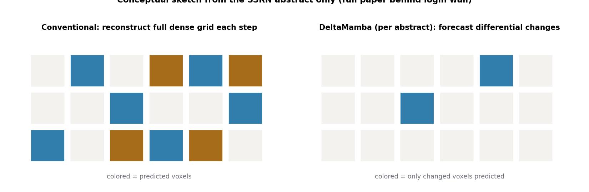

# 降级为备选观察：DeltaMamba（全文不可得，仅摘要可核验）

> **信息块**
> - 论文：DeltaMamba: Structure-Aware Spatiotemporal World Model for 4D Occupancy Forecasting
> - 作者：Yingjian Zhang, Ning Li, Jichao Jiao, Peiyuan Zhao, Zheng Yan, Yingchao Zeng, Min Pang, Jizhou Wang
> - 版本：SSRN 预印本，2026-05-11 发布（https://doi.org/10.2139/ssrn.6749443）。**非同行评审，无发表 venue。**
> - 全文状态：**不可得**。SSRN 的 PDF 下载需要 eLibrary 登录，直接下载链接返回登录墙页面（已验证，未绕过）。以下分析仅基于 SSRN 公开页的摘要与元数据。
> - 代码：未找到。
> - **可信度评级：备选观察（watchlist）**，不作为 RAMP 相关工作的引用依据，理由见文末。
> - 一句话：用 Mamba 做"差分预测"（只预测环境的变化量、不从零重建稠密网格）来缓解 4D occupancy 长程预测的误差累积，这个方向本身是实的；但它"服务 planning"的声称——Kinematics-Aware Dual Attention + Codebook Reconstruction Planning——在公开信息层面**没有可核验的实质**，planning 一词更像是包装。

## 公开摘要里到底说了什么

把摘要的事实性内容转述如下（不做超出摘要的推断）：

1. **问题**：基于 Transformer 自回归的 4D occupancy 预测有两个痛点——二次计算复杂度，以及长程预测的空间退化（spatial degradation）。
2. **方法核心**：DeltaMamba，一个 kinematics-aware 的时空世界模型。用状态空间模型（SSM / Mamba）**预测环境的变化量（differential changes），而不是从零重建稠密网格**，达到线性 $O(L)$ 复杂度，并缓解长期误差累积。
3. **"连接表征与规划"的模块**：Kinematics-Aware Dual Attention + Codebook Reconstruction Planning，用 Adaptive Layer Normalization 调制，"显式对齐视觉特征与 ego 意图，迫使网络主动关注可行驶走廊和潜在危险"。
4. **实验**：nuScenes 数据集；3 秒 horizon 的 4D 预测 mIoU **相对**提升 49.6%；planning 安全性 "highly competitive"（定性表述，无数字）；验证时推理速度 14.1 FPS，相对现有基线加速 43.9%。

以上是全部可核验的信息。没有方法章节、没有公式、没有消融、没有 planning 评测细节。

## "差分预测"这个想法：方向是实的

先说摘要里**有实质**的部分。4D occupancy forecasting 这一脉（OccWorld、RenderWorld、OccSora 等）的主流范式是：VQ-VAE 把 3D 场景压成离散 token → Transformer 自回归生成未来 token → 解码回 occupancy 网格。这个范式有两个公认的痛：

- **误差累积**：自回归一步错、步步错，长程（3 秒+）预测里静态结构（路面、建筑）会漂移、变形；
- **二次复杂度**：Transformer 对 token 数的二次复杂度，4D 网格的 token 量本来就大。

DeltaMamba 的回答是：**别重建整个网格，只预测变化量**。静态场景的大部分体素在相邻帧之间是不变的，真正需要模型花力气的是一小部分动态变化（ moving 物体、ego 自身运动带来的视角变化）。预测残差/差分在直觉上更容易学、误差也不容易滚雪球——这和视频压缩里传 P 帧不传 I 帧是同一个道理。配合 Mamba 的线性复杂度，这个组合在方向上是说得通的，不是凭空造词。

49.6% 的相对 mIoU 提升（3 秒 horizon）如果为真，说明差分建模确实打中了长程误差累积这个痛点。但注意三个限定：**相对**提升（基数未知——如果基线在 3 秒 horizon 本来就很低，相对数会很好看）、只有摘要一句话、无同行评审。在全文不可得的情况下，这个数字只能记为"作者自称"，不能当证据用。

## "服务 planning"的机制：公开信息层面不实质

这是任务要求重点验证的部分，结论是明确的：**不实质，至少在可核验的公开信息里不实质**。

逐项看摘要里和 planning 相关的表述：

**"Kinematics-Aware Dual Attention … explicitly aligns the visual features with ego-intent"**。把"视觉特征"和"自车意图"对齐，这是一个**特征对齐**操作，不是决策机制，也不是安全校验机制。对齐做得再好，回答的也是"表征里有没有意图信息"，而不是"这条轨迹安不安全"。把它称为"bridge the critical gap between world representation and motion planning"是修辞上的跨越：特征对齐和运动规划之间，还隔着决策、约束、验证整整三层，摘要里没有任何一层被展开。

**"Codebook Reconstruction Planning"**。码本（codebook）是 VQ-VAE 那套离散表征的词汇，"重建"（reconstruction）是表征学习的词汇，"planning"是一个动作决策的词汇。三个词拼在一起，从摘要里读不出它到底是个什么计算过程：是从码本里解码出轨迹？还是用重建误差当规划代价？还是别的？**一个机制如果连输入输出都说不清，就不具备可核验性。** 对比 CoPhy（rollout → 语义图 → 五项指标 → 奖励，每一步输入输出都写清了）和 HEAT（记忆检索修正航点，Eq.9-14 全写清了），DeltaMamba 的 planning 机制在摘要层面是黑箱。

**"highly competitive planning safety"**。全文摘要里 planning 唯一的"结果"就是这句定性表述：没有 benchmark 名字（是 nuScenes 开环规划？还是 NAVSIM closed-loop？还是自建指标？）、没有数字、没有基线、没有消融说明 planning 增益来自 Dual Attention 还是差分预测。**一个连评测方式都不披露的 planning 声称，在审稿标准下等于没有声称。**

所以降级结论是：DeltaMamba 有实质的部分在**感知/预测侧**（差分预测 + Mamba 长程建模），"服务 planning"是**包装性表述**，在公开信息层面没有对应得上 planning 实质的机制设计。这不是说它一定没做 planning 工作——全文在登录墙后，不能排除正文里有真东西——而是说**基于可核验信息，它够不上"世界模型服务 planning"的案例**，按任务铁律如实降级，不硬写。

## 可信度降级理由清单

1. **发表渠道**：SSRN 是预印本服务器，且在计算机视觉/自动驾驶领域，SSRN 的同行评审前置程度低于 arXiv（arXiv 至少有领域内的快速同行评议生态，SSRN 在该领域基本没有）。无 venue、无审稿记录。
2. **全文不可得**：PDF 在登录墙后，关键机制（Dual Attention 的结构、Codebook Reconstruction Planning 的计算过程、planning 评测协议）全部无法核验。摘要是作者自己写的宣传文本，不能当证据。
3. **数字的包装痕迹**："49.6% 相对提升"不给基数；"43.9% 相对加速"的基线未具名；"SOTA"自称无第三方复现。这是预印本摘要的常见写法，但落在不可核验的全文上，可信度要再打折。
4. **作者背景未知**：SSRN 页未披露作者单位（已检查公开页元数据），无法判断团队的研究 lineage。对比之下，CoPhy 和 HEAT 的作者单位、引用脉络都是清晰的。
5. **无代码、无引用**：发布 5 个月，无公开代码，无可查引用。

以上任何一条单独拿出来都不致命，但五条叠加，这篇在 RAMP 的证据体系里只能放在最外圈：**备选观察**。

## 与 RAMP 的血缘/划界

**血缘（弱，且只在预测侧）。** "预测变化量而不从零重建"和 RAMP 的"单次前向中间分布复用"有表面上的亲缘：都是"别每次都从零算"的经济性思想。但两者的"差分"不在一个维度：DeltaMamba 的差分是**时序上**的（这一帧相对上一帧变了什么），RAMP 的复用是**单次前向内**的（同一帧里规划和校验共享中间分布）。前者省的是跨帧的重复建模，后者省的是同帧内多模块的重复前向。思想相通，用法不通。

**划界（明确）。** DeltaMamba 不能作为"世界模型服务 planning"的正面或反面案例引用，因为它的 planning 机制不可核验。RAMP 的 related work 里如果要提 occupancy 世界模型这一脉，OccWorld / RenderWorld / OccSora 是更合适的引用对象（机制公开、可核验）。DeltaMamba 最多在"4D occupancy forecasting 的近期进展"这种背景句里一笔带过，且必须标注"SSRN 预印本、未同行评审"。

**升级条件（写给未来的自己）。** 如果出现以下任一情况，可把本篇从备选观察升级为正式精读：全文公开（arXiv 或会议版本）且 planning 机制有可核验的公式与评测；官方代码放出且 planning 部分可复现；被同行评审 venue 接收。升级时编号不变，在本文档头部追加升级记录。

**一句话划界：** 差分预测的方向值得记在小本子上（长程误差累积是真痛点），但它的 planning 声称在公开信息里没有实质——RAMP 不欠它一个引用位置。
